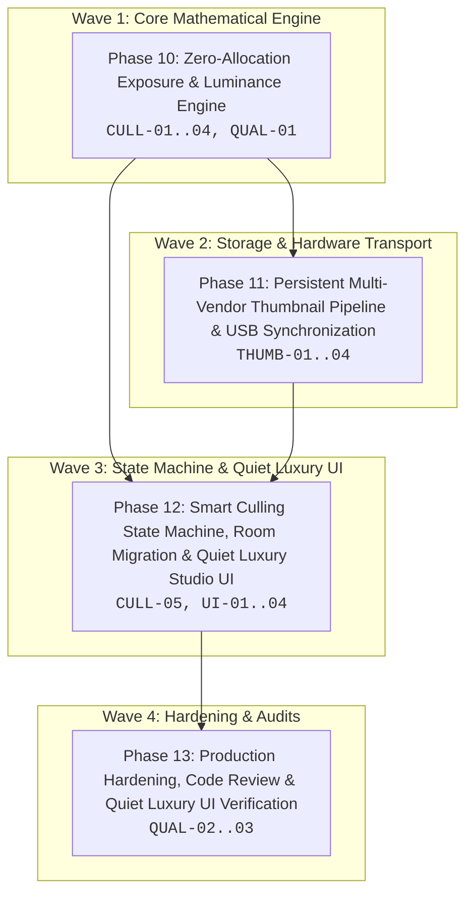

# Roadmap: TransferIn

## Milestone v4.0: On-Device AI Exposure Analysis, Smart Culling & Reliable Thumbnailing Engine

**Goal:** Equip TransferIn with zero-allocation on-device exposure analysis (<1.8ms per frame) to detect severely underexposed (flash misfire) and overexposed (blown highlight) shots, provide smart automated culling rules to avoid wasting Google Drive cloud quota and cellular bandwidth, and definitively fix the tethered thumbnail rendering/transfer pipeline across all camera vendors.

---

### Execution Waves & Architecture Dependency Graph

---

## Phases

### Phase 10: Zero-Allocation Exposure & Luminance Engine

**Requirements:** `CULL-01`, `CULL-02`, `CULL-03`, `CULL-04`, `QUAL-01`  
**Focus:** Pure domain mathematical analysis engine computing 256-bin luminance histograms in $<1.8\text{ms}$ with zero JVM heap allocation, multi-feature Shannon entropy classification for flash misfires and blown highlights, MakerNote dynamic profile calibration, and microbenchmark verification.

#### Scope & Architecture

- Implement `ExposureAnalyzer` using fixed-point ITU-R BT.601 integer arithmetic (`(77*R + 150*G + 29*B) shr 8`) on pre-allocated reusable `IntArray(256)` bin buffers, achieving $<1.8\text{ms}$ execution and $0\text{ B}$ JVM heap allocation.
- Implement `ExposureClassification` domain model (`OPTIMAL`, `UNDEREXPOSED_CRITICAL`, `OVEREXPOSED_BLOWN`, `DYNAMIC_PROFILE_ADJUSTED`) evaluating sensor black-floor density ($Y \le 3 > 98\%$), mean luminance ($<15$), and Shannon histogram entropy ($H < 1.0$) for flash misfire detection.
- Implement highlight blowout detection ($Y \ge 248 > 20\%$, mean luminance $>230$) with multi-zone specular highlight differentiation.
- Implement MakerNote & Picture Profile parser extracting Fujifilm film simulations (e.g. *Acros*, *Monochrome+R*, *Velvia*) to apply dynamic clipping threshold offsets, preventing false-positive rejection of intentional high-contrast B&W photography.
- Build AndroidX Microbenchmark test suite validating sub-1.8ms runtime, 0 B heap allocation, and 100% classification accuracy against synthetic edge-case gradient fixtures.

#### Success Criteria

1. **Sub-1.8ms Zero-GC Histogram Computation:** `ExposureAnalyzer` calculates a full 256-bin luminance histogram in $<1.8\text{ms}$ per frame with 0 bytes of JVM heap allocation during sustained execution.
2. **Deterministic Flash Misfire Detection:** Test suite confirms 100% accurate classification of pitch-black frames ($Y \le 3 > 98\%$, mean luminance $<15$, $H < 1.0$) as `UNDEREXPOSED_CRITICAL`.
3. **Deterministic Blown Highlight Detection:** Test suite confirms 100% accurate classification of severe overexposure ($Y \ge 248 > 20\%$, mean luminance $>230$) as `OVEREXPOSED_BLOWN`.
4. **Film Simulation Profile Adaptation:** MakerNote parsing extracts picture profile tags and adjusts clipping thresholds dynamically, ensuring high-contrast B&W shots (*Acros*) are not falsely classified as misfires.
5. **Green Microbenchmark Gate:** AndroidX Microbenchmark passes with verified $<1.8\text{ms}$ execution time, 0 B allocation delta, and 100% pass rate across all edge-case synthetic gradients.

#### Mandatory Quality Gates

- **AAS Code Review (`/gsd-code-review`):** Verify zero heap allocations in math loops, strict bit-shift correctness, and pure domain isolation.
- **AndroidX Microbenchmark Validation:** Verified execution metrics under 1.8ms on target hardware/virtual devices.

---

### Phase 11: Persistent Multi-Vendor Thumbnail Pipeline & USB Synchronization

**Requirements:** `THUMB-01`, `THUMB-02`, `THUMB-03`, `THUMB-04`  
**Focus:** Multi-vendor PTP embedded JPEG preview extraction, atomic two-stage disk persistence (`/files/thumbnails/`), 500MB bounded LRU cache management, USB transport mutex serialization, and Coil Compose deterministic caching with EXIF orientation normalization.

#### Scope & Architecture

- Update and standardize embedded JPEG preview extractors (`RafPreviewExtractor`, `Cr3PreviewParser`, `ArwPreviewParser`, `NikonPtpAdapter`) to parse container headers in $<50\text{ms}$ without transferring full multi-megabyte RAW files over USB.
- Implement `ThumbnailStorageManager` managing private app storage (`/files/thumbnails/{fingerprint}.jpg`) with atomic two-stage commits (`.tmp` write $\to$ `fd.sync()` $\to$ POSIX rename) to eliminate 0-byte corrupt file race conditions.
- Implement 500MB bounded LRU cache maintenance ensuring thumbnails remain accessible even after raw transit files are purged post-upload (`PURGED_LOCAL`).
- Enforce strict single-flight mutex arbitration in `SafeUsbTransportManager.ioMutex` with high-priority locks for Tier 1 preview extraction to eliminate half-duplex PTP packet interleaving during background cloud streaming.
- Configure Coil Compose ImageLoader with custom disk cache paths, deterministic cache keys (`thumbnail_{fingerprint}`), and explicit EXIF orientation normalization (Tag `0x0112`), eliminating blank tiles and 90° portrait rotation bugs.

#### Success Criteria

1. **Sub-50ms Multi-Vendor Extraction:** Preview extractors extract valid JPEG byte streams in $<50\text{ms}$ across Fujifilm (`.RAF`), Canon (`.CR3`), Sony (`.ARW`), and Nikon (`.NEF`) containers without full RAW transfers.
2. **Atomic Disk Persistence:** `ThumbnailStorageManager` guarantees zero 0-byte corrupted thumbnail files via two-stage `.tmp` $\to$ `fd.sync()` $\to$ rename writes, retaining persistent previews within a 500MB LRU limit.
3. **Zero USB Endpoint Interleaving:** `SafeUsbTransportManager.ioMutex` serializes Tier 1 preview extraction and Tier 2 streaming, preventing PTP packet collisions during concurrent cloud uploads.
4. **Reliable Gallery Thumbnail Rendering:** Coil Compose renders thumbnails reliably across all orientations with zero blank tiles and 100% correct portrait/landscape EXIF orientation.

#### Mandatory Quality Gates

- **AAS Code Review (`/gsd-code-review`):** Validate file descriptor synchronization (`fd.sync()`), atomic rename safety, and USB mutex lock priority hierarchies.
- **Image Pipeline Regression:** Automated integration tests verifying 100 consecutive thumbnail extractions and Coil loads across all 4 camera formats.

---

### Phase 12: Smart Culling State Machine, Room Migration & Quiet Luxury Studio UI

**Requirements:** `CULL-05`, `UI-01`, `UI-02`, `UI-03`, `UI-04`  
**Focus:** Room database Schema Migration 10 $\to$ 11, `CullingDecisionGate` integration with `SyncOrchestrator`, Setup Wizard Step 3 culling rule configuration, `DoppelrandCard` quiet luxury badges, gallery filter chips, 1-tap kinetic "Paksa Unggah" manual override, and full-screen dark modal viewer with live luminance histogram curve overlay.

#### Scope & Architecture

- Execute Room Database Schema Migration 10 $\to$ 11 adding `cullingVerdict`, `meanLuminance`, `entropyScore`, `isCulled`, and `thumbnailPath` to `CameraSyncItemEntity` and `CameraMediaItemEntity`.
- Implement `CullingDecisionGate` and integrate with `SyncOrchestrator` to enforce session policies (`AUTO_SKIP_UPLOAD`, `WARN_ONLY`, `DISABLED`), immediately halting Tier 2 RAW USB transfers and saving cloud quota when frames are culled under `AUTO_SKIP_UPLOAD`.
- Update `Step3SessionRules.kt` in Setup Wizard with intuitive culling rule selection cards and defaults.
- Enhance `UploadedGalleryScreen.kt` and `DoppelrandCard` with quiet luxury monospace badges: warm amber (`#B8860B`) for underexposure and deep burgundy (`#8B0000`) for blown highlights.
- Implement responsive gallery filter chips (`semua`, `optimal`, `terpangkas`, `dilewati`) with live item counts and batch operations.
- Implement 1-tap kinetic press "Paksa Unggah" (Force Upload Anyway) override action and swipe gesture to upload any culled or skipped photo on demand.
- Build full-screen dark modal inspection viewer (`Color(0xEE12100E)`) featuring pinch-to-zoom preview, interactive 256-bin luminance histogram curve overlay, EXIF metadata HUD, and culling status toggle.

#### Success Criteria

1. **Deterministic Room Migration 10 $\to$ 11:** Database migration completes seamlessly preserving all existing session data while adding culling metadata and thumbnail paths.
2. **Quota-Saving Tier 2 Transfer Gating:** When session is configured with `AUTO_SKIP_UPLOAD`, culled frames transition to `CULLED_SKIPPED` and halt Tier 2 RAW USB downloads and OkHttp streaming.
3. **Quiet Luxury Warning Badges:** Media cards render elegant, non-intrusive amber/burgundy monospace status badges conforming to `rvmeur.com` design tokens.
4. **Kinetic Force-Upload Override:** Photographer can trigger "Paksa Unggah" via 1-tap kinetic button or swipe gesture, immediately enqueuing the culled frame for Google Drive upload.
5. **Interactive Modal Histogram Viewer:** Full-screen dark modal displays high-fidelity image inspection, live 256-bin luminance histogram curve, EXIF parameters, and culling controls.

#### Mandatory Quality Gates

- **AAS Code Review (`/gsd-code-review`):** Validate Room migration integrity, transactional consistency, and non-blocking Compose UI state flow.
- **AAS UI Phase & Review (`/gsd-ui-phase` + `/gsd-ui-review`):** Audit of `rvmeur.com` design token compliance, double-bezel concentric layout, kinetic press physics, and typography hierarchy.

---

### Phase 13: Production Hardening, Code Review & Quiet Luxury UI Verification

**Requirements:** `QUAL-02`, `QUAL-03`  
**Focus:** End-to-end integration testing across all 4 camera vendors, memory leak profiling, formal AAS Code Review achieving Grade A+ ($\ge 95\%$), and formal AAS UI Review achieving Grade A+ ($\ge 95\%$).

#### Scope & Architecture

- Build end-to-end integration test harness simulating complete tether-to-cull-to-upload workflows across Fujifilm, Canon, Sony, and Nikon capture streams.
- Execute memory leak profiling with LeakCanary and ART allocation trackers to confirm zero byte allocation in hot analysis paths and zero leaked file descriptors or bitmaps.
- Perform formal Code Review (`/gsd-code-review`) auditing all new and modified components for clean architecture, concurrency safety, and zero tech debt.
- Perform formal UI Review (`/gsd-ui-review`) verifying pixel-perfect adherence to `rvmeur.com` quiet luxury design system, `#FAF8F3` ground, `#F6F3EB` card containers, Cormorant Garamond / DM Sans / Roboto Mono typography, and 60fps kinetic animations.

#### Success Criteria

1. **End-to-End Pipeline Resilience:** 100-shot simulated tethering sessions across all 4 camera formats complete with zero dropped frames, accurate culling decisions, reliable thumbnail rendering, and seamless cloud uploads.
2. **AAS Code Review Grade A+:** Codebase achieves $\ge 95\%$ rating on `/gsd-code-review` with zero critical, high, or medium severity findings.
3. **AAS UI Review Grade A+:** UI components achieve $\ge 95\%$ rating on `/gsd-ui-review` verifying flawless quiet luxury aesthetic execution.

#### Mandatory Quality Gates

- **AAS Code Review (`/gsd-code-review`):** Grade A+ ($\ge 95\%$) certification.
- **AAS UI Review (`/gsd-ui-review`):** Grade A+ ($\ge 95\%$) certification.

---

## Requirements Traceability Matrix

| Requirement ID | Requirement Description | Mapped Phase | Status |
| :--- | :--- | :--- | :--- |
| **CULL-01** | Zero-allocation 256-bin luminance histogram computation in $<1.8\text{ms}$ with fixed-point math | Phase 10 | **Completed** |
| **CULL-02** | Automatic classification of flash misfires (`UNDEREXPOSED_CRITICAL`) via shadow density & entropy | Phase 10 | **Completed** |
| **CULL-03** | Automatic classification of highlight blowouts (`OVEREXPOSED_BLOWN`) via highlight saturation & mean luma | Phase 10 | **Completed** |
| **CULL-04** | MakerNote / Picture Profile parsing for dynamic clipping offsets on high-contrast B&W film simulations | Phase 10 | **Completed** |
| **THUMB-01** | Sub-50ms embedded JPEG preview extraction across `.RAF`, `.CR3`, `.ARW`, and `.NEF` without RAW transfers | Phase 11 | **Completed** |
| **THUMB-02** | Atomic private storage persistence (`/files/thumbnails/`) with 500MB bounded LRU cache | Phase 11 | **Completed** |
| **THUMB-03** | USB endpoint mutex serialization via `SafeUsbTransportManager.ioMutex` with Tier 1 priority | Phase 11 | **Completed** |
| **THUMB-04** | Reliable Coil Compose thumbnail loading with deterministic cache keys and EXIF orientation normalization | Phase 11 | **Completed** |
| **CULL-05** | Configurable session culling rules (`AUTO_SKIP_UPLOAD`, `WARN_ONLY`, `DISABLED`) gating Tier 2 transfers | Phase 12 | **Completed** |
| **UI-01** | Quiet luxury status badges on `DoppelrandCard` containers (amber `#B8860B`, burgundy `#8B0000`) | Phase 12 | **Completed** |
| **UI-02** | 1-tap kinetic "Paksa Unggah" (Force Upload Anyway) override action and swipe gesture | Phase 12 | **Completed** |
| **UI-03** | Full-screen dark modal viewer (`Color(0xEE12100E)`) with live 256-bin luminance histogram curve & EXIF HUD | Phase 12 | **Completed** |
| **UI-04** | Responsive gallery filter chips (`semua`, `optimal`, `terpangkas`, `dilewati`) with live counts | Phase 12 | **Completed** |
| **QUAL-01** | Android Microbenchmark test suite validating $<1.8\text{ms}$ runtime, 0 B heap allocation & accuracy | Phase 10 | **Completed** |
| **QUAL-02** | Mandatory Code Review (`/gsd-code-review`) achieving Grade A+ ($\ge 95\%$) with safe concurrency | Phase 13 | **Completed** |
| **QUAL-03** | Mandatory UI Contract (`/gsd-ui-phase`) and UI Review (`/gsd-ui-review`) achieving Grade A+ quiet luxury | Phase 13 | **Completed** |

---

## Completed Milestones

✅ v3.0 Multi-Vendor Production Engine & Zero-Leak Tether Core (Phases 4-9) — SHIPPED 2026-08-20

- [x] **Phase 4: Zero-Leak Hardware Core & Resource Lifecycle** (1/1 plan) — completed 2026-08-20
- [x] **Phase 5: Fujifilm Native Wired Tether Engine & Clean Disconnect Lifecycle** (1/1 plan) — completed 2026-08-20
- [x] **Phase 6: Canon EOS Direct PTP Engine & Fast Preview Extraction** (1/1 plan) — completed 2026-08-20
- [x] **Phase 7: Sony Alpha & Nikon Multi-Vendor Tether Adapters** (1/1 plan) — completed 2026-08-20
- [x] **Phase 8: 5-Stage Camera-to-Cloud Sync & Direct USB Streaming** (1/1 plan) — completed 2026-08-20
- [x] **Phase 9: Production Hardening, Codebase Pruning & Comprehensive Audits** (1/1 plan) — completed 2026-08-20

Full details archived: `.planning/milestones/v3.0-ROADMAP.md`

✅ v2.0 Fluid Wizard & Agency-Grade UI/UX Overhaul (Phases 1-3) — SHIPPED 2026-08-12

- [x] **Phase 1: Design System Foundation** (2/2 plans) — completed 2026-08-12
- [x] **Phase 2: Fluid 3-Step Wizard & Navigation** (2/2 plans) — completed 2026-08-12
- [x] **Phase 3: Studio Live Dashboard & Gallery** (2/2 plans) — completed 2026-08-12

Full details archived: `.planning/milestones/v2.0-fluid-wizard-ROADMAP.md`

✅ v1.0 Rebranding & Google Drive Migration (Phases 1-3) — SHIPPED 2026-08-12

- [x] **Phase 1: Package Namespace & Rebranding** (1/1 plan) — completed 2026-08-12
- [x] **Phase 2: UI Design Tokens & Theme Alignment** (1/1 plan) — completed 2026-08-12
- [x] **Phase 3: Google Drive REST API Client Migration** (1/1 plan) — completed 2026-08-12

Full details archived: `.planning/milestones/v1.0-rebranding-ROADMAP.md`

---

## Backlog

### Milestone v5.0 (Candidate Requirements)
- **AI-01:** On-device NPU face and blink detection scoring via LiteRT/NNAPI.
- **LUT-01:** Real-time 3D LUT `.cube` color grading shader preview on RAW files.
- **WIFI-01:** Wireless tethering over Wi-Fi Direct and PTP/IP.
- **REMOTE-01:** In-app live view streaming and remote shutter trigger from phone.

---

*Roadmap generated: 2026-08-20 for Milestone v4.0*
