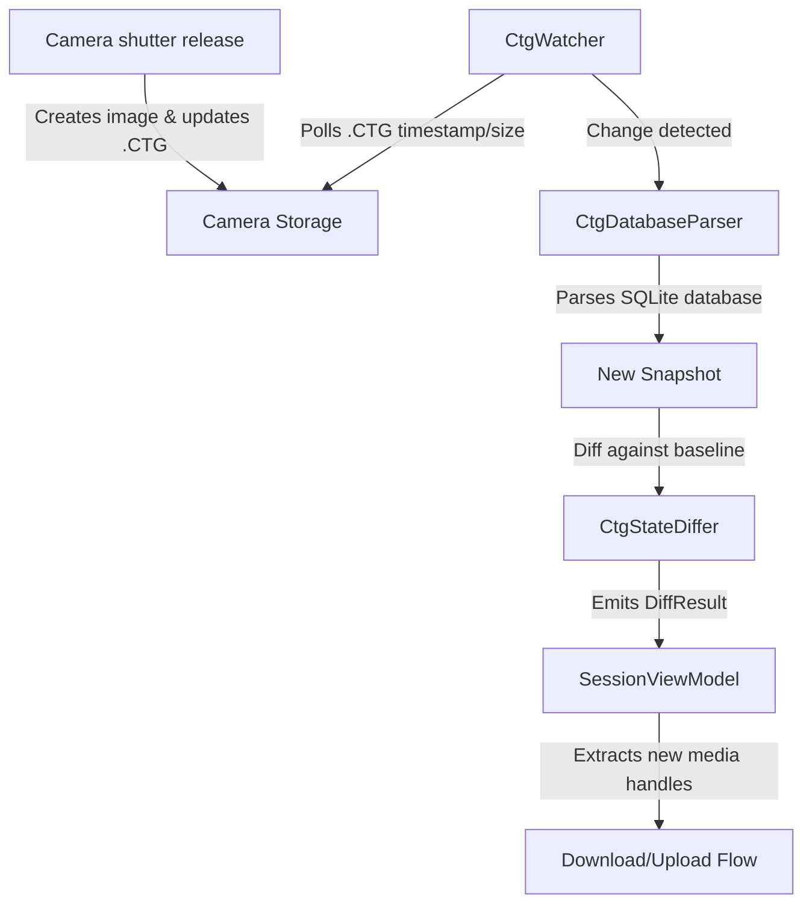

# Research: CTG Deduplication & NAS Write Check

This research documents findings and solutions for integrating `CtgWatcher` for fast, efficient tethered photo detection and adding SFTP RW permission validation in the folder browser.

---

## 1. NAS Read/Write Permission Validation

### Findings
* Currently, users can navigate the NAS directory tree via SFTP, but they might not have Write permissions.
* The "Create New Folder" button calls `sftpClient.createDirectory()`, which fails silently or logs an error without user-facing feedback when permissions are insufficient.
* There is no preemptive write-access check when selecting a destination folder.

### Solution
1. **Preemptive RW Check**:
   * Add a `checkFolderWritePermission` function to `SftpClient` / `JschSftpClient` that attempts to create and delete a tiny temporary file (e.g., `.write_test_<uuid>`) in the target directory.
   * Call this check when navigating to a directory or clicking "Select Folder" in `SelectFolderViewModel.kt`.
   * Display a warning in the UI if the folder is read-only.
2. **Expose Create Folder Errors**:
   * Ensure `createDirectory` returns meaningful error descriptions (e.g., "Permission Denied") to `SelectFolderViewModel.kt` so the UI can display it to the user.

---

## 2. Tethered Mode CTG Integration & Deduplication

### Findings
* `CtgWatcher` and `CtgDatabaseParser` were implemented in Phase 1 but never wired into the active session.
* Tethered mode currently relies on `ShootModeEngine` (querying MediaStore, which is slow/unreliable on modern Android for USB cameras) and `PhotoWatcher` (which scans all SD card handles, taking 5-10s for large cards).
* Canon cameras update the `.CTG` file in `MISC` on every shot. We can poll this single file to detect new media handles in < 100ms.

### Proposed Architecture

### Optimizing `CtgWatcher`
To prevent traversing the entire storage handles list (which defeats the performance purpose of CTG polling):
1. Cache the object handle of the `.CTG` database file once found.
2. For subsequent checks, query the cached handle directly. If it fails (device reconnected), invalidate the cache and search again.

### Wiring `CtgWatcher` into `SessionViewModel`
1. Initialize and start `CtgWatcher` when starting a `TETHERED` session.
2. Collect events from `ctgDiffs` or `ctgSnapshots`.
3. For each added media handle/record:
   * Query the database (`UploadedFingerprintDao`) using the file fingerprint (name + size).
   * If already uploaded, skip.
   * Otherwise, enqueue for upload.

---

## Verification Plan

### Manual Verification
1. Connect Canon camera via USB and select Tethered mode.
2. Take a photo; verify it is detected within 2 seconds.
3. Verify that taking the same photo again or restarting the session does not re-upload the same photo (correct deduplication).
4. Verify the folder browser shows a clear error message when trying to create a directory in a read-only SFTP folder.
