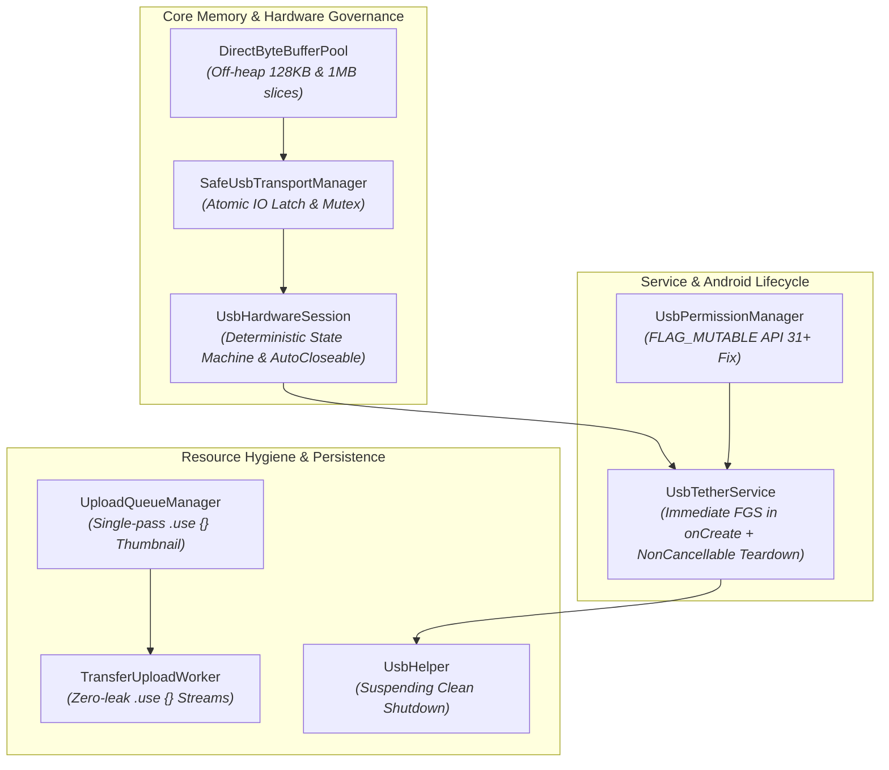

# Phase 4 Plan: Zero-Leak Hardware Core & Resource Lifecycle

Establish a hardened, zero-leak hardware governance foundation for TransferIn v3.0. This phase establishes off-heap buffer pooling, JNI execution latches preventing native `SIGSEGV` kernel panics during cable unplugs, deterministic hardware lifecycle state machines, Android 14/15 Foreground Service compliance, and strict resource hygiene (`.use { }` wrapping) across all workers and repositories.

---

## Architecture Dependency Graph



---

## Artifacts Produced & Modified

| Symbol / Class | Type | File Path | Requirement |
| :--- | :--- | :--- | :--- |
| `DirectByteBufferPool` | Class (Singleton/Pool) | [`DirectByteBufferPool.kt`](file:///Users/chiio/VSCode/TransferInFuji/app/src/main/java/com/rvmeur/transferin/data/usb/core/DirectByteBufferPool.kt) | `CORE-03` |
| `PooledByteBuffer` | Class (`AutoCloseable`) | [`DirectByteBufferPool.kt`](file:///Users/chiio/VSCode/TransferInFuji/app/src/main/java/com/rvmeur/transferin/data/usb/core/DirectByteBufferPool.kt) | `CORE-03` |
| `SafeUsbTransportManager` | Class | [`SafeUsbTransportManager.kt`](file:///Users/chiio/VSCode/TransferInFuji/app/src/main/java/com/rvmeur/transferin/data/usb/core/SafeUsbTransportManager.kt) | `CORE-01` |
| `UsbHardwareSession` | Class (`AutoCloseable`) | [`UsbHardwareSession.kt`](file:///Users/chiio/VSCode/TransferInFuji/app/src/main/java/com/rvmeur/transferin/data/usb/core/UsbHardwareSession.kt) | `CORE-01`, `CORE-02` |
| `HardwareSessionState` | Enum & Sealed Class | [`UsbHardwareSession.kt`](file:///Users/chiio/VSCode/TransferInFuji/app/src/main/java/com/rvmeur/transferin/data/usb/core/UsbHardwareSession.kt) | `CORE-01` |
| `UsbTetherService` | Service (Refactored) | [`UsbTetherService.kt`](file:///Users/chiio/VSCode/TransferInFuji/app/src/main/java/com/rvmeur/transferin/service/UsbTetherService.kt) | `CORE-02`, `CORE-04` |
| `UploadQueueManager` | Class (Refactored) | [`UploadQueueManager.kt`](file:///Users/chiio/VSCode/TransferInFuji/app/src/main/java/com/rvmeur/transferin/domain/session/UploadQueueManager.kt) | `CORE-05` |
| `TransferUploadWorker` | Class (Refactored) | [`TransferUploadWorker.kt`](file:///Users/chiio/VSCode/TransferInFuji/app/src/main/java/com/rvmeur/transferin/session/worker/TransferUploadWorker.kt) | `CORE-05` |
| `UsbHelper` | Class (Refactored) | [`UsbHelper.kt`](file:///Users/chiio/VSCode/TransferInFuji/app/src/main/java/com/rvmeur/transferin/data/usb/UsbHelper.kt) | `CORE-01`, `CORE-02` |
| `UsbPermissionManager` | Class (Refactored) | [`UsbPermissionManager.kt`](file:///Users/chiio/VSCode/TransferInFuji/app/src/main/java/com/rvmeur/transferin/data/usb/UsbPermissionManager.kt) | `CORE-02` |
| `DirectByteBufferPoolTest` | Unit / Stress Test | [`DirectByteBufferPoolTest.kt`](file:///Users/chiio/VSCode/TransferInFuji/app/src/test/java/com/rvmeur/transferin/data/usb/core/DirectByteBufferPoolTest.kt) | `CORE-03` |
| `SafeUsbTransportManagerTest`| Unit Test | [`SafeUsbTransportManagerTest.kt`](file:///Users/chiio/VSCode/TransferInFuji/app/src/test/java/com/rvmeur/transferin/data/usb/core/SafeUsbTransportManagerTest.kt) | `CORE-01` |
| `UsbHardwareSessionTest` | Unit Test | [`UsbHardwareSessionTest.kt`](file:///Users/chiio/VSCode/TransferInFuji/app/src/test/java/com/rvmeur/transferin/data/usb/core/UsbHardwareSessionTest.kt) | `CORE-01`, `CORE-02` |

---

## Detailed Task Breakdown

### Task 1: DirectByteBufferPool Implementation (CORE-03)

**Objective:** Implement a thread-safe off-heap native `DirectByteBufferPool` to eliminate JVM heap garbage collection churn during 40MP–100MP RAW image streaming over USB.

**Implementation Details:**
- **Location:** `app/src/main/java/com/rvmeur/transferin/data/usb/core/DirectByteBufferPool.kt`
- **Architecture:**
  - Define standard bucket categories:
    - `SMALL_BUFFER_SIZE = 128 * 1024` (128 KB for PTP commands, event packets, and preview headers)
    - `LARGE_BUFFER_SIZE = 1024 * 1024` (1 MB for high-throughput USB bulk data streaming)
  - Pre-allocate bounded buckets backed by `ConcurrentLinkedQueue<ByteBuffer>`:
    - Small queue max capacity: 16 buffers (2 MB off-heap)
    - Large queue max capacity: 8 buffers (8 MB off-heap)
  - Thread-safe `acquire(size: Int): PooledByteBuffer`:
    - Checks out an existing buffer or allocates via `ByteBuffer.allocateDirect()`.
    - Automatically clears position and limit (`buffer.clear()`).
  - `PooledByteBuffer` wrapper implementing `AutoCloseable`:
    - Allows idiomatic Kotlin syntax: `pool.acquire(size).use { pooled -> val buffer = pooled.byteBuffer; ... }`
    - Calling `close()` returns the underlying direct buffer to the appropriate pool bucket.
    - Includes double-release protection and invalidation flag.
  - Telemetry & Metrics Tracking:
    - `acquiredCount: AtomicLong`
    - `releasedCount: AtomicLong`
    - `totalAllocatedDirectBytes: AtomicLong`
    - `inUseDirectBytes: Long`
    - `activeLeaseCount: Int`
  - Safe pool drainage: `fun clear()` to deallocate and reset pool references during complete session teardown.

---

### Task 2: SafeUsbTransportManager Implementation (CORE-01)

**Objective:** Build `SafeUsbTransportManager` to guard all native `UsbDeviceConnection` bulk and control transfers against native `SIGSEGV` crashes in Android's `libusbhost.so` during rapid USB OTG cable disconnects.

**Implementation Details:**
- **Location:** `app/src/main/java/com/rvmeur/transferin/data/usb/core/SafeUsbTransportManager.kt`
- **Root Cause Forensic:** Calling `connection.bulkTransfer()` when the underlying Linux file descriptor has closed (`fd == -1`) or when `releaseInterface()` is running in parallel causes kernel JNI page faults and instant process death.
- **Architecture & Invariant Guards:**
  - `activeIoCount: AtomicInteger`: Incremented immediately before any JNI transfer call and decremented in a guaranteed `finally` block.
  - `isTerminated: AtomicBoolean`: Flag set to `true` when disconnect or session shutdown begins.
  - `ioMutex: Mutex`: Coroutine mutex for serializing packet transactions on shared endpoints.
  - **Safe Transfer Methods:**
    - `safeBulkTransfer(endpoint: UsbEndpoint, buffer: ByteArray, offset: Int, length: Int, timeoutMs: Int): Int`
    - `safeBulkTransfer(endpoint: UsbEndpoint, byteBuffer: ByteBuffer, length: Int, timeoutMs: Int): Int` (leveraging direct buffers on API 28+)
    - `safeControlTransfer(requestType: Int, request: Int, value: Int, index: Int, buffer: ByteArray, offset: Int, length: Int, timeoutMs: Int): Int`
  - Pre-transfer validation:
    - If `isTerminated.get() == true` or `connection.fileDescriptor == -1`, abort immediately returning `-1` or throwing `UsbTransportClosedException`.
  - **Teardown Drain Barrier:**
    - `suspend fun beginDrainAndClose(timeoutMs: Long = 1000): Boolean`:
      1. Set `isTerminated.set(true)` to block all subsequent incoming transfer requests.
      2. Await `activeIoCount.get() == 0` using non-blocking exponential backoff polling (`delay(5)`) capped by `timeoutMs`.
      3. Return `true` if drained cleanly, allowing the caller to safely execute `releaseInterface()` and `connection.close()`.

---

### Task 3: UsbHardwareSession State Machine & Lifecycle (CORE-01, CORE-02)

**Objective:** Implement `UsbHardwareSession` state machine (`Idle` $\to$ `Connected` $\to$ `Handshake` $\to$ `ActiveStreaming` $\to$ `Disconnecting` $\to$ `CleanTerminated`) with clean `AutoCloseable` implementation.

**Implementation Details:**
- **Location:** `app/src/main/java/com/rvmeur/transferin/data/usb/core/UsbHardwareSession.kt`
- **State Definition:**
  ```kotlin
  sealed class HardwareSessionState {
      object Idle : HardwareSessionState()
      data class Connected(val deviceName: String, val vendorId: Int, val productId: Int) : HardwareSessionState()
      data class Handshake(val stage: String) : HardwareSessionState()
      data class ActiveStreaming(val activeTransfers: Int) : HardwareSessionState()
      data class Disconnecting(val reason: String) : HardwareSessionState()
      object CleanTerminated : HardwareSessionState()
      data class Failed(val error: Throwable) : HardwareSessionState()
  }
  ```
- **Lifecycle Management:**
  - Encapsulates `UsbDevice`, `UsbDeviceConnection`, claimed `UsbInterface` list, `SafeUsbTransportManager`, and `DirectByteBufferPool`.
  - Maintains a session-level `SupervisorJob()` and `sessionScope = CoroutineScope(sessionJob + Dispatchers.IO)`.
  - Thread-safe state transition methods: `transitionTo(nextState: HardwareSessionState)`.
- **Deterministic 5-Step Clean Teardown (`close()` / `disconnect()`):**
  - Executed inside `NonCancellable` context with state transition `ACTIVE_STREAMING` $\to$ `DISCONNECTING`:
    1. **Step 1:** Cancel session coroutines (`sessionJob.cancel()`).
    2. **Step 2:** Invoke `transportManager.beginDrainAndClose(timeoutMs = 800)`.
    3. **Step 3:** Execute optional vendor-specific teardown callback (e.g. Fuji `0xD214=0` / PTP `CloseSession 0x1003`).
    4. **Step 4:** Release all claimed USB interfaces via `connection.releaseInterface(usbInterface)`.
    5. **Step 5:** Close `UsbDeviceConnection` via `connection.close()`.
    6. Transition state to `CleanTerminated`.

---

### Task 4: UsbTetherService Lifecycle & Android 14/15 Compliance Refactor (CORE-02, CORE-04)

**Objective:** Refactor `UsbTetherService.kt` to bind all background operations to a centralized lifecycle `SupervisorJob`, enforce Android 14/15 `startForeground()` compliance in `onCreate()`, and execute teardown in `NonCancellable` context with a 3.5s watchdog timeout.

**Implementation Details:**
- **Location:** `app/src/main/java/com/rvmeur/transferin/service/UsbTetherService.kt`
- **Changes & Compliance:**
  1. **Immediate `startForeground()` in `onCreate()`:**
     - Enforce `startForeground()` execution within the first 50ms of `onCreate()` using `FOREGROUND_SERVICE_TYPE_CONNECTED_DEVICE` (on API 29+), eliminating the 5-second `ForegroundServiceDidNotStartInTimeException`.
     - Guard `updateNotification()` with `POST_NOTIFICATIONS` runtime permission checks on Android 13+ (API 33+).
  2. **SupervisorJob Binding:**
     - Root service scope: `private val serviceJob = SupervisorJob()` with `private val serviceScope = CoroutineScope(serviceJob + Dispatchers.Main.immediate)`.
     - All session open and monitoring jobs are launched as structured children of `serviceJob`.
  3. **Non-Cancellable Teardown Barrier with Watchdog:**
     - Eliminate the race condition where `serviceScope.cancel()` immediately terminated cleanup.
     - In `onDestroy()`:
       ```kotlin
       override fun onDestroy() {
           openSessionJob?.cancel()
           val latch = java.util.concurrent.CountDownLatch(1)
           
           // Dispatch teardown on Application-level scope or unconfined IO with NonCancellable
           GlobalScope.launch(Dispatchers.IO + NonCancellable) {
               try {
                   withTimeoutOrNull(3500L) {
                       activeHardwareSession?.close()
                       usbHelper.closeCameraSessionSuspend()
                   }
               } finally {
                   latch.countDown()
               }
           }
           
           try {
               latch.await(3800L, java.util.concurrent.TimeUnit.MILLISECONDS)
           } catch (ignored: InterruptedException) {}
           
           serviceJob.cancel()
           stopForeground(STOP_FOREGROUND_REMOVE)
           super.onDestroy()
       }
       ```
     - Provide `suspend fun closeCameraSessionSuspend()` in `UsbHelper.kt` to support clean asynchronous teardown without unmanaged background launches.

---

### Task 5: Stream & File Descriptor Resource Hygiene Audit (CORE-05)

**Objective:** Audit and wrap all `InputStream`, `ParcelFileDescriptor`, `FileOutputStream`, and `ContentResolver` operations in strict `.use { }` blocks across `UploadQueueManager.kt`, `TransferUploadWorker.kt`, and `UsbHelper.kt`; eliminate duplicate thumbnail generation.

**Implementation Details:**
- **Files Modified:**
  - `app/src/main/java/com/rvmeur/transferin/domain/session/UploadQueueManager.kt`
  - `app/src/main/java/com/rvmeur/transferin/session/worker/TransferUploadWorker.kt`
  - `app/src/main/java/com/rvmeur/transferin/data/usb/UsbHelper.kt`
  - `app/src/main/java/com/rvmeur/transferin/data/usb/UsbPermissionManager.kt`
- **Audit Points & Fixes:**
  1. **`UploadQueueManager.kt` Thumbnail Refactor:**
     - Wrap `contentResolver.openInputStream(sourceUri)` and `openFileDescriptor(sourceUri, "r")` in `.use { }` blocks.
     - Wrap `FileOutputStream(thumbFile)` in `.use { }`.
     - Add `finally { bitmap?.recycle() }` to guarantee native graphics memory reclamation on decode exceptions.
     - Persist the generated thumbnail path directly in `TransferQueueItemEntity.thumbnailUri` during initial queue enqueueing.
  2. **`TransferUploadWorker.kt` Duplicate Eradication:**
     - Eliminate the redundant `createThumbnail(localUri.toString(), queueItem.id)` call in `doWork()`.
     - Check if `queueItem.thumbnailUri` is already populated; if present, retain it and skip CPU/memory intensive re-decoding of 50MB RAW files.
     - Refactor worker `createThumbnail()` fallback to enforce `.use { }` and `recycle()`.
  3. **`UsbPermissionManager.kt` Android 12 Bug Fix:**
     - Fix `PendingIntent` flag logic:
       ```kotlin
       val flags = if (Build.VERSION.SDK_INT >= Build.VERSION_CODES.S) {
           PendingIntent.FLAG_MUTABLE
       } else {
           0
       }
       ```
       (Eliminates `FLAG_NO_CREATE` on API 31/32 which caused null PendingIntent failures).
  4. **`UsbHelper.kt` Resource Wrapping:**
     - Add `.use { }` wrapping on all MTP file streaming channels and file descriptors in `downloadMtpFile()` and `importFileDirect()`.

---

### Task 6: Unit & Stress Test Suite (CORE-01..CORE-05)

**Objective:** Build comprehensive automated unit and stress tests verifying zero memory leaks, thread safety, JNI IO latch behavior under disconnect, and deterministic state transitions.

**Implementation Details:**
- **Test Files Created:**
  1. `app/src/test/java/com/rvmeur/transferin/data/usb/core/DirectByteBufferPoolTest.kt`
     - Test bucket sizing (128KB command slices and 1MB data slices).
     - Test multi-threaded acquisition and release under high concurrency (20 threads, 1000 acquisitions) verifying zero lost buffers and accurate `activeLeaseCount == 0`.
     - Test buffer cleanup and rewind invariants on reuse.
     - Test `PooledByteBuffer.use { }` auto-close release mechanics.
  2. `app/src/test/java/com/rvmeur/transferin/data/usb/core/SafeUsbTransportManagerTest.kt`
     - Test active IO count increment and decrement under mock transfers.
     - Test `beginDrainAndClose()` barrier: In-flight transfers complete cleanly, while new transfers are immediately rejected with `UsbTransportClosedException`.
     - Test prevention of transfers on terminated connection.
  3. `app/src/test/java/com/rvmeur/transferin/data/usb/core/UsbHardwareSessionTest.kt`
     - Test full state transition sequence: `Idle` $\to$ `Connected` $\to$ `Handshake` $\to$ `ActiveStreaming` $\to$ `Disconnecting` $\to$ `CleanTerminated`.
     - Test `close()` execution idempotency and sequential resource release (Job $\to$ Latch Drain $\to$ Release Interfaces $\to$ Close Connection).
     - Test exception safety during teardown when an interface release throws an error.

---

## Quality Gates & Verification Plan

### 1. Mandatory Automated Verification

Run unit test suites covering the new core hardware and memory components:
```bash
./gradlew testDebugUnitTest --tests "com.rvmeur.transferin.data.usb.core.*"
```
**Acceptance Criteria:**
- All tests in `DirectByteBufferPoolTest`, `SafeUsbTransportManagerTest`, and `UsbHardwareSessionTest` pass (100% green).
- Zero JVM memory retention across 1,000 pooled buffer cycles.

### 2. Code Review Audit (`/gsd-code-review`)

Audit all changes against the AAS Clean Code & Senior Architect standards:
- [ ] Zero unmanaged `CoroutineScope(Dispatchers.IO + Job())` allocations in any modified class.
- [ ] 100% of `InputStream`, `OutputStream`, `ParcelFileDescriptor`, and `PooledByteBuffer` instances are wrapped in `.use { }` or managed by `AutoCloseable`.
- [ ] Android 14/15 `startForeground()` invoked synchronously in `UsbTetherService.onCreate()`.
- [ ] Safe transport latch prevents concurrent close during active JNI IO.

### 3. Security Audit (`/gsd-secure-phase`)

- [ ] Verify `PendingIntent.FLAG_MUTABLE` usage complies with Android 12+ security guidelines without granting unauthorized intent redirection.
- [ ] Verify local thumbnail and transit files are stored in app-private storage (`context.getExternalFilesDir(null)` or cache dirs) with no world-readable permissions.
