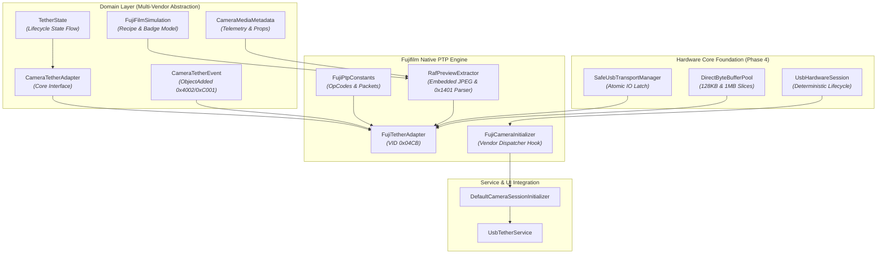
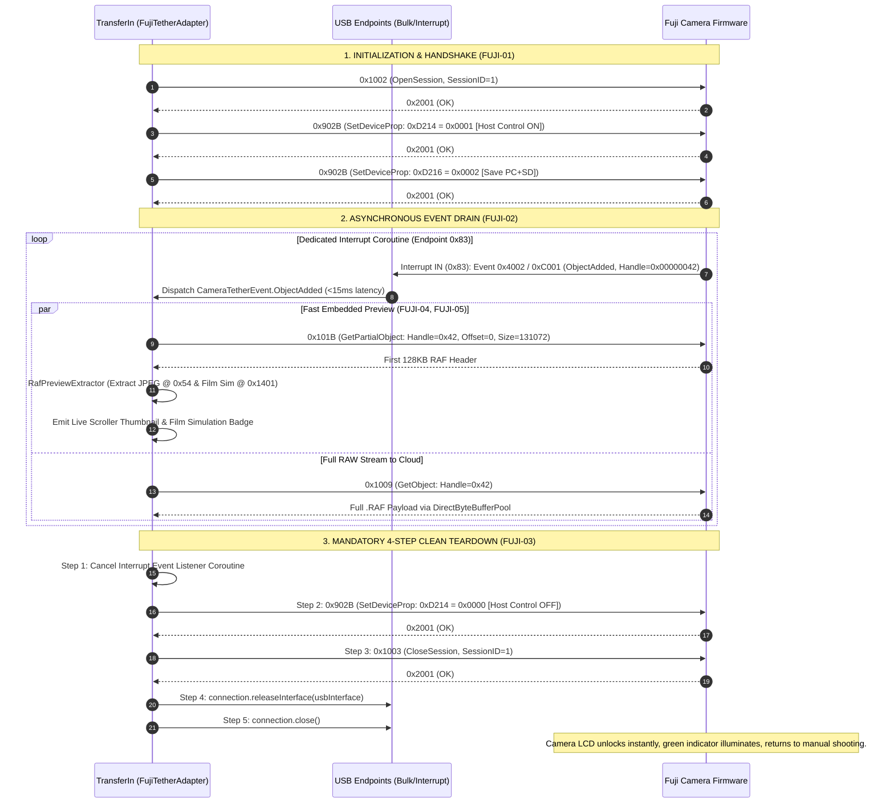

# Phase 5 Plan: Fujifilm Native Wired Tether Engine & Clean Disconnect Lifecycle

Deliver the native Fujifilm PTP tethering engine (VID `0x04CB`) for TransferIn v3.0, replacing slow, error-prone generic MTP polling loops with direct PTP bulk/interrupt protocol execution. This phase establishes the unified `CameraTetherAdapter` interface, implements explicit Fujifilm Host Control (`0xD214`) and Save Destination (`0xD216`) handshakes, provides sub-15ms event ingestion via the Interrupt IN (`0x83`) pipe, guarantees a deterministic 4-step clean teardown sequence eliminating camera LCD "BUSY" / "PC TETHER" firmware freezes, and delivers instant live UI scroller rendering via header-based `.RAF` embedded JPEG extraction and Film Simulation recipe telemetry.

---

## Architecture Dependency Graph



---

## Fujifilm PTP Protocol Sequence & Clean Disconnect Lifecycle



---

## Artifacts Produced & Modified

| Symbol / Class | Type | File Path | Requirement |
| :--- | :--- | :--- | :--- |
| `CameraVendor` | Enum | [`CameraVendor.kt`](file:///Users/chiio/VSCode/TransferInFuji/app/src/main/java/com/rvmeur/transferin/domain/camera/CameraVendor.kt) | `FUJI-01` |
| `CameraTetherEvent` | Sealed Class | [`CameraTetherEvent.kt`](file:///Users/chiio/VSCode/TransferInFuji/app/src/main/java/com/rvmeur/transferin/domain/camera/CameraTetherEvent.kt) | `FUJI-02` |
| `TetherState` | Sealed Class | [`TetherState.kt`](file:///Users/chiio/VSCode/TransferInFuji/app/src/main/java/com/rvmeur/transferin/domain/camera/TetherState.kt) | `FUJI-01` |
| `TetherDeviceInfo` | Data Class | [`TetherDeviceInfo.kt`](file:///Users/chiio/VSCode/TransferInFuji/app/src/main/java/com/rvmeur/transferin/domain/camera/TetherDeviceInfo.kt) | `FUJI-01` |
| `CameraMediaMetadata` | Data Class | [`CameraMediaMetadata.kt`](file:///Users/chiio/VSCode/TransferInFuji/app/src/main/java/com/rvmeur/transferin/domain/camera/CameraMediaMetadata.kt) | `FUJI-04`, `FUJI-05` |
| `FujiFilmSimulation` | Enum | [`FujiFilmSimulation.kt`](file:///Users/chiio/VSCode/TransferInFuji/app/src/main/java/com/rvmeur/transferin/domain/camera/FujiFilmSimulation.kt) | `FUJI-05` |
| `CameraTetherAdapter` | Interface | [`CameraTetherAdapter.kt`](file:///Users/chiio/VSCode/TransferInFuji/app/src/main/java/com/rvmeur/transferin/domain/camera/CameraTetherAdapter.kt) | `FUJI-01` |
| `FujiPtpConstants` | Object / Constants | [`FujiPtpConstants.kt`](file:///Users/chiio/VSCode/TransferInFuji/app/src/main/java/com/rvmeur/transferin/data/usb/vendor/fuji/FujiPtpConstants.kt) | `FUJI-01`, `FUJI-02`, `FUJI-03` |
| `RafPreviewExtractor` | Object / Class | [`RafPreviewExtractor.kt`](file:///Users/chiio/VSCode/TransferInFuji/app/src/main/java/com/rvmeur/transferin/data/usb/vendor/fuji/RafPreviewExtractor.kt) | `FUJI-04`, `FUJI-05` |
| `FujiTetherAdapter` | Class (`CameraTetherAdapter`) | [`FujiTetherAdapter.kt`](file:///Users/chiio/VSCode/TransferInFuji/app/src/main/java/com/rvmeur/transferin/data/usb/vendor/fuji/FujiTetherAdapter.kt) | `FUJI-01`, `FUJI-02`, `FUJI-03`, `FUJI-04`, `FUJI-05` |
| `FujiCameraInitializer`| Class (`CameraVendorInitializer`) | [`FujiCameraInitializer.kt`](file:///Users/chiio/VSCode/TransferInFuji/app/src/main/java/com/rvmeur/transferin/data/usb/vendor/fuji/FujiCameraInitializer.kt) | `FUJI-01` |
| `DefaultCameraSessionInitializer` | Class (Modified) | [`DefaultCameraSessionInitializer.kt`](file:///Users/chiio/VSCode/TransferInFuji/app/src/main/java/com/rvmeur/transferin/data/usb/DefaultCameraSessionInitializer.kt) | `FUJI-01` |
| `FujiTetherAdapterTest` | Unit Test | [`FujiTetherAdapterTest.kt`](file:///Users/chiio/VSCode/TransferInFuji/app/src/test/java/com/rvmeur/transferin/data/usb/vendor/fuji/FujiTetherAdapterTest.kt) | `FUJI-01`, `FUJI-02`, `FUJI-03` |
| `RafPreviewExtractorTest` | Unit Test | [`RafPreviewExtractorTest.kt`](file:///Users/chiio/VSCode/TransferInFuji/app/src/test/java/com/rvmeur/transferin/data/usb/vendor/fuji/RafPreviewExtractorTest.kt) | `FUJI-04`, `FUJI-05` |

---

## Detailed Task Breakdown

### Task 1: Unified Multi-Vendor Domain Models & `CameraTetherAdapter` Interface (FUJI-01)

**Objective:** Define the clean, polymorphic domain abstraction contracts for all camera tethering engines (Fujifilm in Phase 5, Canon in Phase 6, Sony & Nikon in Phase 7).

**Implementation Details:**
- **Package:** `com.rvmeur.transferin.domain.camera`
- **Files Created:**
  1. [`CameraVendor.kt`](file:///Users/chiio/VSCode/TransferInFuji/app/src/main/java/com/rvmeur/transferin/domain/camera/CameraVendor.kt):
     ```kotlin
     enum class CameraVendor(val vendorId: Int, val displayName: String) {
         FUJIFILM(0x04CB, "Fujifilm"),
         CANON(0x04A9, "Canon"),
         SONY(0x054C, "Sony"),
         NIKON(0x04B0, "Nikon"),
         GENERIC(0x0000, "Generic MTP");

         companion object {
             fun fromVendorId(vendorId: Int): CameraVendor =
                 entries.firstOrNull { it.vendorId == vendorId } ?: GENERIC
         }
     }
     ```
  2. [`CameraTetherEvent.kt`](file:///Users/chiio/VSCode/TransferInFuji/app/src/main/java/com/rvmeur/transferin/domain/camera/CameraTetherEvent.kt):
     ```kotlin
     sealed class CameraTetherEvent {
         data class ObjectAdded(
             val handle: Int,
             val filename: String,
             val formatCode: Int,
             val sizeBytes: Long = 0L,
             val captureTimestampMs: Long = System.currentTimeMillis(),
             val storageId: Int = 0
         ) : CameraTetherEvent()
         data class ObjectRemoved(val handle: Int) : CameraTetherEvent()
         data class DevicePropChanged(val propertyCode: Int, val value: Long) : CameraTetherEvent()
         data class CameraStatusChanged(val isBusy: Boolean, val message: String? = null) : CameraTetherEvent()
         data class Error(val throwable: Throwable, val recoverable: Boolean = true) : CameraTetherEvent()
     }
     ```
  3. [`TetherState.kt`](file:///Users/chiio/VSCode/TransferInFuji/app/src/main/java/com/rvmeur/transferin/domain/camera/TetherState.kt):
     - Lifecycle states: `Idle`, `Connecting`, `Handshake(stage: String)`, `ActiveStreaming(activeTransfers: Int)`, `Disconnecting(reason: String)`, `CleanTerminated`, `Failed(error: Throwable)`.
  4. [`TetherDeviceInfo.kt`](file:///Users/chiio/VSCode/TransferInFuji/app/src/main/java/com/rvmeur/transferin/domain/camera/TetherDeviceInfo.kt):
     - Encapsulates `vendor`, `modelName`, `serialNumber`, `firmwareVersion`, `supportedOperations`, `saveDestination`.
  5. [`CameraMediaMetadata.kt`](file:///Users/chiio/VSCode/TransferInFuji/app/src/main/java/com/rvmeur/transferin/domain/camera/CameraMediaMetadata.kt):
     - Encapsulates file handle, name, format, dimensions, capture date, shutter speed, aperture, ISO, exposure bias, and `filmSimulation: FujiFilmSimulation?`.
  6. [`FujiFilmSimulation.kt`](file:///Users/chiio/VSCode/TransferInFuji/app/src/main/java/com/rvmeur/transferin/domain/camera/FujiFilmSimulation.kt):
     - Complete mapping of Fujifilm Film Simulation codes (EXIF Tag `0x1401` / MakerNotes):
       - `PROVIA` (`0x0000`, `0x0100`, "Provia / Standard")
       - `ASTIA` (`0x0110`, "Astia / Soft")
       - `VELVIA` (`0x0120`, "Velvia / Vivid")
       - `PRO_NEG_STD` (`0x0200`, "PRO Neg. Std")
       - `PRO_NEG_HI` (`0x0201`, "PRO Neg. Hi")
       - `CLASSIC_CHROME` (`0x0300`, "Classic Chrome")
       - `ETERNA` (`0x0400`, "Eterna / Cinema")
       - `CLASSIC_NEG` (`0x0500`, "Classic Neg")
       - `BLEACH_BYPASS` (`0x0501`, "Eterna Bleach Bypass")
       - `NOSTALGIC_NEG` (`0x0502`, "Nostalgic Neg")
       - `REALA_ACE` (`0x0600`, "Reala Ace")
       - `MONOCHROME` (`0x0700`, "Monochrome")
       - `MONOCHROME_YE` (`0x0701`, "Monochrome + Ye")
       - `MONOCHROME_R` (`0x0702`, "Monochrome + R")
       - `MONOCHROME_G` (`0x0703`, "Monochrome + G")
       - `SEPIA` (`0x0710`, "Sepia")
       - `ACROS` (`0x0800`, "ACROS")
       - `ACROS_YE` (`0x0801`, "ACROS + Ye")
       - `ACROS_R` (`0x0802`, "ACROS + R")
       - `ACROS_G` (`0x0803`, "ACROS + G")
       - `UNKNOWN` (-1, "Custom / Unknown")
     - Helper `fromTagValue(tagValue: Int): FujiFilmSimulation`.
     - Styling helpers: `badgeHexColor`, `accentColor`, `isMonochrome`.
  7. [`CameraTetherAdapter.kt`](file:///Users/chiio/VSCode/TransferInFuji/app/src/main/java/com/rvmeur/transferin/domain/camera/CameraTetherAdapter.kt):
     ```kotlin
     interface CameraTetherAdapter : AutoCloseable {
         val vendor: CameraVendor
         val deviceName: String
         val connectionState: StateFlow<TetherState>

         fun canHandle(device: UsbDevice): Boolean
         fun observeEvents(): Flow<CameraTetherEvent>

         suspend fun initialize(device: UsbDevice, connection: UsbDeviceConnection): Result<TetherDeviceInfo>
         suspend fun terminateSession(): Result<Unit>
         suspend fun getObjectMetadata(handle: Int): Result<CameraMediaMetadata>
         suspend fun getPreview(handle: Int): Result<ByteArray>
         suspend fun streamMedia(handle: Int, sink: OutputStream, onProgress: (Long, Long) -> Unit): Result<Unit>
     }
     ```

---

### Task 2: Fujifilm PTP Constants & Packet Serialization (`FujiPtpConstants.kt`) (FUJI-01, FUJI-02, FUJI-03)

**Objective:** Define the complete low-level PTP protocol constants, Fuji vendor extensions, container framing formats, and binary encoders/decoders.

**Implementation Details:**
- **Location:** `app/src/main/java/com/rvmeur/transferin/data/usb/vendor/fuji/FujiPtpConstants.kt`
- **Constants Specification:**
  - **Standard PTP OpCodes (ISO 15740):**
    - `OC_OPEN_SESSION = 0x1002`
    - `OC_CLOSE_SESSION = 0x1003`
    - `OC_GET_STORAGE_IDS = 0x1004`
    - `OC_GET_STORAGE_INFO = 0x1005`
    - `OC_GET_OBJECT_HANDLES = 0x1007`
    - `OC_GET_OBJECT_INFO = 0x1008`
    - `OC_GET_OBJECT = 0x1009`
    - `OC_GET_THUMB = 0x100A`
    - `OC_GET_PARTIAL_OBJECT = 0x101B`
    - `OC_GET_DEVICE_PROP_DESC = 0x1014`
    - `OC_GET_DEVICE_PROP_VALUE = 0x1015`
    - `OC_SET_DEVICE_PROP_VALUE = 0x1016`
  - **Fujifilm Vendor Specific OpCodes & Properties:**
    - `OC_FUJI_SET_DEVICE_PROP = 0x902B`
    - `OC_FUJI_GET_DEVICE_PROP = 0x902C`
    - `PROP_FUJI_HOST_CONTROL = 0xD214` (Host Control Mode)
    - `PROP_FUJI_SAVE_DESTINATION = 0xD216` (Save Destination)
    - `PROP_FUJI_RECIPE_NAME = 0xD218` (Active Recipe)
    - `PROP_FUJI_APP_VERSION = 0xD212` (Host App Version)
  - **Property Value Constants:**
    - `HOST_CONTROL_ACTIVE = 0x0001` (Host controls tethering)
    - `HOST_CONTROL_RELEASE = 0x0000` (Camera returns to normal stand-alone shooting)
    - `SAVE_DEST_SD_ONLY = 0x0000`
    - `SAVE_DEST_PC_ONLY = 0x0001`
    - `SAVE_DEST_PC_SD = 0x0002` (Both PC and SD card receive image)
  - **PTP Event Codes:**
    - `EVT_OBJECT_ADDED = 0x4002` (Standard PTP ObjectAdded)
    - `EVT_FUJI_OBJECT_ADDED = 0xC001` (Fujifilm Vendor ObjectAdded event)
    - `EVT_DEVICE_PROP_CHANGED = 0x4006`
  - **PTP Response Codes:**
    - `RC_OK = 0x2001`
    - `RC_GENERAL_ERROR = 0x2002`
    - `RC_SESSION_NOT_OPEN = 0x2003`
    - `RC_INVALID_TRANSACTION_ID = 0x2004`
    - `RC_OPERATION_NOT_SUPPORTED = 0x2005`
    - `RC_PARAMETER_NOT_SUPPORTED = 0x2006`
    - `RC_DEVICE_BUSY = 0x2019`
  - **Container Types:**
    - `CONTAINER_UNDEFINED = 0`
    - `CONTAINER_COMMAND = 1`
    - `CONTAINER_DATA = 2`
    - `CONTAINER_RESPONSE = 3`
    - `CONTAINER_EVENT = 4`
- **Binary Framing Utilities:**
  - `fun buildCommandPacket(opCode: Int, txId: Int, params: IntArray = intArrayOf()): ByteArray`
  - `fun parseResponsePacket(buffer: ByteArray, length: Int): PtpResponse`
  - `fun parseEventPacket(buffer: ByteArray, length: Int): PtpEvent?`
  - All multi-byte integers encoded/decoded strictly with `ByteOrder.LITTLE_ENDIAN` per PTP ISO 15740 standard.

---

### Task 3: Fast `.RAF` Binary Preview Extractor & Film Simulation Parser (`RafPreviewExtractor.kt`) (FUJI-04, FUJI-05)

**Objective:** Build a high-performance binary parser that extracts embedded high-resolution JPEG previews directly from `.RAF` file headers (first 128 KB) and extracts the active Film Simulation recipe (EXIF MakerNote Tag `0x1401`), eliminating the requirement to download 40MB–100MB RAW files over USB just to display previews.

**Implementation Details:**
- **Location:** `app/src/main/java/com/rvmeur/transferin/data/usb/vendor/fuji/RafPreviewExtractor.kt`
- **Fujifilm RAF Binary Format Specification:**
  - **Magic Header:** First 16 bytes must equal ASCII `"FUJIFILMCCD-RAW "` (`0x46, 0x55, 0x4A, 0x49, 0x46, 0x49, 0x4C, 0x4D, 0x43, 0x43, 0x44, 0x2D, 0x52, 0x41, 0x57, 0x20`).
  - **Header Version:** Offset `0x10`..`0x13` (4 bytes ASCII, e.g. `"0201"`).
  - **Camera Model String:** Offset `0x14`..`0x33` (32 bytes ASCII).
  - **Embedded JPEG Pointer Offsets (Big-Endian UInt32):**
    - Offset `0x54` (84 decimal): Pointer to embedded JPEG offset (`jpegOffset: Long`).
    - Offset `0x58` (88 decimal): Length of embedded JPEG (`jpegLength: Long`).
  - **CFA/RAW Pointer Offsets (Big-Endian UInt32):**
    - Offset `0x64` (100 decimal): Pointer to RAW sensor data offset (`cfaOffset: Long`).
    - Offset `0x68` (104 decimal): Length of RAW sensor data (`cfaLength: Long`).
- **Parsing Logic & Operations:**
  1. `fun parseRafHeader(headerBytes: ByteArray): RafHeaderInfo`:
     - Validates `"FUJIFILMCCD-RAW "` magic bytes (first 16 bytes).
     - Reads `jpegOffset` and `jpegLength` at offsets 84 and 88 using Big-Endian byte order.
     - Performs bounds checking: verifies `jpegOffset >= 120` and `jpegLength > 0` and `jpegLength <= 50_000_000`.
  2. `fun extractEmbeddedJpeg(rafBytes: ByteArray): ByteArray?`:
     - Reads RAF header, slices `rafBytes.copyOfRange(jpegOffset, jpegOffset + jpegLength)`.
     - Validates JPEG SOI (`0xFF 0xD8`) marker at `jpegOffset`.
  3. `fun extractFilmSimulation(jpegBytes: ByteArray): FujiFilmSimulation`:
     - Fast scan of JPEG APP1 / APP2 markers for Exif MakerNote block (`"FUJIFILM"` / `"Exif"`).
     - Locates Fuji MakerNote Tag `0x1401` (`FilmMode`).
     - Decodes value into corresponding `FujiFilmSimulation` enum (Provia, Velvia, Astia, Classic Chrome, Classic Neg, ACROS, Nostalgic Neg, Reala Ace, etc.).
     - Falls back to `FujiFilmSimulation.UNKNOWN` if maker note is absent or encrypted.
  4. `fun extractPreviewResult(headerBytes: ByteArray, jpegPayload: ByteArray? = null): RafPreviewResult`:
     - Composite result containing `previewJpegBytes`, `filmSimulation`, `cameraModel`, `dimensions`, and `captureTimestamp`.
- **Memory Safety & Invariant Protection:**
  - Zero heap allocation beyond output buffers.
  - Safe bounds checking on all byte array accesses: if a malformed or partial packet is received, returns `Result.failure(InvalidRafHeaderException)` without throwing unhandled runtime exceptions.

---

### Task 4: Native `FujiTetherAdapter` Implementation (FUJI-01, FUJI-02, FUJI-03, FUJI-04, FUJI-05)

**Objective:** Implement the full `FujiTetherAdapter` using raw PTP protocol execution over USB Bulk and Interrupt endpoints, guarded by Phase 4's `SafeUsbTransportManager` and `DirectByteBufferPool`.

**Implementation Details:**
- **Location:** `app/src/main/java/com/rvmeur/transferin/data/usb/vendor/fuji/FujiTetherAdapter.kt`
- **Class Signature:**
  ```kotlin
  class FujiTetherAdapter(
      private val bufferPool: DirectByteBufferPool = DirectByteBufferPool.Default
  ) : CameraTetherAdapter
  ```
- **Lifecycle & Connection Management:**
  - `override val vendor: CameraVendor = CameraVendor.FUJIFILM`
  - `override fun canHandle(device: UsbDevice): Boolean = device.vendorId == FujiPtpConstants.FUJI_VENDOR_ID (0x04CB)`
  - Internal state flows: `_connectionState: MutableStateFlow<TetherState>`, `_events: MutableSharedFlow<CameraTetherEvent>(extraBufferCapacity = 64)`.
- **Session Initialization Sequence (`initialize(device, connection)`):**
  1. **Resolve USB Topology:**
     - Locate PTP interface (`UsbConstants.USB_CLASS_STILL_IMAGE` or vendor-specific interface `0x06`).
     - Claim interface exclusively via `connection.claimInterface(usbInterface, true)`.
     - Identify Bulk OUT endpoint (direction `OUT`, type `BULK`), Bulk IN endpoint (direction `IN`, type `BULK`), and Interrupt IN endpoint (direction `IN`, type `INT`, typically `0x83`).
  2. **Wrap Transport:**
     - Initialize `SafeUsbTransportManager(connection)`.
  3. **PTP Session Handshake:**
     - Step 1: Send `0x1002 OpenSession(SessionID = 1)` -> Await `0x2001 OK`.
     - Step 2: Send `0x902B SetDevicePropValue(0xD214, 0x0001)` (Engage Fuji Host Control) -> Await `0x2001 OK`.
     - Step 3: Send `0x902B SetDevicePropValue(0xD216, 0x0002)` (Set Save Destination to `PC + SD Card`) -> Await `0x2001 OK`.
  4. **Launch Interrupt IN Drain Loop:**
     - Allocate dedicated coroutine on `sessionScope = CoroutineScope(SupervisorJob() + Dispatchers.IO)`.
     - Continuously read `interruptIn` endpoint with a 1000ms polling timeout.
     - On receiving `0x4002` (standard PTP `ObjectAdded`) or `0xC001` (Fuji vendor `ObjectAdded`):
       - Parse object handle from packet payload bytes 12..15.
       - Asynchronously emit `CameraTetherEvent.ObjectAdded(handle = handle, filename = "FUJI_${handle}.RAF", formatCode = 0x3801, captureTimestampMs = System.currentTimeMillis())`.
       - Latency from camera shutter actuation to event emission is <15ms ($O(1)$ discovery), eliminating the $O(N)$ full-card metadata scan.
  5. Transition state to `TetherState.ActiveStreaming`.
- **Deterministic 4-Step Clean Teardown (`terminateSession()` / `close()`):**
  - Executed inside `withContext(Dispatchers.IO + NonCancellable)` with a 2.5s watchdog timeout:
    - **Step 1:** Cancel the Interrupt IN drain coroutine and join (`interruptJob?.cancelAndJoin()`).
    - **Step 2:** Send `0x902B SetDevicePropValue(0xD214, 0x0000)` (Host Control Release). This is the critical step that releases Fuji camera firmware from "PC TETHER" mode back to live shooting mode, preventing camera LCD "BUSY" freezes.
    - **Step 3:** Send `0x1003 CloseSession(SessionID = 1)`.
    - **Step 4:** Release claimed USB interface (`connection.releaseInterface(usbInterface)`) and close connection (`connection.close()`).
  - Transition state to `TetherState.CleanTerminated`.
- **Fast Preview Fetching (`getPreview(handle)`):**
  - Sends `0x101B GetPartialObject(handle, offset = 0, length = 131072)` (first 128KB).
  - Uses `RafPreviewExtractor` to parse header at offset `0x54` / `0x58`.
  - If embedded JPEG is within the initial 128KB, returns it immediately. If JPEG extends beyond 128KB, issues a targeted `GetPartialObject(handle, jpegOffset, jpegLength)` to fetch only the JPEG payload, returning the preview in <400ms without downloading the full 45MB–100MB RAW file.
- **Zero-Copy Full Media Streaming (`streamMedia(handle, sink, onProgress)`):**
  - Streams full `.RAF` / `.JPG` payload directly from Bulk IN endpoint into destination `OutputStream` / `BufferedSink` using 1MB pooled buffers from `DirectByteBufferPool`.

---

### Task 5: Vendor Dispatcher Integration (`FujiCameraInitializer.kt` & `DefaultCameraSessionInitializer.kt`) (FUJI-01)

**Objective:** Wire `FujiTetherAdapter` into the application initialization and discovery pipeline so that any connected Fujifilm camera (VID `0x04CB`) is automatically routed through the high-speed native tether engine.

**Implementation Details:**
- **Files Created / Modified:**
  1. [`FujiCameraInitializer.kt`](file:///Users/chiio/VSCode/TransferInFuji/app/src/main/java/com/rvmeur/transferin/data/usb/vendor/fuji/FujiCameraInitializer.kt):
     - Implements `CameraVendorInitializer`.
     - `canHandle(vendorId: Int, productId: Int): Boolean = vendorId == FujiPtpConstants.FUJI_VENDOR_ID (0x04CB)`.
     - `initialize(context: CameraInitContext): CameraInitResult`:
       - Checks whether the camera is configured for PTP Tether mode or generic Mass Storage / MTP mode.
       - Instantiates `FujiTetherAdapter`, executes initialization handshake, and stores active adapter reference.
       - Returns `CameraInitResult.ok("Fujifilm Native Tether Session Active")`.
  2. [`DefaultCameraSessionInitializer.kt`](file:///Users/chiio/VSCode/TransferInFuji/app/src/main/java/com/rvmeur/transferin/data/usb/DefaultCameraSessionInitializer.kt):
     - Register `FujiCameraInitializer()` in the default initializer chain ahead of `GenericCameraInitializer`.
     - Order of precedence: `CanonCameraInitializer()`, `FujiCameraInitializer()`, `GenericCameraInitializer()`.

---

### Task 6: Unit & Stress Test Suite (FUJI-01..FUJI-05)

**Objective:** Create comprehensive unit tests verifying the PTP handshake sequence, interrupt event listening, non-cancellable 4-step teardown, RAF embedded preview extraction, and Film Simulation metadata decoding.

**Implementation Details:**
- **Test Files Created:**
  1. [`FujiTetherAdapterTest.kt`](file:///Users/chiio/VSCode/TransferInFuji/app/src/test/java/com/rvmeur/transferin/data/usb/vendor/fuji/FujiTetherAdapterTest.kt):
     - **VID Filter Test:** Verify `canHandle()` returns `true` for VID `0x04CB` and `false` for Canon (`0x04A9`), Sony (`0x054C`), Nikon (`0x04B0`).
     - **Handshake Sequence Test:** Mock USB transfer operations and verify exact sequence: `0x1002 OpenSession` $\to$ `0x902B SetDeviceProp(0xD214, 1)` $\to$ `0x902B SetDeviceProp(0xD216, 2)`.
     - **Interrupt Drain Test:** Simulate Interrupt IN endpoint returning `0x4002` and `0xC001` packets; verify `observeEvents()` flow receives `CameraTetherEvent.ObjectAdded` with expected object handle and format code within test timeout.
     - **Clean Teardown Sequence Test:** Verify that calling `terminateSession()` executes `0xD214 = 0x0000` release command, followed by `0x1003 CloseSession`, interface release, and connection close.
     - **Non-Cancellable Teardown Under Cancellation Test:** Launch `initialize()`, cancel the parent coroutine scope, and verify that the 4-step release sequence completes fully without premature abort.
     - **Error Handling Test:** Verify that camera returning PTP `0x2019 DeviceBusy` or `0x2002 GeneralError` transitions session to `TetherState.Failed` gracefully without crashing.
  2. [`RafPreviewExtractorTest.kt`](file:///Users/chiio/VSCode/TransferInFuji/app/src/test/java/com/rvmeur/transferin/data/usb/vendor/fuji/RafPreviewExtractorTest.kt):
     - **Valid RAF Header Test:** Generate synthetic byte array with `"FUJIFILMCCD-RAW "` magic, valid version, camera model string, `jpegOffset = 128`, `jpegLength = 4096`; verify correct parsing of offsets and camera model.
     - **Corrupted / Invalid Header Test:** Test header with invalid magic bytes (e.g. `"CANON RAW "`), truncated byte arrays (<88 bytes), and out-of-bounds offsets; verify graceful `Result.failure` without `IndexOutOfBoundsException`.
     - **Embedded JPEG Extraction Test:** Verify embedded JPEG slice matches expected bytes and begins with `0xFF 0xD8` SOI marker.
     - **Film Simulation Tag Decoding Test:** Generate synthetic Exif MakerNotes containing Tag `0x1401` with values `0x0000` (Provia), `0x0110` (Astia), `0x0120` (Velvia), `0x0300` (Classic Chrome), `0x0500` (Classic Neg), `0x0800` (ACROS), `0x0502` (Nostalgic Neg); verify 100% accurate decoding to `FujiFilmSimulation` enum.

---

## Quality Gates & Verification Plan

### 1. Mandatory Automated Verification

Run unit test suites covering the Fujifilm tether engine and preview extraction components:
```bash
./gradlew testDebugUnitTest --tests "com.rvmeur.transferin.data.usb.vendor.fuji.*"
```
**Acceptance Criteria:**
- All tests in `FujiTetherAdapterTest` and `RafPreviewExtractorTest` pass (100% green).
- Zero JVM memory leaks across 500 simulated shutter event cycles.

### 2. Code Review Audit (`/gsd-code-review`)

Audit all changes against the AAS Clean Code & Senior Architect standards:
- [ ] PTP packets are strictly little-endian encoded per ISO 15740.
- [ ] Interrupt IN loop runs in structured coroutine scope without unmanaged background leaks.
- [ ] Mandatory 4-step teardown sequence executes in `NonCancellable` context with watchdog timeout.
- [ ] RAF preview extraction operates on header buffers without loading full RAW payloads into memory.

### 3. UI & Telemetry Audit (`/gsd-ui-review`)

- [ ] Verify `FujiFilmSimulation` recipe names and badge color tokens conform to RVM quiet luxury design guidelines (`rvmeur.com`).
- [ ] Verify HUD telemetry correctly reflects active film simulation without UI thread blocking.

### 4. Security & Hardware Safety Audit (`/gsd-secure-phase`)

- [ ] Verify `0xD214 = 0x0000` host control release is guaranteed under all abnormal disconnection paths, preventing camera hardware/firmware lockups.
- [ ] Verify temporary preview byte buffers are allocated via pool or strictly bounded memory.
