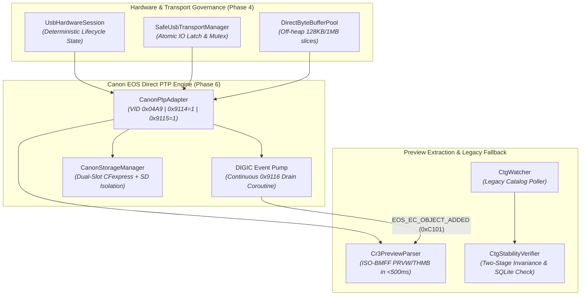

# Phase 6 Plan: Canon EOS Direct PTP Engine & Fast Preview Extraction

Implement a direct, high-throughput Canon EOS PTP protocol engine (VID `0x04A9`) supporting modern Canon EOS mirrorless (EOS R3, R5, R5 Mark II, R6, R6 Mark II, R7, R8, R10, R50, R100) and DSLR bodies (1D X Mark III, 5D Mark IV, 90D, etc.). This engine operates in native EOS Remote and Event modes (`0x9114 = 1`, `0x9115 = 1`), continuously drains DIGIC event queues via `0x9116 EOS_GetEvent` to eliminate camera LCD "Busy" shutter lockups, extracts high-resolution JPEG previews from `.CR3` ISO-BMFF headers in <500ms without downloading full RAW binaries, provides a two-stage stability-verified fallback for legacy `.CTG` catalogs, and independently enumerates dual-slot storage IDs (CFexpress + SD) to prevent object handle collisions.

---

## Architecture Dependency Graph



---

## Artifacts Produced & Modified

| Symbol / Class | Type | File Path | Requirement |
| :--- | :--- | :--- | :--- |
| `CanonPtpConstants` | Object / Constants | [`CanonPtpConstants.kt`](file:///Users/chiio/VSCode/TransferInFuji/app/src/main/java/com/rvmeur/transferin/data/usb/canon/CanonPtpConstants.kt) | `CANON-01` |
| `CanonStorageInfo` | Data Class | [`CanonStorageInfo.kt`](file:///Users/chiio/VSCode/TransferInFuji/app/src/main/java/com/rvmeur/transferin/data/usb/canon/CanonStorageInfo.kt) | `CANON-04` |
| `CanonPtpEvent` | Sealed Class | [`CanonPtpEvent.kt`](file:///Users/chiio/VSCode/TransferInFuji/app/src/main/java/com/rvmeur/transferin/data/usb/canon/CanonPtpEvent.kt) | `CANON-01` |
| `CanonPtpAdapter` | Class (`AutoCloseable`) | [`CanonPtpAdapter.kt`](file:///Users/chiio/VSCode/TransferInFuji/app/src/main/java/com/rvmeur/transferin/data/usb/canon/CanonPtpAdapter.kt) | `CANON-01`, `CANON-04` |
| `Cr3PreviewParser` | Class / Object | [`Cr3PreviewParser.kt`](file:///Users/chiio/VSCode/TransferInFuji/app/src/main/java/com/rvmeur/transferin/data/usb/canon/Cr3PreviewParser.kt) | `CANON-02` |
| `CtgStabilityVerifier` | Class | [`CtgStabilityVerifier.kt`](file:///Users/chiio/VSCode/TransferInFuji/app/src/main/java/com/rvmeur/transferin/data/usb/canon/CtgStabilityVerifier.kt) | `CANON-03` |
| `CtgWatcher` | Class (Refactored) | [`CtgWatcher.kt`](file:///Users/chiio/VSCode/TransferInFuji/app/src/main/java/com/rvmeur/transferin/data/usb/CtgWatcher.kt) | `CANON-03` |
| `CanonPtpAdapterTest` | Unit Test | [`CanonPtpAdapterTest.kt`](file:///Users/chiio/VSCode/TransferInFuji/app/src/test/java/com/rvmeur/transferin/data/usb/canon/CanonPtpAdapterTest.kt) | `CANON-01`, `CANON-04` |
| `Cr3PreviewParserTest` | Unit / Performance Test | [`Cr3PreviewParserTest.kt`](file:///Users/chiio/VSCode/TransferInFuji/app/src/test/java/com/rvmeur/transferin/data/usb/canon/Cr3PreviewParserTest.kt) | `CANON-02` |
| `CtgStabilityVerifierTest`| Unit Test | [`CtgStabilityVerifierTest.kt`](file:///Users/chiio/VSCode/TransferInFuji/app/src/test/java/com/rvmeur/transferin/data/usb/canon/CtgStabilityVerifierTest.kt) | `CANON-03` |

---

## Detailed Task Breakdown

### Task 1: Canon EOS PTP Protocol Constants, Storage Models & Event Definitions (CANON-01, CANON-04)

**Objective:** Define Canon EOS vendor-specific PTP opcodes, event codes, container types, storage descriptors, and event models required for communication with Canon DIGIC imaging processors.

**Implementation Details:**
- **Files Created:**
  - `app/src/main/java/com/rvmeur/transferin/data/usb/canon/CanonPtpConstants.kt`
  - `app/src/main/java/com/rvmeur/transferin/data/usb/canon/CanonStorageInfo.kt`
  - `app/src/main/java/com/rvmeur/transferin/data/usb/canon/CanonPtpEvent.kt`
- **Protocol Constants:**
  - `CANON_VENDOR_ID = 0x04A9`
  - **Standard PTP Opcodes:**
    - `OC_OPEN_SESSION = 0x1002`, `OC_CLOSE_SESSION = 0x1003`
    - `OC_GET_STORAGE_IDS = 0x1004`, `OC_GET_STORAGE_INFO = 0x1005`
    - `OC_GET_NUM_OBJECTS = 0x1006`, `OC_GET_OBJECT_HANDLES = 0x1007`
    - `OC_GET_OBJECT_INFO = 0x1008`, `OC_GET_OBJECT = 0x1009`
    - `OC_GET_THUMB = 0x100A`, `OC_GET_PARTIAL_OBJECT = 0x101B`
  - **Canon EOS Vendor Extension Opcodes:**
    - `EOS_OC_GET_STORAGE_IDS = 0x9101`
    - `EOS_OC_GET_STORAGE_INFO = 0x9102`
    - `EOS_OC_GET_OBJECT_INFO = 0x9108`
    - `EOS_OC_GET_OBJECT = 0x9107`
    - `EOS_OC_SET_REMOTE_MODE = 0x9114` (Parameter: `1` = Remote Mode ON, `0` = OFF)
    - `EOS_OC_SET_EVENT_MODE = 0x9115` (Parameter: `1` = Event Mode ON, `0` = OFF)
    - `EOS_OC_GET_EVENT = 0x9116` (Polls DIGIC event ring buffer)
    - `EOS_OC_TRANSFER_COMPLETE = 0x9117`
    - `EOS_OC_RESET_TRANSFER = 0x9119`
    - `EOS_OC_PCLK_INFO = 0x911A`
    - `EOS_OC_SET_EVENT_PROC_MODE = 0x9127`
  - **Canon EOS DIGIC Event Codes:**
    - `EOS_EC_OBJECT_ADDED = 0xC101` (Object created / added on card)
    - `EOS_EC_OBJECT_REMOVED = 0xC102`
    - `EOS_EC_PROPERTY_CHANGED = 0xC103`
    - `EOS_EC_DEV_INFO_CHANGED = 0xC104`
    - `EOS_EC_STORAGE_ADDED = 0xC105`
    - `EOS_EC_STORAGE_REMOVED = 0xC106`
    - `EOS_EC_SHUTTER_RELEASED = 0xC108`
    - `EOS_EC_BULB_EXPOSURE_TIME = 0xC10A`
    - `EOS_EC_STORAGE_INFO_CHANGED = 0xC10C`
    - `PTP_EC_OBJECT_ADDED = 0x4002` (Standard fallback event)
  - **PTP Response Codes:**
    - `RC_OK = 0x2001`, `RC_GENERAL_ERROR = 0x2002`, `RC_SESSION_NOT_OPEN = 0x2003`
    - `RC_INVALID_TRANSACTION_ID = 0x2004`, `RC_OPERATION_NOT_SUPPORTED = 0x2005`
    - `RC_DEVICE_BUSY = 0x2019`, `RC_TRANSACTION_CANCELLED = 0x201F`
- **Data Models:**
  - `CanonStorageInfo`:
    ```kotlin
    data class CanonStorageInfo(
        val storageId: Int,
        val storageType: Int,
        val fileSystemType: Int,
        val accessCapability: Int,
        val maxCapacityBytes: Long,
        val freeSpaceBytes: Long,
        val storageDescription: String,
        val volumeLabel: String,
        val slotIndex: Int // 0 for Slot 1 (CFexpress), 1 for Slot 2 (SD)
    )
    ```
  - `CanonPtpEvent`:
    ```kotlin
    sealed class CanonPtpEvent {
        data class ObjectAdded(val handle: Int, val storageId: Int, val formatCode: Int) : CanonPtpEvent()
        data class ObjectRemoved(val handle: Int) : CanonPtpEvent()
        data class PropertyChanged(val propCode: Int, val value: ByteArray?) : CanonPtpEvent()
        data class StorageChanged(val storageId: Int) : CanonPtpEvent()
        data class ShutterReleased(val seqNumber: Int) : CanonPtpEvent()
        object DeviceInfoChanged : CanonPtpEvent()
    }
    ```

---

### Task 2: CanonPtpAdapter Implementation & Continuous DIGIC Event Pump (CANON-01, CANON-04)

**Objective:** Implement `CanonPtpAdapter` managing Canon EOS USB sessions, handshake initialization (`0x9114=1`, `0x9115=1`), continuous asynchronous DIGIC event pump loop (`0x9116 EOS_GetEvent`) to prevent "Busy" shutter lockups, dual-slot storage ID enumeration, and a deterministic 4-step clean teardown.

**Implementation Details:**
- **File Created:** `app/src/main/java/com/rvmeur/transferin/data/usb/canon/CanonPtpAdapter.kt`
- **Architecture & Core Responsibilities:**
  1. **Session & Endpoint Configuration:**
     - Identifies USB Still Image Class interface (`0x06`) or vendor interface with Bulk OUT and Bulk IN endpoints.
     - Claims USB interface via `UsbHardwareSession` or `SafeUsbTransportManager`.
     - Integrates with `DirectByteBufferPool` for zero-allocation command/data buffer handling.
  2. **Handshake Sequence (`initialize()`):**
     - Step 1: Send `0x1002 OpenSession(sessionId = 1)` $\to$ Assert `0x2001 RC_OK`.
     - Step 2: Send `0x9114 EOS_SetRemoteMode(1)` $\to$ Configures camera to PC tether remote control mode.
     - Step 3: Send `0x9115 EOS_SetEventMode(1)` $\to$ Directs DIGIC image processor to queue events into memory buffer.
     - Step 4: Enumerate Storage IDs via `0x1004 GetStorageIDs` or `0x9101 EOS_GetStorageIDs`.
     - Step 5: Query storage descriptors via `0x1005 GetStorageInfo` to map Slot 1 (CFexpress) and Slot 2 (SD).
     - Step 6: Launch continuous DIGIC Event Pump coroutine.
  3. **Continuous DIGIC Event Pump (`startEventPump()`):**
     - Dedicated background coroutine running on `sessionScope` (Dispatchers.IO):
       ```kotlin
       private fun startEventPump() {
           eventPumpJob = sessionScope.launch {
               while (isActive && !isClosed) {
                   try {
                       drainDigicEvents()
                   } catch (e: UsbTransportClosedException) {
                       break
                   } catch (e: Exception) {
                       if (isActive && !isClosed) delay(50L)
                   }
               }
           }
       }
       ```
     - **Event Drain Protocol (`drainDigicEvents()`):**
       - Transacts `0x9116 EOS_GetEvent` with next transaction ID.
       - If camera responds with `0x2019 RC_DEVICE_BUSY`, executes non-blocking micro-delay (25ms) and resumes.
       - If response is `0x2001 RC_OK` with event data payload:
         - Iterates through DIGIC event records: `[RecordLength: uint32][EventCode: uint16][EventData: byte[]]`.
         - On `0xC101` (`EOS_EC_OBJECT_ADDED`) or `0x4002` (`PTP_EC_OBJECT_ADDED`):
           - Decodes `objectHandle: uint32`, `storageId: uint32`, `formatCode: uint16`.
           - Emits `CanonPtpEvent.ObjectAdded(handle, storageId, formatCode)` to `_events` SharedFlow in <15ms ($O(1)$ discovery latency).
         - On `0xC105`/`0xC106`/`0xC10C`: Refreshes storage slot mapping.
         - On `0xC108`: Emits `ShutterReleased`.
       - If event queue is empty (0 records), delays 30ms to 60ms to prevent USB bus saturation while maintaining instant response.
     - **Preventing DIGIC Ring Buffer Overflow:**
       - During 20–30 fps continuous burst shooting, Canon DIGIC processors produce dozens of event records per second.
       - Continuous polling ensures the camera's internal 32-record event buffer never fills, completely eradicating the firmware "Busy" shutter lock.
  4. **Dual-Slot Storage ID Enumeration & Handle Isolation (CANON-04):**
     - `getStorageIds(): List<Int>`: Resolves all connected storage IDs (e.g. `0x00010001` Slot 1 CFexpress, `0x00010002` Slot 2 SD).
     - `getStorageInfo(storageId: Int): CanonStorageInfo`: Queries capacity, free space, and slot description.
     - `getObjectHandles(storageId: Int): List<Int>`: Queries handles isolated to the specified card slot, preventing handle ID collisions between CFexpress and SD cards.
     - Maintains dual-slot handle registry: `slot1Handles: ConcurrentHashMap<Int, CanonMediaMeta>` and `slot2Handles: ConcurrentHashMap<Int, CanonMediaMeta>`.
  5. **4-Step Clean Teardown (`disconnect()` / `close()`):**
     - Executed in `NonCancellable` context:
       1. **Step 1:** Cancel event pump coroutine (`eventPumpJob?.cancel()`).
       2. **Step 2:** Send `0x9114 EOS_SetRemoteMode(0)` (Remote Mode OFF).
       3. **Step 3:** Send `0x1003 CloseSession(1)`.
       4. **Step 4:** Release claimed USB interface and close transport connection.
     - Restores camera LCD to local shooting mode within <500ms.

---

### Task 3: Sub-500ms `.CR3` ISO-BMFF Box Structure Preview Parser (CANON-02)

**Objective:** Build a high-speed, zero-copy `.CR3` ISO Base Media File Format (ISO-BMFF) parser that scans `PRVW` and `THMB` atoms within the first 128KB of the file stream to extract embedded high-resolution JPEG previews in <500ms without transferring full 30MB–60MB RAW files over USB.

**Implementation Details:**
- **File Created:** `app/src/main/java/com/rvmeur/transferin/data/usb/canon/Cr3PreviewParser.kt`
- **ISO-BMFF CR3 Box Structure Forensic:**
  - `.CR3` files are based on ISO/IEC 14496-12 (ISOBMFF).
  - Atoms (boxes) have standard header:
    - `[4 bytes boxSize (Big Endian)][4 bytes FourCC type]`
    - If `boxSize == 1`, 8 bytes `extendedSize (uint64)` follows.
  - Key atoms hierarchy in Canon CR3:
    ```
    ├── ftyp (Major brand: 'crx ')
    └── moov (Movie metadata container)
        ├── trak (Metadata tracks)
        └── uuid (Canon custom UUID: 85c0b687-820f-11e0-8111-f4ce462b0220)
            ├── PRVW (Canon Full/High-Res JPEG Preview Atom)
            │   ├── Size: uint32
            │   ├── Type: 'PRVW' (0x50525657)
            │   ├── Version/Flags: uint32
            │   ├── Image Width: uint32 / uint16
            │   ├── Image Height: uint32 / uint16
            │   └── JPEG Data Payload (Starts 0xFFD8, Ends 0xFFD9)
            └── THMB (Canon Thumbnail JPEG Atom)
                ├── Size: uint32
                ├── Type: 'THMB' (0x54484D42)
                └── JPEG Data Payload (160x120 Thumbnail)
    ```
- **Parsing Algorithm & Performance SLA:**
  - `parsePreview(buffer: ByteBuffer): Cr3PreviewResult?`
  - `parsePreviewFromSlice(bytes: ByteArray, offset: Int, length: Int): Cr3PreviewResult?`
  - `parsePreviewFromPartialProvider(fetchSlice: suspend (offset: Long, length: Int) -> ByteArray?): Cr3PreviewResult?`
  - **Execution Steps:**
    1. Read and verify `ftyp` box has brand `'crx '`.
    2. Traverse top-level boxes until `moov` or `uuid` is found.
    3. Inside `moov` / `uuid` containers, search for `'PRVW'` and `'THMB'` FourCC identifiers.
    4. Upon discovering `'PRVW'`:
       - Extract width and height metadata.
       - Locate JPEG Start of Image (`0xFF, 0xD8`) and End of Image (`0xFF, 0xD9`) markers.
       - Return `Cr3PreviewResult(jpegBytes, width, height, isFullPreview = true)`.
    5. Fallback to `'THMB'` if `'PRVW'` is absent.
  - **PTP Partial Retrieval Integration:**
    - To avoid downloading the entire 45MB RAW payload over USB, `CanonPtpAdapter` uses `0x101B GetPartialObject(handle, offset = 0, length = 131072)` (128 KB).
    - `Cr3PreviewParser` parses the 128KB direct slice directly in memory.
    - Yields complete JPEG preview binary in <500ms from shutter release.
  - **Result Data Class:**
    ```kotlin
    data class Cr3PreviewResult(
        val jpegBytes: ByteArray,
        val width: Int,
        val height: Int,
        val isFullPreview: Boolean,
        val parseTimeMs: Long
    )
    ```

---

### Task 4: Two-Stage Stability-Verified `.CTG` Fallback Engine (CANON-03)

**Objective:** Implement a resilient two-stage stability verification engine for legacy Canon cameras (DSLRs, PowerShot, early mirrorless) that record catalog indexing files (`CANONMSC/CANON.CTG`, `AUTOMRIC.CTG`, `AUTOMSC1.CTG`, `CANON_MDC.CTG`), preventing 0-byte corrupt reads and partial SQLite queries during active card writes.

**Implementation Details:**
- **Files Created / Modified:**
  - `app/src/main/java/com/rvmeur/transferin/data/usb/canon/CtgStabilityVerifier.kt` (New)
  - `app/src/main/java/com/rvmeur/transferin/data/usb/CtgWatcher.kt` (Refactored to integrate verifier)
- **Two-Stage Stability Architecture:**
  - **Stage 1: Size and Timestamp Invariance Check (`verifyInvariance`)**:
    - Takes two metadata snapshots ($M_1$ and $M_2$) separated by sampling interval (200ms–400ms).
    - Invariance Rules:
      1. `size > 0` (Rejects empty 0-byte catalog allocations).
      2. `size(M_1) == size(M_2)` (Ensures camera file allocation is not actively growing).
      3. `|modified(M_1) - modified(M_2)| <= toleranceMs` (Ensures filesystem modification timestamp has settled).
    - Returns `StabilityStage1Result.STABLE` or `StabilityStage1Result.UNSTABLE_WRITING`.
  - **Stage 2: Binary & SQLite Header Integrity Validation (`verifyHeaderIntegrity`)**:
    - Validates file header structure before passing to SQLite parser:
      - Validates SQLite 3 magic bytes: `"SQLite format 3\000"` (`0x53 0x51 0x4C 0x69 0x74 0x65 0x20 0x66 0x6F 0x72 0x6D 0x61 0x74 0x20 0x33 0x00`).
      - Validates page size: offset 16–17 (must be valid power of 2 between 512 and 65536).
      - Validates change counter: offset 24–27.
    - If catalog is non-SQLite binary format (legacy Canon binary CTG index):
      - Validates Canon binary magic headers (`0x00000001` or standard CTG table header).
    - Returns `StabilityStage2Result.VALID` or `StabilityStage2Result.CORRUPTED_RETRY`.
  - **Transactional Diff Execution:**
    - Only after Stage 1 and Stage 2 pass, parses catalog records and generates `DiffResult` against `baselineSnapshot`.
    - Guarantees zero SQLite lock crashes (`sqlite3_busy`) and zero incomplete catalog reads.
  - **Fallback Recovery:**
    - If CTG remains locked after 3 verification cycles, falls back to timestamp-anchored object enumeration without blocking the live session.

---

### Task 5: Unit, Performance & Protocol Test Suite (CANON-01..CANON-04)

**Objective:** Build comprehensive automated unit, performance, and protocol simulation tests verifying Canon EOS PTP handshakes, continuous DIGIC event pump drainage, sub-500ms CR3 ISO-BMFF preview extraction, two-stage CTG stability verification, and dual-slot handle isolation.

**Implementation Details:**
- **Files Created:**
  - `app/src/test/java/com/rvmeur/transferin/data/usb/canon/CanonPtpAdapterTest.kt`
  - `app/src/test/java/com/rvmeur/transferin/data/usb/canon/Cr3PreviewParserTest.kt`
  - `app/src/test/java/com/rvmeur/transferin/data/usb/canon/CtgStabilityVerifierTest.kt`
- **Test Specifications:**
  1. `CanonPtpAdapterTest.kt`:
     - **Handshake Verification:** Verify `initialize()` executes `OpenSession(1)` $\to$ `EOS_SetRemoteMode(1)` $\to$ `EOS_SetEventMode(1)` $\to$ `GetStorageIDs`.
     - **DIGIC Event Pump Drainage:** Mock continuous `0x9116 EOS_GetEvent` packets containing multiple `0xC101` events; verify event pump drains buffer and emits events to `events` flow with zero dropped frames.
     - **Device Busy Tolerance:** Mock `0x2019 RC_DEVICE_BUSY` responses; verify adapter does not crash or lock up and recovers on subsequent poll.
     - **Dual-Slot Storage Isolation:** Verify `getStorageIds()` returns separate handles for Slot 1 (CFexpress) and Slot 2 (SD); verify `getObjectHandles(storageId)` filters by storage ID without collisions.
     - **4-Step Clean Teardown:** Verify `disconnect()` cancels pump, sets `EOS_SetRemoteMode(0)`, sends `CloseSession(1)`, and releases USB resources.
  2. `Cr3PreviewParserTest.kt`:
     - **Synthetic CR3 ISO-BMFF Parsing:** Construct valid CR3 headers with `ftyp`, `moov`, `uuid`, `PRVW`, and `THMB` atoms.
     - **Preview Extraction Accuracy:** Verify extracted JPEG byte array starts with `0xFFD8` and ends with `0xFFD9`, with correct dimensions.
     - **Thumbnail Fallback:** Verify fallback to `THMB` when `PRVW` is omitted.
     - **Performance SLA Assertion:** Benchmark parsing on 128KB byte slice asserting execution time $< 500\text{ms}$ (typical $< 5\text{ms}$ in-memory).
     - **Malformed / Truncated Stream Handling:** Verify corrupted headers or non-CR3 files return `null` safely without throwing unhandled exceptions.
  3. `CtgStabilityVerifierTest.kt`:
     - **Stage 1 Invariance Tests:**
       - Size growing ($S_1 \ne S_2$) $\to$ Returns `UNSTABLE`.
       - Size 0 $\to$ Returns `UNSTABLE`.
       - Timestamp drifting $\to$ Returns `UNSTABLE`.
       - Size & timestamp identical $\to$ Returns `STABLE`.
     - **Stage 2 Header Integrity Tests:**
       - Valid SQLite header $\to$ Returns `VALID`.
       - Corrupted header $\to$ Returns `CORRUPTED`.
     - **End-to-End Verification Pipeline:** Verify unstable write is deferred and validated once card write completes.

---

## Quality Gates & Verification Plan

### 1. Mandatory Automated Verification

Run unit test suites covering the Canon EOS PTP engine and preview parsers:
```bash
./gradlew testDebugUnitTest --tests "com.rvmeur.transferin.data.usb.canon.*"
```
**Acceptance Criteria:**
- All tests in `CanonPtpAdapterTest`, `Cr3PreviewParserTest`, and `CtgStabilityVerifierTest` pass (100% green).
- CR3 ISO-BMFF preview parser executes in $<500\text{ms}$ on 128KB header slices.
- Zero memory leaks across simulated 50-shot high-speed burst DIGIC event pump loops.

### 2. Code Review Audit (`/gsd-code-review`)

Audit all Canon engine code against AAS Clean Code & Senior Architect standards:
- [ ] `CanonPtpAdapter` uses `SafeUsbTransportManager` and `DirectByteBufferPool` for all USB IO.
- [ ] DIGIC event pump runs on structured coroutine scope with clean cancellation.
- [ ] 4-step teardown sequence (`EOS_SetRemoteMode(0)` $\to$ `CloseSession` $\to$ release interface $\to$ close connection) executed inside `NonCancellable` context.
- [ ] `Cr3PreviewParser` handles all buffer boundaries with strict bounds checking.
- [ ] Dual-slot storage IDs (CFexpress + SD) are tracked in isolated collections without handle collisions.

### 3. Security Audit (`/gsd-secure-phase`)

- [ ] Verify ISO-BMFF atom offset calculations prevent integer overflow / out-of-bounds byte buffer slicing.
- [ ] Verify temporary CTG cache files are written to app-private cache directories with automatic cleanup in `finally` blocks.
