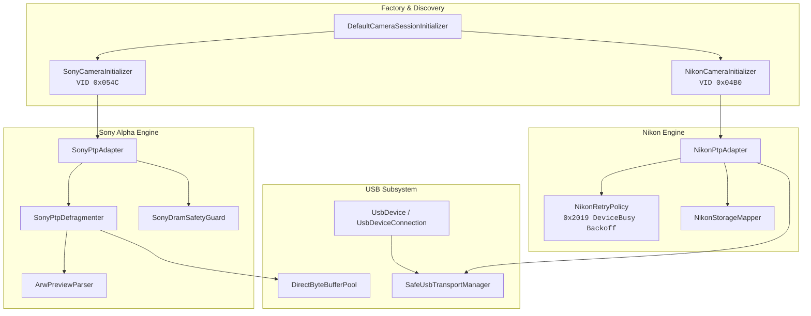

# Phase 7: Sony Alpha & Nikon Multi-Vendor Tether Adapters (PLAN.md)

**Phase:** `07-sony-nikon-tether-adapters`  
**Milestone:** `v3.0 Multi-Vendor Production Engine & Zero-Leak Tether Core`  
**Requirements Covered:** `SONY-01`, `SONY-02`, `NIKON-01`, `NIKON-02`  
**Estimated Complexity:** High  
**Status:** Ready for Execution  

---

## 1. Executive Summary & Architectural Overview

Phase 7 implements native, zero-leak USB PTP tethering engines for **Sony Alpha** (`VID 0x054C`) and **Nikon** (`VID 0x04B0`) cameras, completing the multi-vendor camera tethering suite (alongside Fujifilm and Canon).

### Key Technical Innovations & Safeguards:
1. **Sony SDIO PTP Handshake & Volatile DRAM Safety (`SONY-01`):**
   - Implements `0x9280 SDIOConnect` handshake and `0x9281 GetSDIOExtDeviceInfo` negotiation.
   - Enforces automated validation and switching of the camera's Save Destination property (`0xD2C1` / `0xD2C2`) to `PC + Camera` (`0x0002`). If the camera is configured to volatile `PC Only` (`0x0001`), images reside exclusively in camera DRAM and are permanently destroyed on unexpected USB unplugs or app suspension.
2. **Sony Multi-Packet PTP Defragmenter & `.ARW` TIFF SubIFD Parser (`SONY-02`):**
   - High-throughput USB bulk defragmenter handling multi-packet PTP Data containers, Zero-Length Packets (ZLP), and short packet termination with `DirectByteBufferPool` zero-allocation streaming.
   - Sub-500ms binary `.ARW` parser reading TIFF headers (`II` little-endian / `MM` big-endian), traversing IFD0 and SubIFD tags (`0x014A`, `0x0111`/`0x0201`, `0x0117`/`0x0202`) to extract embedded high-resolution JPEG previews directly from the first 128KB payload without downloading full 50MB+ RAW files.
3. **Nikon Vendor PTP Extension & Dual-Slot Storage Engine (`NIKON-01`):**
   - Implements Nikon-specific commands `0x90C0 CheckEvent` (`Nikon_CheckEvent`) and `0x90C1 SetEventMode` (`Nikon_SetEventMode`).
   - Implements discrete dual-slot storage ID enumeration mapping Slot 1 (e.g. `0x00010001` CFexpress / SD) and Slot 2 (e.g. `0x00020001` SD) independently, preventing object handle collisions.
4. **Adaptive Exponential Backoff Retry Loop (`NIKON-02`):**
   - Mitigates Nikon EXPEED processor `0x2019 PTP_RC_DeviceBusy` responses during card buffer flushing.
   - Adaptive exponential backoff curve (Base 25ms, Multiplier 1.5x, Max 8 retries, Jitter ±10%) preventing USB timeout crashes and thread lockups during high-speed burst shooting.
5. **Unified Multi-Vendor Adapter Factory:**
   - Integrates Sony and Nikon adapters into `DefaultCameraSessionInitializer` and `CameraVendorInitializer` registry with dynamic USB VID/PID detection.

---

## 2. Architecture & Component Interaction

---

## 3. Requirements & Traceability

| Requirement ID | Description | Component / File | Verification Gate |
| :--- | :--- | :--- | :--- |
| **SONY-01** | `SonyPtpAdapter` (VID `0x054C`) with `0x9280 SDIOConnect` handshake and `PC + Camera` destination safety guard | `SonyPtpAdapter.kt`, `SonyCameraInitializer.kt`, `SonyDramSafetyGuard.kt` | Unit tests verify SDIO handshake sequence, DRAM property check, and safety alert emission when "PC Only" detected. |
| **SONY-02** | Sony multi-packet PTP payload defragmenter and `.ARW` TIFF SubIFD preview parser | `SonyPtpDefragmenter.kt`, `ArwPreviewParser.kt` | Unit tests verify reassembly across multiple USB packets, ZLP handling, TIFF SubIFD offset extraction, and preview slice decoding. |
| **NIKON-01** | `NikonPtpAdapter` (VID `0x04B0`) with vendor PTP commands (`0x90C0`/`0x90C1`) and discrete dual-slot storage ID mapping | `NikonPtpAdapter.kt`, `NikonCameraInitializer.kt`, `NikonStorageMapper.kt` | Unit tests verify `0x90C0`/`0x90C1` event mode lifecycle, dual-slot handle partitioning (`0x00010001` vs `0x00020001`). |
| **NIKON-02** | Adaptive exponential backoff retry loop for Nikon `0x2019 PTP_RC_DeviceBusy` responses during EXPEED card flushes | `NikonRetryPolicy.kt`, `NikonPtpAdapter.kt` | Unit tests simulate `0x2019 DeviceBusy` bursts, verifying exponential backoff delays, jitter calculation, and recovery without session termination. |

---

## 4. Work Breakdown Structure & Task List

### Task 1: Sony Alpha SDIO Handshake & DRAM Safety Guard (`SONY-01`)
- **Target Files:**
  - `app/src/main/java/com/rvmeur/transferin/data/usb/vendor/sony/SonyPtpConstants.kt`
  - `app/src/main/java/com/rvmeur/transferin/data/usb/vendor/sony/SonyDramSafetyGuard.kt`
  - `app/src/main/java/com/rvmeur/transferin/data/usb/vendor/sony/SonyPtpAdapter.kt`
  - `app/src/main/java/com/rvmeur/transferin/data/usb/vendor/sony/SonyCameraInitializer.kt`
- **Details:**
  1. Define Sony PTP Extension constants:
     - `VID_SONY = 0x054C`
     - OpCodes: `0x9280 SDIOConnect`, `0x9281 GetSDIOExtDeviceInfo`, `0x9282 SDIOClose`, `0x9801 GetDevicePropDesc`, `0x9802 GetDevicePropValue`, `0x9803 SetDevicePropValue`.
     - Device Property Codes: `0xD2C1 DPC_SaveMedia` / `0xD2C2 SaveDestination` (Values: `0x0001` = PC Only, `0x0002` = PC + Camera, `0x0003` = Camera Only).
  2. Implement `SonyPtpAdapter`:
     - Executes 3-phase SDIO handshake: `0x1002 OpenSession(sessionId=1)` $\to$ `0x9280 SDIOConnect(1, 0, 0)` $\to$ `0x9280 SDIOConnect(2, 0, 0)` $\to$ `0x9281 GetSDIOExtDeviceInfo`.
     - Safe teardown hook: `0x9282 SDIOClose` $\to$ `0x1003 CloseSession` inside `NonCancellable` context.
  3. Implement `SonyDramSafetyGuard`:
     - Reads Save Destination property (`0xD2C1`/`0xD2C2`).
     - If property is `0x0001` (PC Only), attempts automatic remediation via `0x9803 SetDevicePropValue(0xD2C1, 0x0002)` (PC + Camera).
     - If property cannot be written, emits a high-priority UI alert `SonyDramSafetyWarning` warning the photographer of volatile DRAM risk.
  4. Implement `SonyCameraInitializer` implementing `CameraVendorInitializer` matching `vendorId == 0x054C`.

### Task 2: Sony Multi-Packet PTP Defragmenter (`SONY-02`)
- **Target Files:**
  - `app/src/main/java/com/rvmeur/transferin/data/usb/vendor/sony/SonyPtpDefragmenter.kt`
  - `app/src/main/java/com/rvmeur/transferin/data/usb/vendor/sony/SonyPtpTransport.kt`
- **Details:**
  1. Build `SonyPtpDefragmenter`:
     - Manages multi-packet USB IN transfers where data payload exceeds endpoint packet size (e.g. 512B / 1024B) or transfer slice.
     - Reads PTP header: `Length (4B)`, `Type (2B = 0x0002 Data)`, `OpCode (2B)`, `TransactionId (4B)`.
     - Allocates/borrows target direct buffer from `DirectByteBufferPool`.
     - Loops `SafeUsbTransportManager.safeBulkTransfer()` until total payload bytes (`Length - 12`) are received.
     - Handles USB Zero-Length Packet (ZLP) and short packet boundaries indicating end-of-transfer.
     - Detects and recovers from truncated or malformed packets with clear `CorruptedPtpPayloadException`.
  2. Build `SonyPtpTransport`:
     - Integrates command sending, defragmented data intake, and response container (`Type = 0x0003 Response`) verification.

### Task 3: Sony `.ARW` TIFF SubIFD Preview Parser (`SONY-02`)
- **Target Files:**
  - `app/src/main/java/com/rvmeur/transferin/data/usb/vendor/sony/ArwPreviewParser.kt`
  - `app/src/main/java/com/rvmeur/transferin/data/usb/vendor/sony/ArwPreviewInfo.kt`
- **Details:**
  1. Implement `ArwPreviewParser`:
     - Sony `.ARW` container is a TIFF-based structured format.
     - Reads 8-byte TIFF header:
       - Byte Order: `0x4949` ('II' Little-Endian) or `0x4D4D` ('MM' Big-Endian).
       - Magic Number: `0x002A` (42).
       - Offset of IFD0: 4 bytes.
     - Scans IFD0 tags:
       - Number of Directory Entries (2 bytes).
       - Each 12-byte entry: `Tag ID (2B)`, `Type (2B)`, `Count (4B)`, `Value/Offset (4B)`.
       - Scans for `SubIFD` offset tag (`0x014A` or `0x8769` ExifIFD).
       - Scans for direct JPEG tags: `0x0201` (`JPEGInterchangeFormat` / Preview Offset), `0x0202` (`JPEGInterchangeFormatLength` / Preview Length), or `0x0111` (`StripOffsets`) and `0x0117` (`StripByteCounts`).
     - SubIFD navigation:
       - Follows pointer to SubIFD table, reads thumbnail and primary preview IFD entries.
       - Validates JPEG SOI marker (`0xFFD8`) at the extracted offset.
     - Fast extraction: Only streams the first 128KB–256KB from the camera over USB to locate and extract the preview binary slice.

### Task 4: Nikon Vendor PTP Engine & Dual-Slot Storage Enumeration (`NIKON-01`)
- **Target Files:**
  - `app/src/main/java/com/rvmeur/transferin/data/usb/vendor/nikon/NikonPtpConstants.kt`
  - `app/src/main/java/com/rvmeur/transferin/data/usb/vendor/nikon/NikonStorageMapper.kt`
  - `app/src/main/java/com/rvmeur/transferin/data/usb/vendor/nikon/NikonPtpAdapter.kt`
  - `app/src/main/java/com/rvmeur/transferin/data/usb/vendor/nikon/NikonCameraInitializer.kt`
- **Details:**
  1. Define Nikon PTP Extension constants:
     - `VID_NIKON = 0x04B0`
     - OpCodes: `0x90C0 CheckEvent` (`Nikon_CheckEvent`), `0x90C1 SetEventMode` (`Nikon_SetEventMode`), `0x90C2 SendEvent` (`Nikon_SendEvent`).
     - Response Codes: `0x2001 PTP_RC_OK`, `0x2019 PTP_RC_DeviceBusy`, `0xA001 PTP_RC_Nikon_HardwareError`.
     - Event Modes: `0x0001` (Nikon Event Mode On), `0x0000` (Nikon Event Mode Off).
     - Storage IDs: `0x00010001` (Slot 1 - Primary CFexpress/SD), `0x00020001` (Slot 2 - Secondary SD), `0x00000000` (All Storages).
  2. Implement `NikonStorageMapper`:
     - Maps storage IDs to discrete logical slots (`SLOT_1`, `SLOT_2`, `INTERNAL`).
     - Resolves multi-card capture configurations (Overflow, Backup/Duplicate, RAW Slot 1 + JPEG Slot 2).
     - Prevents duplicate handle collisions across slots.
  3. Implement `NikonPtpAdapter`:
     - Handshake: `0x1002 OpenSession` $\to$ `0x90C1 SetEventMode(0x0001)`.
     - Continuous event poll coroutine executing `0x90C0 CheckEvent` at 25ms intervals.
     - Parses Nikon event packets for `0x4002 ObjectAdded` events with object handle.
     - Clean Teardown: `0x90C1 SetEventMode(0x0000)` $\to$ `0x1003 CloseSession`.
  4. Implement `NikonCameraInitializer` implementing `CameraVendorInitializer` matching `vendorId == 0x04B0`.

### Task 5: Adaptive Exponential Backoff Retry Loop for EXPEED Buffer Flushes (`NIKON-02`)
- **Target Files:**
  - `app/src/main/java/com/rvmeur/transferin/data/usb/vendor/nikon/NikonRetryPolicy.kt`
- **Details:**
  1. Build `NikonRetryPolicy`:
     - Intercepts PTP transactions returning `0x2019 PTP_RC_DeviceBusy`.
     - Configuration parameters:
       - `initialDelayMs = 25L`
       - `backoffMultiplier = 1.5`
       - `maxRetries = 8`
       - `maxDelayMs = 1500L`
       - `jitterRatio = 0.1` (±10% random randomization)
     - Calculates sleep duration using formula:
       $$\text{Delay}_k = \min(\text{maxDelayMs}, \text{initialDelayMs} \times \text{multiplier}^k) \times (1 \pm \text{jitter})$$
     - Suspends on coroutine dispatcher without blocking thread.
     - If retries exhausted, throws descriptive `NikonDeviceBusyTimeoutException`.
  2. Integrate `NikonRetryPolicy` into `NikonPtpAdapter` for all object info, thumbnail, and stream fetch operations.

### Task 6: Multi-Vendor Adapter Factory & Initialization Registry Integration
- **Target Files:**
  - `app/src/main/java/com/rvmeur/transferin/data/usb/DefaultCameraSessionInitializer.kt`
  - `app/src/main/java/com/rvmeur/transferin/data/usb/vendor/CameraTetherAdapter.kt`
  - `app/src/main/java/com/rvmeur/transferin/data/usb/vendor/CameraTetherAdapterFactory.kt`
- **Details:**
  1. Create `CameraTetherAdapter.kt` common interface exposing `suspend fun startSession()`, `suspend fun getStorageIds(): List<Int>`, `suspend fun getObjectHandles(storageId: Int): List<Int>`, `suspend fun extractPreview(handle: Int): ByteArray?`, `suspend fun closeSession()`.
  2. Implement `CameraTetherAdapterFactory.kt` instantiating `SonyPtpAdapter`, `NikonPtpAdapter`, `CanonPtpAdapter`, or `FujiTetherAdapter` based on `device.vendorId`.
  3. Update `DefaultCameraSessionInitializer.kt` to include `SonyCameraInitializer` and `NikonCameraInitializer` in the default initializer chain.
  4. Ensure seamless fallback to `GenericCameraInitializer` for unsupported vendors.

### Task 7: Comprehensive Unit Testing Suite
- **Target Files:**
  - `app/src/test/java/com/rvmeur/transferin/data/usb/vendor/sony/SonyPtpAdapterTest.kt`
  - `app/src/test/java/com/rvmeur/transferin/data/usb/vendor/sony/ArwPreviewParserTest.kt`
  - `app/src/test/java/com/rvmeur/transferin/data/usb/vendor/nikon/NikonPtpAdapterTest.kt`
  - `app/src/test/java/com/rvmeur/transferin/data/usb/vendor/nikon/NikonRetryPolicyTest.kt`
- **Details:**
  1. `SonyPtpAdapterTest.kt`:
     - Tests `0x9280 SDIOConnect` handshake sequence with mocked USB bulk endpoints.
     - Tests `PC + Camera` DRAM safety validation and automatic property correction (`0xD2C1 = 0x0002`).
     - Tests `SonyDramSafetyWarning` event emission when "PC Only" mode is forced.
     - Tests multi-packet defragmentation across 3 segmented bulk IN packets + ZLP termination.
     - Tests clean disconnect execution (`0x9282 SDIOClose` $\to$ `0x1003 CloseSession`).
  2. `ArwPreviewParserTest.kt`:
     - Tests TIFF header decoding for both Little-Endian (`II`) and Big-Endian (`MM`).
     - Tests IFD0 and SubIFD tag resolution (`0x014A`, `0x0201`, `0x0202`).
     - Tests JPEG preview extraction from simulated Sony A7 IV / A1 `.ARW` binary byte array.
     - Tests error resilience against truncated/corrupted TIFF byte streams.
  3. `NikonPtpAdapterTest.kt`:
     - Tests `0x90C1 SetEventMode` handshake and event polling loop.
     - Tests `0x90C0 CheckEvent` parsing with `0x4002 ObjectAdded` payload.
     - Tests dual-slot storage ID enumeration (`0x00010001` and `0x00020001`).
     - Tests clean session teardown sequence.
  4. `NikonRetryPolicyTest.kt`:
     - Simulates 3 consecutive `0x2019 DeviceBusy` responses followed by `0x2001 OK`, asserting retry counts and backoff delay curve.
     - Tests retry exhaustion throwing `NikonDeviceBusyTimeoutException` after 8 failed attempts.

---

## 6. Testing Strategy & Synthetic Fixtures

### Test Scenarios:
1. **Sony SDIO Handshake & Property Check:**
   - Verify transaction sequence: `OpenSession (1)` $\to$ `SDIOConnect(1,0,0) (2)` $\to$ `SDIOConnect(2,0,0) (3)` $\to$ `GetSDIOExtDeviceInfo (4)`.
   - Verify property write `0xD2C1 = 0x0002` when initial read returns `0x0001`.
2. **Sony Multi-Packet Defragmentation:**
   - Inject 3 sequential USB packets: Packet 1 (Header + chunk 1), Packet 2 (chunk 2), Packet 3 (final chunk < 512B) $\to$ assert reassembled byte payload matches expected binary.
3. **Sony ARW SubIFD Binary Parsing:**
   - Synthetic Little-Endian TIFF with IFD0 pointing to SubIFD containing `0x0201` offset (1024) and `0x0202` length (4096) with `0xFFD8` SOI marker at offset 1024 $\to$ assert extracted preview matches SOI slice.
4. **Nikon EXPEED Busy Exponential Backoff:**
   - Mock transport returning `0x2019` on attempts 1, 2, 3 and `0x2001` on attempt 4. Verify exact 4 attempts executed with progressive backoff delays.
5. **Nikon Dual-Slot Handle Partitioning:**
   - Storage `0x00010001` returns handles `[101, 102]`, Storage `0x00020001` returns handles `[201, 202]`. Verify no handle collisions and correct slot tagging.

---

## 7. Quality Gates & Acceptance Criteria

- [ ] **SONY-01:** `SonyPtpAdapter` executes `0x9280 SDIOConnect` handshake and prevents volatile camera DRAM loss by enforcing `PC + Camera` mode.
- [ ] **SONY-02:** `SonyPtpDefragmenter` reassembles multi-packet payloads cleanly, and `ArwPreviewParser` extracts embedded JPEG previews from `.ARW` TIFF SubIFDs in <500ms.
- [ ] **NIKON-01:** `NikonPtpAdapter` supports `0x90C0`/`0x90C1` vendor commands and maps discrete dual-slot storage IDs without collisions.
- [ ] **NIKON-02:** `NikonRetryPolicy` smoothly handles EXPEED `0x2019 DeviceBusy` bursts with exponential backoff and zero session termination.
- [ ] **Clean Code & Architecture:** All classes adhere to single responsibility, AutoCloseable lifecycle, zero heap churn, and pass `./gradlew testDebugUnitTest`.
