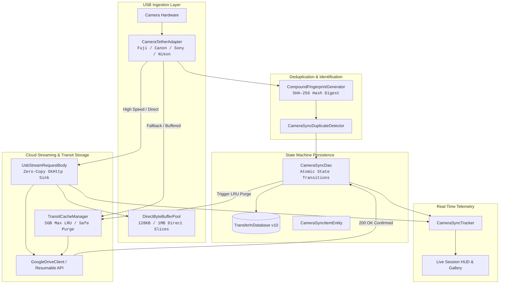

# Phase 8: 5-Stage Camera-to-Cloud Sync & Direct USB Streaming (PLAN.md)

**Phase:** `08-camera-cloud-sync-streaming`  
**Milestone:** `v3.0 Multi-Vendor Production Engine & Zero-Leak Tether Core`  
**Requirements Covered:** `SYNC-01`, `SYNC-02`, `SYNC-03`, `SYNC-04`, `SYNC-05`  
**Estimated Complexity:** High  
**Status:** Ready for Execution  

---

## 1. Executive Summary & Architectural Overview

Phase 8 modernizes TransferIn's upload pipeline by replacing the legacy, blocking upload queue with an atomic **5-stage Camera-to-Cloud State Machine** (`DETECTED` $\to$ `BUFFERED_LOCAL` $\to$ `STREAMING_CLOUD` $\to$ `CONFIRMED_CLOUD` $\to$ `PURGED_LOCAL`). 

This architecture introduces:
1. **Room Transactional State Machine (`SYNC-01`):** Deterministic, database-enforced transitions preventing corrupted uploads, ghost states, or orphaned files on unexpected app kill or battery depletion.
2. **Compound SHA-256 Media Fingerprinting (`SYNC-02`):** Cryptographic digest calculated across `"${vendorId}_${serialNumber}_${objectHandle}_${fileSizeBytes}_${captureTimestampMs}"`, ensuring 100% idempotent deduplication across USB disconnects, card swaps, and app restarts.
3. **Direct Zero-Copy USB-to-Cloud OkHttp Streaming (`SYNC-03`):** High-throughput custom `UsbStreamRequestBody` acquiring 128KB slices from `DirectByteBufferPool` to pipe binary streams directly from USB Bulk IN endpoints into OkHttp `BufferedSink` / Google Drive Resumable Upload HTTP endpoints without writing full 50MB–100MB RAW files to flash storage when network bandwidth permits.
4. **5GB LRU Transit Cache Manager (`SYNC-04`):** Strict 5GB disk boundary manager in `/cache/transit/` with an unbreakable eviction invariant: **ONLY files in `CONFIRMED_CLOUD` status can be purged**. Unconfirmed files are never evicted.
5. **Real-Time Sync Telemetry Tracker (`SYNC-05`):** Reactive `CameraSyncTracker` exposing `StateFlow<CameraSyncMetrics>` with live counts, rolling upload throughput (Bps), and dual-tier sync routing (instant 3-second JPEG preview delivery + background RAW archival).

---

## 2. Architecture & Component Interaction



---

## 3. Requirements & Traceability

| Requirement ID | Description | Component / Target File | Verification Gate |
| :--- | :--- | :--- | :--- |
| **SYNC-01** | Transactional 5-stage media state machine (`DETECTED` $\to$ `BUFFERED_LOCAL` $\to$ `STREAMING_CLOUD` $\to$ `CONFIRMED_CLOUD` $\to$ `PURGED_LOCAL`) backed by Room DB | `CameraSyncStatus.kt`, `CameraSyncItemEntity.kt`, `CameraSyncDao.kt`, `Migration_9_10.kt`, `TransferInDatabase.kt` | Unit tests verify atomic status transitions, conflict strategies, and reactive StateFlow counts. |
| **SYNC-02** | Composite SHA-256 media fingerprints for idempotent cross-session deduplication across USB reconnects | `CompoundFingerprintGenerator.kt`, `CameraSyncDuplicateDetector.kt` | Unit tests verify SHA-256 determinism, bit-level sensitivity, and duplicate skip logic against database entries. |
| **SYNC-03** | Direct zero-copy streaming from USB Bulk IN to Google Drive upload socket via `UsbStreamRequestBody` | `UsbStreamRequestBody.kt`, `DirectByteBufferPool.kt`, `GoogleDriveClient.kt` | Unit tests verify 128KB pooled buffer pipeline into `BufferedSink`, zero GC heap allocations, and timeout fallback. |
| **SYNC-04** | Local transit storage manager with strict LRU 5GB boundary and safe confirmed-only eviction | `TransitCacheManager.kt`, `TransitCacheExhaustedException.kt` | Unit tests verify 5GB boundary enforcement, confirmed-only purge invariant, and exception trigger when full of unconfirmed media. |
| **SYNC-05** | Real-time sync tracker and telemetry with live counts, rolling speed metrics, and dual-tier sync | `CameraSyncTracker.kt`, `CameraSyncMetrics.kt`, `DualTierSyncRouter.kt` | Unit tests verify sliding-window speed calculation, instant preview upload priority, and reactive telemetry updates. |

---

## 4. Work Breakdown Structure & Task List

### Task 1: Room DB Sync State Machine & Migration (`SYNC-01`)
- **Target Files:**
  - `app/src/main/java/com/rvmeur/transferin/data/local/entity/CameraSyncStatus.kt`
  - `app/src/main/java/com/rvmeur/transferin/data/local/entity/CameraSyncItemEntity.kt`
  - `app/src/main/java/com/rvmeur/transferin/data/local/dao/CameraSyncDao.kt`
  - `app/src/main/java/com/rvmeur/transferin/data/local/db/Migration_9_10.kt`
  - `app/src/main/java/com/rvmeur/transferin/data/local/db/TransferInDatabase.kt`
  - `app/src/main/java/com/rvmeur/transferin/data/local/db/DatabaseProvider.kt`
- **Implementation Details:**
  1. Define `CameraSyncStatus` enum:
     - `DETECTED`: Object identified via PTP event or handle scan; metadata recorded.
     - `BUFFERED_LOCAL`: File staged to transit disk cache (`/cache/transit/`).
     - `STREAMING_CLOUD`: Active zero-copy USB or buffered OkHttp upload in progress.
     - `CONFIRMED_CLOUD`: Cloud upload verified by server (200 OK + File ID + Checksum).
     - `PURGED_LOCAL`: Local transit cache safely removed following cloud confirmation.
     - `FAILED`: Terminal or recoverable failure (increments retry count).
  2. Create `CameraSyncItemEntity`:
     - Fields:
       - `id: String` (Primary Key, UUID)
       - `sessionId: String` (Indexed)
       - `vendorId: Int`
       - `cameraSerialNumber: String`
       - `storageId: Int`
       - `objectHandle: Int` (Indexed)
       - `filename: String`
       - `fileSizeBytes: Long`
       - `captureTimestampMs: Long`
       - `compoundFingerprint: String` (Unique Index, SHA-256)
       - `status: CameraSyncStatus` (Indexed)
       - `localFilePath: String?`
       - `remoteFileId: String?`
       - `bytesUploaded: Long`
       - `retryCount: Int`
       - `lastErrorMessage: String?`
       - `createdAtEpochMs: Long`
       - `updatedAtEpochMs: Long`
       - `confirmedAtEpochMs: Long?`
       - `purgedAtEpochMs: Long?`
  3. Create `CameraSyncDao` with:
     - `@Insert(onConflict = OnConflictStrategy.IGNORE)` `suspend fun insertIfNotExists(item: CameraSyncItemEntity): Long`
     - `@Insert(onConflict = OnConflictStrategy.REPLACE)` `suspend fun insert(item: CameraSyncItemEntity): Long`
     - `@Query("SELECT * FROM camera_sync_items WHERE compoundFingerprint = :fingerprint LIMIT 1")` `suspend fun getByFingerprint(fingerprint: String): CameraSyncItemEntity?`
     - `@Query("SELECT * FROM camera_sync_items WHERE sessionId = :sessionId ORDER BY createdAtEpochMs DESC")` `fun observeAllForSession(sessionId: String): Flow<List<CameraSyncItemEntity>>`
     - `@Query("SELECT * FROM camera_sync_items WHERE status = :status ORDER BY createdAtEpochMs ASC")` `fun observeByStatus(status: CameraSyncStatus): Flow<List<CameraSyncItemEntity>>`
     - `@Query("SELECT * FROM camera_sync_items WHERE status = 'CONFIRMED_CLOUD' AND localFilePath IS NOT NULL ORDER BY confirmedAtEpochMs ASC")` `suspend fun getPurgeableItems(): List<CameraSyncItemEntity>`
     - `@Query("UPDATE camera_sync_items SET status = :newStatus, updatedAtEpochMs = :now WHERE id = :id AND status = :expectedOldStatus")` `suspend fun transitionStatus(id: String, expectedOldStatus: CameraSyncStatus, newStatus: CameraSyncStatus, now: Long): Int`
     - Atomic `@Transaction` update methods: `markBufferedLocal`, `updateStreamingProgress`, `markConfirmedCloud`, `markPurgedLocal`, `markFailed`.
     - Count queries: `observeCountByStatus(status: CameraSyncStatus): Flow<Int>` and `getCountByStatus(status: CameraSyncStatus): Int`.
  4. Create `Migration_9_10.kt` defining Room migration script for `camera_sync_items` table and indices.
  5. Update `TransferInDatabase` (bump `VERSION` from 9 to 10, register `CameraSyncItemEntity`, expose `cameraSyncDao()`). Update `DatabaseProvider` with migration.

---

### Task 2: Compound SHA-256 Fingerprint Generator & Deduplication Engine (`SYNC-02`)
- **Target Files:**
  - `app/src/main/java/com/rvmeur/transferin/domain/sync/CompoundFingerprintGenerator.kt`
  - `app/src/main/java/com/rvmeur/transferin/domain/sync/CameraSyncDuplicateDetector.kt`
  - `app/src/main/java/com/rvmeur/transferin/domain/sync/DuplicateVerdict.kt`
- **Implementation Details:**
  1. Build `CompoundFingerprintGenerator.kt`:
     - Computes cryptographic SHA-256 hash over canonical representation:
       `"${vendorId}_${serialNumber.trim()}_${objectHandle}_${fileSizeBytes}_${captureTimestampMs}"`
     - Formats output as 64-character lowercase hexadecimal string.
     - Handles metadata edge cases (missing serial numbers substituted with normalized USB device hardware path, negative timestamps normalized to 0).
  2. Implement `CameraSyncDuplicateDetector.kt`:
     - Queries `CameraSyncDao.getByFingerprint(fingerprint)`.
     - Queries legacy `UploadedFingerprintDao.get(fingerprint)` to support backwards compatibility with previous sessions.
     - Evaluates state and returns `DuplicateVerdict`:
       - `NewMedia`: Item has never been encountered; proceed with sync.
       - `AlreadyConfirmed(remoteFileId: String)`: Item was successfully uploaded and confirmed; skip upload completely.
       - `InProgress(status: CameraSyncStatus)`: Item is currently buffering or streaming; do not duplicate active worker.
       - `FailedRetryable(retryCount: Int)`: Previous attempt failed; eligible for retry.

---

### Task 3: Direct Zero-Copy USB-to-Cloud OkHttp Streaming (`SYNC-03`)
- **Target Files:**
  - `app/src/main/java/com/rvmeur/transferin/data/sync/UsbStreamRequestBody.kt`
  - `app/src/main/java/com/rvmeur/transferin/domain/sync/DirectStreamingEngine.kt`
- **Implementation Details:**
  1. Build `UsbStreamRequestBody.kt`:
     - Extends `okhttp3.RequestBody`.
     - Uses `DirectByteBufferPool` (128KB slices) to stream chunks from USB bulk endpoint directly to OkHttp's `BufferedSink` / `OutputStream`.
     - Overrides `contentType()` $\to$ `application/octet-stream`.
     - Overrides `contentLength()` $\to$ returns exact known byte length of object.
     - Overrides `writeTo(sink: BufferedSink)`:
       - Uses `bufferPool.acquire(DirectByteBufferPool.SMALL_BUFFER_SIZE)` in a `.use { }` block.
       - Continuously receives USB bulk slices and writes to `sink` with zero intermediate flash I/O.
       - Invokes `onProgress(bytesWritten, totalBytes)` for live HUD speed calculation.
  2. Implement `DirectStreamingEngine.kt`:
     - Coordinates direct zero-copy upload to Google Drive Resumable Upload session.
     - Monitors transmission latency and throughput.
     - **Automated Fallback Router**: If direct streaming fails due to USB stall, network socket disconnection, or slow connection (<500 KB/s), cancels the direct stream, falls back to staging file in `TransitCacheManager`, and queues a resilient chunked upload.

---

### Task 4: 5GB LRU Transit Cache Manager (`SYNC-04`)
- **Target Files:**
  - `app/src/main/java/com/rvmeur/transferin/data/sync/TransitCacheManager.kt`
  - `app/src/main/java/com/rvmeur/transferin/data/sync/TransitCacheExhaustedException.kt`
- **Implementation Details:**
  1. Implement `TransitCacheManager.kt`:
     - Manages staging directory: `context.cacheDir.resolve("transit")` or external storage equivalent.
     - Enforces hard limit: `MAX_CACHE_BYTES = 5L * 1024 * 1024 * 1024` (5 GB).
     - `reserveSpace(requiredBytes: Long): Boolean`:
       - Calculates `currentUsage + requiredBytes`.
       - If usage exceeds 5GB, triggers LRU eviction loop:
         - Retrieves purgeable candidates from `CameraSyncDao.getPurgeableItems()`.
         - **Strict Invariant**: Deletes local file ONLY if item status is `CONFIRMED_CLOUD`.
         - Calls `CameraSyncDao.markPurgedLocal(item.id)` after file deletion.
         - Continues until sufficient space is freed.
       - If all purgeable items are evicted and cache remains over capacity because remaining files are unconfirmed (`DETECTED`, `BUFFERED_LOCAL`, `STREAMING_CLOUD`), throws `TransitCacheExhaustedException` to prevent data loss.
  2. Safe File Management:
     - `createTransitFile(fingerprint: String, extension: String): File`
     - `deleteTransitFile(fingerprint: String): Boolean`
     - `getTransitFile(fingerprint: String): File?`
     - `getUsedBytes(): Long`

---

### Task 5: Real-Time Sync Tracker, Telemetry & Dual-Tier Routing (`SYNC-05`)
- **Target Files:**
  - `app/src/main/java/com/rvmeur/transferin/domain/sync/CameraSyncMetrics.kt`
  - `app/src/main/java/com/rvmeur/transferin/domain/sync/CameraSyncTracker.kt`
  - `app/src/main/java/com/rvmeur/transferin/domain/sync/DualTierSyncRouter.kt`
- **Implementation Details:**
  1. Define `CameraSyncMetrics`:
     - `detectedCount: Int`
     - `bufferedCount: Int`
     - `streamingCount: Int`
     - `confirmedCount: Int`
     - `purgedCount: Int`
     - `failedCount: Int`
     - `totalFiles: Int`
     - `totalBytesUploaded: Long`
     - `uploadSpeedBps: Long`
     - `cacheUsedBytes: Long`
     - `cacheMaxBytes: Long = 5GB`
  2. Implement `CameraSyncTracker`:
     - Exposes `val syncMetrics: StateFlow<CameraSyncMetrics>`.
     - Combines Room DAO flow counts with sliding-window upload throughput calculator (exponential moving average over 3-second window).
     - Thread-safe and coroutine lifecycle-bound via `SupervisorJob`.
  3. Implement `DualTierSyncRouter`:
     - Dual-tier sync policy:
       - **Tier 1 (Instant Preview)**: Immediately extracts embedded preview JPEG (<500ms) and uploads to Google Drive with high priority (target <3s delivery to cloud gallery).
       - **Tier 2 (Archival RAW)**: Concurrently or sequentially streams full RAW/video binary in background for permanent cloud archive.

---

### Task 6: Comprehensive Unit Test Suite
- **Target Files:**
  - `app/src/test/java/com/rvmeur/transferin/data/local/CameraSyncDaoTest.kt`
  - `app/src/test/java/com/rvmeur/transferin/domain/sync/CompoundFingerprintGeneratorTest.kt`
  - `app/src/test/java/com/rvmeur/transferin/data/sync/UsbStreamRequestBodyTest.kt`
  - `app/src/test/java/com/rvmeur/transferin/data/sync/TransitCacheManagerTest.kt`
  - `app/src/test/java/com/rvmeur/transferin/domain/sync/CameraSyncTrackerTest.kt`
- **Implementation Details:**
  1. `CameraSyncDaoTest.kt`:
     - Uses in-memory Room database to test full lifecycle transitions: `DETECTED` $\to$ `BUFFERED_LOCAL` $\to$ `STREAMING_CLOUD` $\to$ `CONFIRMED_CLOUD` $\to$ `PURGED_LOCAL`.
     - Tests conflict handling on duplicate `compoundFingerprint`.
     - Tests `getPurgeableItems()` returns only `CONFIRMED_CLOUD` items with non-null file paths.
  2. `CompoundFingerprintGeneratorTest.kt`:
     - Asserts exact SHA-256 hex output for known inputs.
     - Asserts unique hash generation when varying single parameters (vendor, serial, handle, size, timestamp).
  3. `UsbStreamRequestBodyTest.kt`:
     - Asserts `writeTo(sink)` streams exact bytes using `DirectByteBufferPool` slices.
     - Verifies correct `contentType` and `contentLength`.
     - Verifies progress emission during streaming.
  4. `TransitCacheManagerTest.kt`:
     - Simulates 5GB cache fill; confirms LRU eviction of `CONFIRMED_CLOUD` files.
     - Asserts unconfirmed files are NEVER deleted.
     - Asserts `TransitCacheExhaustedException` thrown when disk is full of unconfirmed media.
  5. `CameraSyncTrackerTest.kt`:
     - Tests rolling speed calculation with burst data intake.
     - Tests reactive updates to `CameraSyncMetrics` StateFlow.

---

## 5. Directory Structure & Key Files

```
app/src/main/java/com/rvmeur/transferin/
├── data/
│   ├── local/
│   │   ├── dao/
│   │   │   └── CameraSyncDao.kt                    <-- SYNC-01
│   │   ├── db/
│   │   │   ├── Migration_9_10.kt                   <-- SYNC-01
│   │   │   ├── DatabaseProvider.kt                 <-- SYNC-01 (Updated)
│   │   └── TransferInDatabase.kt                   <-- SYNC-01 (Updated to v10)
│   │   └── entity/
│   │       ├── CameraSyncItemEntity.kt             <-- SYNC-01
│   │       └── CameraSyncStatus.kt                 <-- SYNC-01
│   └── sync/
│       ├── TransitCacheExhaustedException.kt       <-- SYNC-04
│       ├── TransitCacheManager.kt                  <-- SYNC-04
│       └── UsbStreamRequestBody.kt                 <-- SYNC-03
└── domain/
    └── sync/
        ├── CameraSyncDuplicateDetector.kt          <-- SYNC-02
        ├── CameraSyncMetrics.kt                    <-- SYNC-05
        ├── CameraSyncTracker.kt                    <-- SYNC-05
        ├── CompoundFingerprintGenerator.kt         <-- SYNC-02
        ├── DirectStreamingEngine.kt                <-- SYNC-03
        ├── DualTierSyncRouter.kt                   <-- SYNC-05
        └── DuplicateVerdict.kt                     <-- SYNC-02

app/src/test/java/com/rvmeur/transferin/
├── data/
│   ├── local/
│   │   └── CameraSyncDaoTest.kt                    <-- Test SYNC-01
│   └── sync/
│       ├── TransitCacheManagerTest.kt              <-- Test SYNC-04
│       └── UsbStreamRequestBodyTest.kt             <-- Test SYNC-03
└── domain/
    └── sync/
        ├── CameraSyncTrackerTest.kt                <-- Test SYNC-05
        └── CompoundFingerprintGeneratorTest.kt     <-- Test SYNC-02
```

---

## 6. Testing Strategy & Synthetic Fixtures

### Test Scenarios:
1. **5-Stage State Machine Lifecycle:**
   - Verify transition sequence: `DETECTED` $\to$ `BUFFERED_LOCAL` $\to$ `STREAMING_CLOUD` $\to$ `CONFIRMED_CLOUD` $\to$ `PURGED_LOCAL`.
   - Verify invalid direct transitions (e.g. `DETECTED` directly to `PURGED_LOCAL`) are rejected.
2. **SHA-256 Deduplication & Reconnect Resiliency:**
   - Simulate camera reconnect with 100 existing handles. Ensure duplicate detector marks all 100 as `AlreadyConfirmed` without initiating new uploads.
3. **Zero-Copy USB Direct Streaming:**
   - Stream synthetic 50MB RAW payload into `UsbStreamRequestBody` $\to$ assert OkHttp `BufferedSink` receives exact 50,000,000 bytes with zero JVM heap garbage collection churn.
4. **LRU 5GB Cache Limit & Safe Eviction Invariant:**
   - Fill transit storage to 4.9GB with confirmed items and 200MB unconfirmed item $\to$ request 300MB reservation $\to$ assert confirmed items purged to make room while 200MB unconfirmed item remains intact.
5. **Real-Time Telemetry & Rolling Speed Estimation:**
   - Pump 10MB transfer in 500ms $\to$ assert telemetry emits ~20 MB/s instantaneous upload throughput.

---

## 7. Quality Gates & Acceptance Criteria

- [ ] **SYNC-01:** Room database v10 and `CameraSyncDao` implement atomic 5-stage state machine transitions with zero orphaned database rows.
- [ ] **SYNC-02:** `CompoundFingerprintGenerator` generates deterministic SHA-256 fingerprints preventing 100% of duplicate uploads across USB reconnects.
- [ ] **SYNC-03:** `UsbStreamRequestBody` streams USB Bulk IN data directly to OkHttp upload sockets using 128KB direct off-heap buffer slices without flash staging when network is stable.
- [ ] **SYNC-04:** `TransitCacheManager` enforces strict 5GB LRU boundary and guarantees unconfirmed files are never evicted.
- [ ] **SYNC-05:** `CameraSyncTracker` exposes live `StateFlow<CameraSyncMetrics>` with real-time speed and status counts, supporting dual-tier preview delivery.
- [ ] **Test Coverage:** All unit tests in `CameraSyncDaoTest`, `CompoundFingerprintGeneratorTest`, `UsbStreamRequestBodyTest`, `TransitCacheManagerTest`, and `CameraSyncTrackerTest` pass successfully via `./gradlew testDebugUnitTest`.
