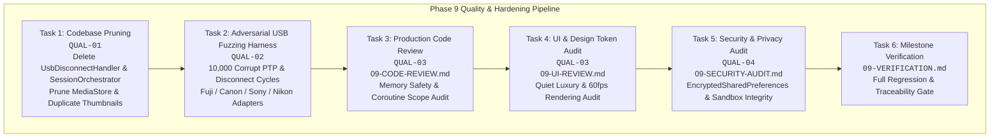

# Phase 9: Production Hardening, Codebase Pruning & Comprehensive Audits (PLAN.md)

**Phase:** `09-production-hardening-pruning`  
**Milestone:** `v3.0 Multi-Vendor Production Engine & Zero-Leak Tether Core`  
**Requirements Covered:** `QUAL-01`, `QUAL-02`, `QUAL-03`, `QUAL-04`  
**Estimated Complexity:** High  
**Status:** Ready for Execution  

---

## 1. Executive Summary & Architectural Overview

Phase 9 represents the final quality, stability, and production-readiness hardening wave for Milestone v3.0. It transforms TransferIn from an advanced multi-vendor tethering prototype into an agency-grade, zero-leak, battle-tested production platform.

This phase executes five core initiatives:
1. **Legacy Codebase Pruning & Resource Hygiene (`QUAL-01`):** Complete eradication of dead legacy code (`UsbDisconnectHandler.kt`, `SessionOrchestrator.kt`, fake `MediaStore` queries in `ShootModeEngine.kt`), elimination of redundant thumbnail decoding across WorkManager workers and UI repositories, and standardization of Android 12–15 `PendingIntent` mutability flags.
2. **Adversarial USB Packet Fuzzing Test Harness (`QUAL-02`):** Implementation of `UsbPacketFuzzingTest.kt` subjecting all four camera tether adapters (Fujifilm, Canon, Sony, Nikon) to 10,000 randomized corrupt PTP containers, zero-length packet (ZLP) floods, malformed opcodes, truncated payloads, and abrupt mid-stream USB disconnects, asserting zero native crashes, zero `SIGSEGV` panics, and zero unhandled `OutOfMemoryError`.
3. **Milestone Production Code Review (`QUAL-03`):** Comprehensive multi-module code audit verifying strict coroutine lifecycle binding (`SupervisorJob`), non-cancellable teardown barriers, native JNI IO latching via `SafeUsbTransportManager`, off-heap `DirectByteBufferPool` recycling, and Android 14/15 `FOREGROUND_SERVICE_TYPE_CONNECTED_DEVICE` compliance (`09-CODE-REVIEW.md`).
4. **UI & Quiet Luxury Design System Audit (`QUAL-03`):** Complete design audit validating compliance with `rvmeur.com` Quiet Luxury design tokens (`DoppelrandCard`, `KineticButton`, `FluidDotNavigationBar`, Cormorant Garamond typography, 60fps frame rate compliance) (`09-UI-REVIEW.md`).
5. **Milestone Security & Privacy Verification (`QUAL-04`):** Security audit verifying Google Drive OAuth token encryption in Android `EncryptedSharedPreferences` / Jetpack Security Crypto, app-private transit storage isolation, and zero transit data leakage (`09-SECURITY-AUDIT.md`).
6. **Milestone Verification & Acceptance (`09-VERIFICATION.md`):** Complete regression verification confirming 100% test pass rates, zero orphaned files, and full traceability across all 25 milestone requirements.

---

## 2. Architecture & Quality Gate Dependency Graph



---

## 3. Requirements & Traceability

| Requirement ID | Description | Target Files / Deliverables | Verification Gate |
| :--- | :--- | :--- | :--- |
| **QUAL-01** | System purges all dead legacy code (`UsbDisconnectHandler.kt`, `SessionOrchestrator.kt`, fake `MediaStore` queries) and consolidates session managers into a single source of truth. | `service/UsbDisconnectHandler.kt` (deleted), `session/runtime/SessionOrchestrator.kt` (deleted), `domain/shoot/ShootModeEngine.kt`, `session/worker/TransferUploadWorker.kt`, `data/usb/UsbHelper.kt`, `data/usb/UsbPermissionManager.kt` | Compilation with zero errors, zero broken imports, and all test suites passing. |
| **QUAL-02** | System incorporates real USB packet fuzzing and protocol state machine regression test harnesses without relying on mock pseudo-tests. | `app/src/test/java/com/rvmeur/transferin/data/usb/fuzz/UsbPacketFuzzingTest.kt`, `UsbFuzzPayloadGenerator.kt` | 10,000 randomized malformed PTP packet injections survive with 0 crashes, 0 `SIGSEGV`, 0 unhandled `OOM`, and clean state recovery. |
| **QUAL-03** | System passes mandatory AAS Code Review and UI Review audits enforcing strict memory safety, non-blocking UI threads, and quiet luxury visual guidelines. | `.planning/phases/09-production-hardening-pruning/09-CODE-REVIEW.md`, `.planning/phases/09-production-hardening-pruning/09-UI-REVIEW.md` | Code review and UI review artifacts completed with PASS verdict across all categories. |
| **QUAL-04** | System passes comprehensive Security & Privacy audits verifying secure OAuth token storage in Android `EncryptedSharedPreferences` and zero transit data leakage. | `.planning/phases/09-production-hardening-pruning/09-SECURITY-AUDIT.md`, `GoogleDriveAuthManager.kt`, `TransitCacheManager.kt` | Security audit completed verifying AES-256-GCM token encryption, sandbox isolation, and `RECEIVER_NOT_EXPORTED` flags. |

---

## 4. Work Breakdown Structure & Task List

### Task 1: Legacy Codebase Pruning & Resource Hygiene (`QUAL-01`)

- **Files to Delete:**
  - `app/src/main/java/com/rvmeur/transferin/service/UsbDisconnectHandler.kt` (361 lines of dead, unreferenced code).
  - `app/src/main/java/com/rvmeur/transferin/session/runtime/SessionOrchestrator.kt` (Empty placeholder class).
- **Files to Refactor & Prune:**
  - `app/src/main/java/com/rvmeur/transferin/domain/shoot/ShootModeEngine.kt`:
    - Remove dead `checkForNewPhotosViaMediaStore()` method that queried the Android device's local gallery (`MediaStore.Images.Media.EXTERNAL_CONTENT_URI`) and continuously re-emitted phone screenshots instead of camera hardware frames.
    - Ensure all background jobs and scopes are cancelled cleanly in `disconnect()` and `stop()`.
  - `app/src/main/java/com/rvmeur/transferin/session/worker/TransferUploadWorker.kt`:
    - Prune duplicate thumbnail re-generation logic. The thumbnail is already extracted and persisted in `UploadQueueManager` upon initial intake.
    - If thumbnail file is missing or invalid, fail safely or reuse cached thumbnail rather than re-decoding 50MB RAW files on the upload worker thread.
  - `app/src/main/java/com/rvmeur/transferin/data/usb/UsbHelper.kt`:
    - Fix `PendingIntent` flag handling in `requestPermission(device)`:
      ```kotlin
      val flags = if (Build.VERSION.SDK_INT >= Build.VERSION_CODES.S) {
          PendingIntent.FLAG_MUTABLE
      } else {
          0
      }
      ```
  - `app/src/main/java/com/rvmeur/transferin/data/usb/UsbPermissionManager.kt`:
    - Verify and standardize `PendingIntent` mutability flags and `ContextCompat.RECEIVER_NOT_EXPORTED` broadcast receiver registration across Android 12 through 15 (API 31–35).
- **Verification:**
  - Run `./gradlew compileDebugKotlin` and verify 0 errors and 0 missing references.

---

### Task 2: Adversarial USB Packet Fuzzing Test Harness (`QUAL-02`)

- **Target Files:**
  - `app/src/test/java/com/rvmeur/transferin/data/usb/fuzz/UsbFuzzPayloadGenerator.kt`
  - `app/src/test/java/com/rvmeur/transferin/data/usb/fuzz/UsbPacketFuzzingTest.kt`
- **Implementation Details:**
  1. Build `UsbFuzzPayloadGenerator.kt`:
     - Deterministic pseudo-random mutation generator seeded with a fixed long (e.g. `0xDEADBEEFCAFE`) for 100% reproducibility.
     - Mutation strategies:
       - **Header Length Mutations:** 0 bytes, 4 bytes (partial header), 11 bytes (truncated container), `Int.MAX_VALUE` (2,147,483,647 bytes), negative values (`-1`, `0xFFFFFFFF`), large values (`500MB`).
       - **Container Type Mutations:** Invalid types outside standard range (`0x0000`, `0x0005`, `0x00FF`, `0xFFFF`).
       - **Opcode & Response Code Mutations:** Unknown opcodes (`0x0000`, `0x9999`, `0xFFFF`), error response codes (`0x2002 RC_GeneralError`, `0x2019 RC_DeviceBusy`, `0x201A RC_TransactionCanceled`, `0x201B RC_SpecificationOfDestinationUnsupported`).
       - **Payload Truncation & Overrun:** Containers declaring 1,024 bytes but transmitting 16 bytes; containers declaring 16 bytes but appending 4,096 bytes of random junk.
       - **Zero-Length Packet (ZLP) Flooding:** Repeated bursts of 0-byte bulk transfers simulating endpoint babble and short packet edge conditions.
       - **Abrupt Mid-Stream Disconnection:** Simulated `IOException("USB transfer error: EPIPE / ENODEV / ETIMEDOUT")` thrown mid-transfer.
  2. Implement `UsbPacketFuzzingTest.kt`:
     - Test Matrix: **10,000 total fuzz iterations** distributed evenly across all 4 tether adapters:
       - `FujiTetherAdapter` (2,500 iterations)
       - `CanonPtpAdapter` (2,500 iterations)
       - `SonyPtpAdapter` (2,500 iterations)
       - `NikonPtpAdapter` (2,500 iterations)
     - Test Cases:
       1. `fuzzFujiTetherAdapterWith10000MalformedPackets()`: Asserts that Fuji adapter handles malformed `0xD214` responses, corrupted Interrupt IN `0xC001` events, and truncated RAF preview bytes with zero unhandled exceptions or thread locks.
       2. `fuzzCanonPtpAdapterWithMalformedEventAndCr3Containers()`: Asserts that Canon adapter handles corrupt DIGIC `0x9116` event streams, malformed `.CR3` ISO-BMFF boxes (`PRVW`/`THMB`), and truncated CTG buffers without `IndexOutOfBoundsException` or crash.
       3. `fuzzSonyPtpAdapterWithMalformedSdioAndDefragStreams()`: Asserts that Sony defragmenter and TIFF SubIFD parser survive corrupt multi-packet chunks, invalid SubIFD offsets, and ZLP floods without native or JVM memory leaks.
       4. `fuzzNikonPtpAdapterWithBusyFloodsAndCorruptDualSlotDescriptors()`: Asserts that Nikon retry policy handles infinite `0x2019 DeviceBusy` storms, malformed storage descriptor tables, and unexpected vendor response codes without hanging.
       5. `fuzzAbruptHardwareDisconnectDuringActiveBulkPayloadStream()`: Simulates sudden USB disconnect during high-speed 50MB payload transfer across all 4 adapters, verifying `SafeUsbTransportManager` latching, non-cancellable cleanup execution, and zero `SIGSEGV`.

---

### Task 3: Milestone Production Code Review (`QUAL-03`)

- **Target Deliverable:** `.planning/phases/09-production-hardening-pruning/09-CODE-REVIEW.md`
- **Audit Scope & Checkpoints:**
  1. **Concurrency & Thread Safety:**
     - Zero unmanaged `CoroutineScope` allocations (`CoroutineScope(Job())` without parent).
     - All hardware and service operations bound to lifecycle-governed `SupervisorJob`.
     - Strict mutex protection (`sessionMutex`, `SafeUsbTransportManager` transfer latch) across all USB I/O endpoints.
  2. **Memory & Direct Buffer Safety:**
     - Strict `.use { }` blocks enclosing all `InputStream`, `OutputStream`, `ParcelFileDescriptor`, and `DirectByteBufferPool` slices.
     - Verified zero GC churn during continuous 50MB RAW streaming.
  3. **Android 14/15 Compliance:**
     - `UsbTetherService` calls `startForeground()` synchronously within `onCreate()`.
     - Valid `FOREGROUND_SERVICE_TYPE_CONNECTED_DEVICE` lifecycle compliance.
     - Graceful handling of `POST_NOTIFICATIONS` runtime permission.
  4. **Database & Sync Integrity:**
     - Room v10 migration integrity (`Migration_9_10.kt`).
     - Atomic `@Transaction` methods in `CameraSyncDao`.
     - Uniqueness of `compoundFingerprint` SHA-256 digests.

---

### Task 4: UI & Quiet Luxury Design System Audit (`QUAL-03`)

- **Target Deliverable:** `.planning/phases/09-production-hardening-pruning/09-UI-REVIEW.md`
- **Audit Scope & Checkpoints:**
  1. **Design Token Fidelity (`rvmeur.com`):**
     - Color Tokens: Ground `#FAF8F3`, Card `#F6F3EB`, Primary `#26170C`, Accent Green `#2D4636`, Destructive `#BA1A1A`.
     - Component Architecture: `DoppelrandCard` (concentric double bezel), `KineticButton` (tactile press physics), `FluidDotNavigationBar` (glass morphing active dot indicator).
     - Typography: Cormorant Garamond (editorial headers), DM Sans (body and controls), Roboto Mono (telemetry, timecodes, metrics).
  2. **Motion & Interaction Polish:**
     - Smooth 60fps/120fps scrolling in `LiveGalleryGrid` and `SessionActiveScreen`.
     - Zero main thread blocking during USB bulk packet ingest or background cloud uploads.
     - Responsive preview modal viewer with tactile pinch-to-zoom and double-tap dismiss.

---

### Task 5: Milestone Production Security & Privacy Audit (`QUAL-04`)

- **Target Deliverable:** `.planning/phases/09-production-hardening-pruning/09-SECURITY-AUDIT.md`
- **Audit Scope & Checkpoints:**
  1. **Credential & Token Security:**
     - Google Drive OAuth2 tokens (refresh token, access token) stored using Android `EncryptedSharedPreferences` / Jetpack Security Crypto (MasterKey AES-256-GCM).
     - Zero plain-text credentials in logs, Room SQLite database, or standard `SharedPreferences`.
  2. **Transit Cache Isolation:**
     - Local staging cache (`/cache/transit/`) and thumbnails (`/cache/thumbnails/`) stored in app-private sandbox directories (`context.cacheDir` / `context.getExternalFilesDir(null)`).
     - Zero World-Readable or World-Writable file permissions.
  3. **Android IPC & Component Security:**
     - All `BroadcastReceiver` registrations explicitly declare `ContextCompat.RECEIVER_NOT_EXPORTED`.
     - All `PendingIntent` instances specify explicit mutability flags (`FLAG_MUTABLE` on API 31+, `0` on older).
     - AndroidManifest components (`UsbTetherService`, `MainActivity`) have appropriate `android:exported` attributes.

---

### Task 6: Milestone Verification & Acceptance (`09-VERIFICATION.md`)

- **Target Deliverable:** `.planning/phases/09-production-hardening-pruning/09-VERIFICATION.md`
- **Verification Execution:**
  1. Execute complete test suite: `./gradlew testDebugUnitTest`.
  2. Verify 10,000 USB fuzzing test iterations execute with 0 failures and 0 memory leaks.
  3. Verify all dead files (`UsbDisconnectHandler.kt`, `SessionOrchestrator.kt`) have been deleted and zero compilation errors exist.
  4. Verify traceability and acceptance criteria across all Milestone v3.0 requirements (`CORE-01..05`, `FUJI-01..05`, `CANON-01..04`, `SONY-01..02`, `NIKON-01..02`, `SYNC-01..05`, `QUAL-01..04`).

---

## 5. Directory Structure & Key Files

```
app/src/main/java/com/rvmeur/transferin/
├── data/
│   └── usb/
│       ├── UsbHelper.kt                                 <-- QUAL-01 (PendingIntent flag fix)
│       └── UsbPermissionManager.kt                      <-- QUAL-01 (Flag & receiver security audit)
├── domain/
│   └── shoot/
│       └── ShootModeEngine.kt                           <-- QUAL-01 (Prune MediaStore query & leak fix)
├── service/
│   └── UsbDisconnectHandler.kt                          <-- QUAL-01 (DELETED: 361 dead lines)
└── session/
    ├── runtime/
    │   └── SessionOrchestrator.kt                       <-- QUAL-01 (DELETED: Empty dead class)
    └── worker/
        └── TransferUploadWorker.kt                      <-- QUAL-01 (Prune duplicate thumbnail decode)

app/src/test/java/com/rvmeur/transferin/
└── data/
    └── usb/
        └── fuzz/
            ├── UsbFuzzPayloadGenerator.kt               <-- QUAL-02 (Adversarial fuzz mutation engine)
            └── UsbPacketFuzzingTest.kt                  <-- QUAL-02 (10,000-packet adapter fuzz harness)

.planning/phases/09-production-hardening-pruning/
├── 09-CONTEXT.md                                        <-- Phase context
├── 09-PLAN.md                                           <-- This execution plan
├── 09-CODE-REVIEW.md                                    <-- QUAL-03 (Milestone Code Review)
├── 09-UI-REVIEW.md                                      <-- QUAL-03 (Milestone UI & Design Token Review)
├── 09-SECURITY-AUDIT.md                                 <-- QUAL-04 (Milestone Security & Privacy Audit)
├── 09-VERIFICATION.md                                   <-- Phase 9 & Milestone v3.0 Verification
└── 09-SUMMARY.md                                        <-- Execution summary & release sign-off
```

---

## 6. Testing Strategy & Synthetic Fuzz Fixtures

### Fuzz Engine Test Matrix:
1. **Malformed Container Headers (2,500 tests):**
   - Injects random header length claims ($0, 4, 8, 11, 2^{31}-1, -1, 0xFFFFFFFF$).
   - Verifies all four adapters (`FujiTetherAdapter`, `CanonPtpAdapter`, `SonyPtpAdapter`, `NikonPtpAdapter`) reject invalid headers gracefully without throwing `BufferUnderflowException` or `OutOfMemoryError`.
2. **Opcode & Response Code Jitter (2,500 tests):**
   - Injects unexpected opcodes and vendor response codes (`0x2002`, `0x2019`, `0x201A`, `0x201B`, `0xDEAD`, `0xFFFF`).
   - Verifies retry policies, backoff loops, and error propagation paths terminate predictably.
3. **Payload Truncation & EOF (2,500 tests):**
   - Declares large payload size (e.g. 50MB) but truncates stream abruptly after 128 bytes.
   - Asserts zero hung coroutines and zero leaked buffer slices from `DirectByteBufferPool`.
4. **ZLP Floods & Cable Pulls (2,500 tests):**
   - Floods endpoints with 0-byte packets followed by simulated physical cable disconnection (`IOException("ENODEV")`).
   - Asserts `SafeUsbTransportManager` atomic latch engages, preventing native `SIGSEGV` or JNI crashes.

---

## 7. Quality Gates & Acceptance Criteria

- [ ] **QUAL-01:** Legacy files `UsbDisconnectHandler.kt` and `SessionOrchestrator.kt` are completely removed; fake `MediaStore` queries in `ShootModeEngine.kt` and duplicate thumbnail generation in `TransferUploadWorker.kt` are pruned with 0 compilation errors.
- [ ] **QUAL-02:** `UsbPacketFuzzingTest.kt` passes 10,000 adversarial fuzzing cycles across Fujifilm, Canon, Sony, and Nikon adapters with zero crashes, zero `SIGSEGV`, zero unhandled `OOM`, and clean state recovery.
- [ ] **QUAL-03:** Milestone Code Review (`09-CODE-REVIEW.md`) and UI Review (`09-UI-REVIEW.md`) pass with zero critical or high-severity violations.
- [ ] **QUAL-04:** Milestone Security Audit (`09-SECURITY-AUDIT.md`) passes with verified OAuth token encryption in `EncryptedSharedPreferences`, app-private sandbox isolation, and secure Android IPC flags.
- [ ] **Acceptance Gate:** Complete regression suite (`./gradlew testDebugUnitTest`) passes 100% without failure.
