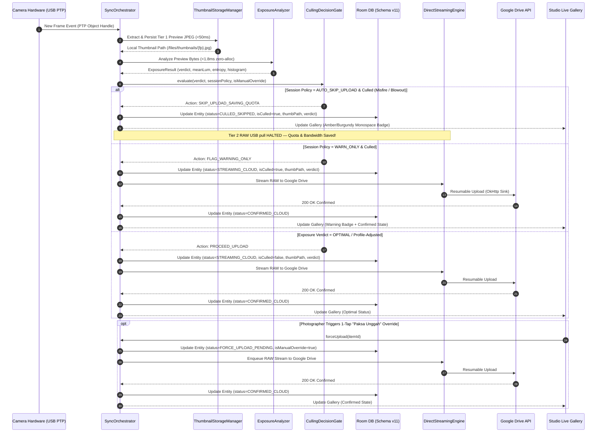

# Phase 12: Smart Culling State Machine, Room Migration & Quiet Luxury Studio UI (PLAN.md)

**Phase:** `12-smart-culling-state-machine-ui`  
**Milestone:** `v4.0 On-Device AI Exposure Analysis, Smart Culling & Reliable Thumbnailing Engine`  
**Requirements Covered:** `CULL-05`, `UI-01`, `UI-02`, `UI-03`, `UI-04`  
**Estimated Complexity:** High  
**Status:** Ready for Execution  

---

## 1. Executive Summary & Architectural Overview

Phase 12 connects the mathematical exposure analysis engine and persistent thumbnail storage into the transactional sync pipeline, database schema, and quiet luxury user interface.

During active high-speed tethered photoshoots, camera misfires (pitch-black frames from flash sync failure) and severe strobe misconfigurations (blown highlights) waste cellular bandwidth, saturate Google Drive cloud quota, and induce unnecessary USB bus contention. 

This phase introduces:
1. **Room Database Schema Migration 10 $\to$ 11 (`CULL-05`):** Non-destructive schema migration extending `camera_sync_items` and `camera_media_items` with `thumbnailPath`, `cullingVerdict`, `meanLuminance`, `entropyScore`, `isCulled`, and `isManualUploadOverride`, backed by automated migration tests.
2. **Quota-Saving State Machine & Decision Gate (`CULL-05`):** `CullingDecisionGate` evaluating session policies (`AUTO_SKIP_UPLOAD`, `WARN_ONLY`, `DISABLED`). In default `AUTO_SKIP_UPLOAD` mode, misfired/blown frames transition to `CULLED_SKIPPED`, immediately halting heavy Tier 2 RAW downloads over USB and cloud streaming sockets.
3. **Session Configuration in Setup Wizard (`CULL-05`):** `Step3SessionRules.kt` with double-bezel quiet luxury cards allowing photographers to configure culling rules prior to shooting (defaulting to Quota-First Protection).
4. **Quiet Luxury Badges & Responsive Filter Chips (`UI-01`, `UI-04`):** `UploadedGalleryScreen` and `DoppelrandCard` featuring subtle Monospace pills (Warm Amber `#B8860B` for underexposure, Deep Burgundy `#8B0000` for blown highlights, Roboto Mono 9sp) and live-count filter chips (`semua`, `optimal`, `terpangkas`, `dilewati`).
5. **1-Tap Kinetic "Paksa Unggah" Override (`UI-02`):** Zero-friction, single-tap kinetic press and swipe gesture allowing instant manual upload of any culled or skipped photo without interrupting the photographer's shooting rhythm.
6. **Full-Screen Dark Inspection Modal & Real-Time Histogram Curve (`UI-03`):** High-fidelity modal viewer (`Color(0xEE12100E)`) featuring pinch-to-zoom preview, live Canvas 256-bin luminance histogram curve overlay, EXIF metadata readout HUD (ISO, shutter, aperture, film simulation), and culling controls.

---

## 2. Architecture & State Machine Sequence Flow



---

## 3. Requirements & Traceability Matrix

| Requirement ID | Description | Target Files / Modules | Verification Gate |
| :--- | :--- | :--- | :--- |
| **CULL-05** | User can configure session culling rules (`AUTO_SKIP_UPLOAD`, `WARN_ONLY`, `DISABLED`), with `AUTO_SKIP_UPLOAD` halting Tier 2 RAW USB transfer and saving cloud quota. | `CullingPolicy.kt`, `CullingDecisionGate.kt`, `SyncOrchestrator.kt`, `Step3SessionRules.kt`, `CameraSyncStatus.kt`, `Migration_10_11.kt` | Unit tests verify decision matrix, Tier 2 transfer abort on `AUTO_SKIP_UPLOAD`, and Room migration v10 $\to$ v11. |
| **UI-01** | Media gallery displays quiet luxury status badges on `DoppelrandCard` containers (warm amber `#B8860B` for underexposure, deep burgundy `#8B0000` for blown highlights) with subtle monospace typography. | `CullingStatusBadge.kt`, `DoppelrandCard.kt`, `UploadedGalleryScreen.kt`, `Color.kt` | Compose UI tests verify badge rendering, color tokens, and Roboto Mono 9sp styling. |
| **UI-02** | User can perform 1-tap kinetic "Paksa Unggah" (Force Upload Anyway) override action or swipe gesture to manually upload any culled/skipped photo to Google Drive. | `UploadedGalleryScreen.kt`, `ExposureInspectionModal.kt`, `GalleryViewModel.kt`, `SyncOrchestrator.kt` | UI tests assert 1-tap kinetic press dispatches force upload and transitions entity to `FORCE_UPLOAD_PENDING` without modal dialogs. |
| **UI-03** | User can inspect any captured photo in a full-screen dark modal viewer (`Color(0xEE12100E)`) featuring high-fidelity preview zoom, live 256-bin luminance histogram curve overlay, EXIF metadata readout, and culling status toggle. | `ExposureInspectionModal.kt`, `ExposureHistogramCanvas.kt`, `UploadedGalleryScreen.kt` | Compose UI tests verify modal visibility, Canvas Bézier histogram curve drawing, and EXIF HUD rendering. |
| **UI-04** | Media gallery provides responsive filter chips for `semua`, `optimal`, `terpangkas`, and `dilewati` with live item counts and batch actions. | `GalleryUiState.kt`, `GalleryViewModel.kt`, `UploadedGalleryScreen.kt` | Unit & UI tests assert accurate live item filtering and badge counts across dynamic intake. |

---

## 4. Work Breakdown Structure & Atomic Tasks

### Task 1: Room Database Schema Migration v10 $\to$ v11 (`CULL-05`)
- **Target Files:**
  - `app/src/main/java/com/rvmeur/transferin/data/local/entity/CameraSyncStatus.kt`
  - `app/src/main/java/com/rvmeur/transferin/data/local/entity/CameraSyncItemEntity.kt`
  - `app/src/main/java/com/rvmeur/transferin/data/local/entity/CameraMediaItemEntity.kt`
  - `app/src/main/java/com/rvmeur/transferin/data/local/dao/CameraSyncDao.kt`
  - `app/src/main/java/com/rvmeur/transferin/data/local/db/Migration_10_11.kt`
  - `app/src/main/java/com/rvmeur/transferin/data/local/db/TransferInDatabase.kt`
  - `app/src/main/java/com/rvmeur/transferin/data/local/db/DatabaseProvider.kt`
  - `app/src/androidTest/java/com/rvmeur/transferin/data/local/db/DatabaseMigrationTest.kt`
- **Implementation Details:**
  1. Extend `CameraSyncStatus` enum with:
     - `CULLED_SKIPPED`: Frame flagged by culling engine; Tier 2 RAW transfer skipped to save cloud quota.
     - `FORCE_UPLOAD_PENDING`: Manual "Paksa Unggah" override triggered; enqueued for forced cloud transmission.
  2. Update `CameraSyncItemEntity`:
     - Add fields:
       - `thumbnailPath: String? = null`
       - `cullingVerdict: String = "OPTIMAL"`
       - `meanLuminance: Double = 128.0`
       - `entropyScore: Double = 5.0`
       - `isCulled: Boolean = false`
       - `isManualUploadOverride: Boolean = false`
  3. Update `CameraMediaItemEntity`:
     - Add fields: `cullingVerdict: String = "OPTIMAL"`, `meanLuminance: Double = 128.0`, `entropyScore: Double = 5.0`, `isCulled: Boolean = false`, `isManualUploadOverride: Boolean = false`.
  4. Create `Migration_10_11.kt`:
     - Execute `ALTER TABLE camera_sync_items ADD COLUMN thumbnailPath TEXT`
     - Execute `ALTER TABLE camera_sync_items ADD COLUMN cullingVerdict TEXT NOT NULL DEFAULT 'OPTIMAL'`
     - Execute `ALTER TABLE camera_sync_items ADD COLUMN meanLuminance REAL NOT NULL DEFAULT 128.0`
     - Execute `ALTER TABLE camera_sync_items ADD COLUMN entropyScore REAL NOT NULL DEFAULT 5.0`
     - Execute `ALTER TABLE camera_sync_items ADD COLUMN isCulled INTEGER NOT NULL DEFAULT 0`
     - Execute `ALTER TABLE camera_sync_items ADD COLUMN isManualUploadOverride INTEGER NOT NULL DEFAULT 0`
     - Execute `ALTER TABLE camera_media_items ADD COLUMN cullingVerdict TEXT NOT NULL DEFAULT 'OPTIMAL'`
     - Execute `ALTER TABLE camera_media_items ADD COLUMN meanLuminance REAL NOT NULL DEFAULT 128.0`
     - Execute `ALTER TABLE camera_media_items ADD COLUMN entropyScore REAL NOT NULL DEFAULT 5.0`
     - Execute `ALTER TABLE camera_media_items ADD COLUMN isCulled INTEGER NOT NULL DEFAULT 0`
     - Execute `ALTER TABLE camera_media_items ADD COLUMN isManualUploadOverride INTEGER NOT NULL DEFAULT 0`
  5. Update `TransferInDatabase`:
     - Bump `VERSION` from 10 to 11.
  6. Update `DatabaseProvider`:
     - Register `Migration_10_11.MIGRATION_10_11`.
  7. Extend `CameraSyncDao`:
     - Add `@Query("UPDATE camera_sync_items SET status = 'CULLED_SKIPPED', cullingVerdict = :verdict, meanLuminance = :meanLum, entropyScore = :entropy, isCulled = 1, thumbnailPath = :thumbPath, updatedAtEpochMs = :now WHERE id = :id")` `suspend fun markCulledSkipped(...)`
     - Add `@Query("UPDATE camera_sync_items SET status = 'FORCE_UPLOAD_PENDING', isCulled = 0, isManualUploadOverride = 1, updatedAtEpochMs = :now WHERE id = :id")` `suspend fun markForceUploadOverride(...)`
     - Add `@Query("SELECT * FROM camera_sync_items WHERE sessionId = :sessionId AND isCulled = 1 ORDER BY createdAtEpochMs DESC")` `fun observeCulledForSession(sessionId: String): Flow<List<CameraSyncItemEntity>>`
     - Add `@Query("SELECT * FROM camera_sync_items WHERE sessionId = :sessionId AND status = 'CULLED_SKIPPED' ORDER BY createdAtEpochMs DESC")` `fun observeSkippedForSession(sessionId: String): Flow<List<CameraSyncItemEntity>>`
     - Add `@Query("SELECT * FROM camera_sync_items WHERE sessionId = :sessionId AND isCulled = 0 ORDER BY createdAtEpochMs DESC")` `fun observeOptimalForSession(sessionId: String): Flow<List<CameraSyncItemEntity>>`
     - Add `@Query("SELECT COUNT(*) FROM camera_sync_items WHERE sessionId = :sessionId AND isCulled = 1")` `fun observeCulledCount(sessionId: String): Flow<Int>`
  8. Write migration test in `DatabaseMigrationTest.kt`:
     - `migrate10To11()`: Inserts sample records in v10, executes `Migration_10_11`, and asserts all existing columns are preserved and new culling columns have expected defaults.
- **Verification:** `./gradlew testDebugUnitTest` and `./gradlew connectedAndroidTest`.

---

### Task 2: `CullingDecisionGate.kt` & `SyncOrchestrator.kt` Integration (`CULL-05`)
- **Target Files:**
  - `app/src/main/java/com/rvmeur/transferin/domain/culling/CullingPolicy.kt`
  - `app/src/main/java/com/rvmeur/transferin/domain/culling/CullingVerdict.kt`
  - `app/src/main/java/com/rvmeur/transferin/domain/culling/CullingAction.kt`
  - `app/src/main/java/com/rvmeur/transferin/domain/culling/CullingDecisionGate.kt`
  - `app/src/main/java/com/rvmeur/transferin/domain/sync/SyncOrchestrator.kt`
  - `app/src/test/java/com/rvmeur/transferin/domain/culling/CullingDecisionGateTest.kt`
  - `app/src/test/java/com/rvmeur/transferin/domain/sync/SyncOrchestratorTest.kt`
- **Implementation Details:**
  1. Define domain models:
     - `CullingPolicy`: `AUTO_SKIP_UPLOAD` (Default: Quota-First Protection), `WARN_ONLY` (Warning badge only; upload continues), `DISABLED` (Bypass culling evaluation).
     - `CullingVerdict`: `OPTIMAL`, `UNDEREXPOSED_CRITICAL` (Flash misfire), `OVEREXPOSED_BLOWN` (Blown highlights), `DYNAMIC_PROFILE_ADJUSTED` (High-contrast B&W film simulation).
     - `CullingAction`: `PROCEED_UPLOAD`, `SKIP_UPLOAD_SAVING_QUOTA`, `FLAG_WARNING_ONLY`.
  2. Implement `CullingDecisionGate.kt`:
     ```kotlin
     class CullingDecisionGate {
         fun evaluate(
             verdict: CullingVerdict,
             policy: CullingPolicy,
             isManualOverride: Boolean = false
         ): CullingAction {
             if (isManualOverride || policy == CullingPolicy.DISABLED) {
                 return CullingAction.PROCEED_UPLOAD
             }
             return when (verdict) {
                 CullingVerdict.OPTIMAL,
                 CullingVerdict.DYNAMIC_PROFILE_ADJUSTED -> CullingAction.PROCEED_UPLOAD
                 CullingVerdict.UNDEREXPOSED_CRITICAL,
                 CullingVerdict.OVEREXPOSED_BLOWN -> {
                     when (policy) {
                         CullingPolicy.AUTO_SKIP_UPLOAD -> CullingAction.SKIP_UPLOAD_SAVING_QUOTA
                         CullingPolicy.WARN_ONLY -> CullingAction.FLAG_WARNING_ONLY
                         CullingPolicy.DISABLED -> CullingAction.PROCEED_UPLOAD
                     }
                 }
             }
         }
     }
     ```
  3. Implement `SyncOrchestrator.kt`:
     - Coordinates intake, thumbnail preview persistence, exposure evaluation, decision gating, and Tier 2 streaming.
     - When `CullingAction.SKIP_UPLOAD_SAVING_QUOTA`:
       - Invokes `cameraSyncDao.markCulledSkipped(...)`
       - Skips calling `DirectStreamingEngine` for the Tier 2 RAW payload.
       - Logs quota savings and emits telemetry update.
     - When `CullingAction.PROCEED_UPLOAD` or `FLAG_WARNING_ONLY`:
       - Invokes `cameraSyncDao.transitionStatus(..., STREAMING_CLOUD)`
       - Triggers `DirectStreamingEngine.streamWithFallback(...)`
       - On cloud confirmation, marks `CONFIRMED_CLOUD`.
     - `forceUpload(itemId)` method:
       - Invokes `cameraSyncDao.markForceUploadOverride(itemId)`
       - Immediately queues item into `DirectStreamingEngine` for cloud upload.
  4. Build Unit Tests:
     - `CullingDecisionGateTest.kt`: Tests all combinations of `CullingVerdict`, `CullingPolicy`, and `isManualOverride`.
     - `SyncOrchestratorTest.kt`: Mocks hardware intake and asserts that `AUTO_SKIP_UPLOAD` halts Tier 2 RAW transfer on `UNDEREXPOSED_CRITICAL`, while `WARN_ONLY` continues upload.
- **Verification:** `./gradlew testDebugUnitTest --tests com.rvmeur.transferin.domain.culling.*` and `--tests com.rvmeur.transferin.domain.sync.SyncOrchestratorTest`.

---

### Task 3: `Step3SessionRules.kt` Setup Wizard Culling Rule Cards (`CULL-05`)
- **Target Files:**
  - `app/src/main/java/com/rvmeur/transferin/feature/wizard/steps/Step3SessionRules.kt`
  - `app/src/main/java/com/rvmeur/transferin/domain/model/ProjectSession.kt`
  - `app/src/main/java/com/rvmeur/transferin/data/local/entity/SessionEntity.kt`
- **Implementation Details:**
  1. Add `cullingPolicy: CullingPolicy = CullingPolicy.AUTO_SKIP_UPLOAD` to `SessionEntity` and `ProjectSession`.
  2. Update `Step3SessionRules.kt`:
     - Add Quiet Luxury Culling Rule Selector card (`DoppelrandCard`):
       - Header: `"kontrol smart culling & kuota"` in `CormorantGaramond` typography.
       - Subtitle: `"otomatis mendeteksi flash misfire dan highlight bocor untuk menghemat kuota cloud."`
       - Three selectable cards / options:
         1. **Auto-Skip Upload (Default):** `"lewati otomatis (hemat kuota)"` — Halts Tier 2 RAW upload for pitch-black misfires and blown highlights.
         2. **Warn Only:** `"peringatan saja (tetap unggah)"` — Displays badges in studio gallery but uploads all files unconditionally.
         3. **Disabled:** `"nonaktif"` — Disables exposure evaluation entirely.
       - Each option renders a quiet luxury radio pill with `AccentGreen` active indicator and Roboto Mono parameter descriptions.
     - Connects selected `CullingPolicy` into the session launch payload.
- **Verification:** Compose Preview and manual wizard flow verification.

---

### Task 4: `UploadedGalleryScreen.kt` & `DoppelrandCard.kt` Quiet Luxury Badges & Filter Chips (`UI-01`, `UI-04`)
- **Target Files:**
  - `app/src/main/java/com/rvmeur/transferin/ui/theme/Color.kt`
  - `app/src/main/java/com/rvmeur/transferin/feature/gallery/components/CullingStatusBadge.kt`
  - `app/src/main/java/com/rvmeur/transferin/feature/gallery/GalleryUiState.kt`
  - `app/src/main/java/com/rvmeur/transferin/feature/gallery/GalleryViewModel.kt`
  - `app/src/main/java/com/rvmeur/transferin/feature/gallery/UploadedGalleryScreen.kt`
- **Implementation Details:**
  1. Add Color Tokens in `Color.kt`:
     - `val BadgeWarmAmber = Color(0xFFB8860B)` (Flash misfire / underexposure alert)
     - `val BadgeDeepBurgundy = Color(0xFF8B0000)` (Blown highlight / overexposure alert)
     - `val ModalDarkBackground = Color(0xEE12100E)` (Inspection modal canvas)
  2. Build `CullingStatusBadge.kt`:
     - Displays subtle monospace pill in top corner of media card:
       - `UNDER`: Warm Amber background (`BadgeWarmAmber`), white text, `RobotoMono` 9sp, bold.
       - `BLOWN`: Deep Burgundy background (`BadgeDeepBurgundy`), white text, `RobotoMono` 9sp, bold.
       - `SKIPPED`: Charcoal taupe background with strike-through icon indicating upload halted.
       - `FORCE`: Forest Emerald background (`AccentGreen`) indicating manual override active.
  3. Extend `GalleryUiState.kt` & `FilterMode`:
     ```kotlin
     enum class FilterMode {
         ALL,
         OPTIMAL,
         CULLED,
         SKIPPED
     }
     
     data class CullingMetrics(
         val totalCount: Int = 0,
         val optimalCount: Int = 0,
         val culledCount: Int = 0,
         val skippedCount: Int = 0,
         val quotaSavedBytes: Long = 0L
     )
     ```
  4. Extend `GalleryViewModel.kt`:
     - Observe `CameraSyncDao` items with culling metadata.
     - Compute live filter counts: `semua (total)`, `optimal (optimalCount)`, `terpangkas (culledCount)`, `dilewati (skippedCount)`.
     - Expose filter mode selector `setFilterMode(FilterMode)`.
  5. Update `UploadedGalleryScreen.kt`:
     - Horizontal `LazyRow` filter chips with active `AccentGreen` background and pill count badges:
       - `"semua (X)"`, `"optimal (Y)"`, `"terpangkas (Z)"`, `"dilewati (W)"`.
     - Render `CullingStatusBadge` on each `DoppelrandCard` thumbnail.
- **Verification:** Compose UI tests asserting badge visibility, correct color palette, and filter chip filtering.

---

### Task 5: 1-Tap Kinetic Press "Paksa Unggah" Override Action & Swipe Gesture (`UI-02`)
- **Target Files:**
  - `app/src/main/java/com/rvmeur/transferin/feature/gallery/UploadedGalleryScreen.kt`
  - `app/src/main/java/com/rvmeur/transferin/feature/gallery/GalleryViewModel.kt`
  - `app/src/main/java/com/rvmeur/transferin/feature/gallery/components/ExposureInspectionModal.kt`
- **Implementation Details:**
  1. Add 1-Tap Kinetic Force Upload Action on Thumbnail Card:
     - On culled/skipped cards (`status == CULLED_SKIPPED` or `isCulled == true`), display a subtle quick-action overlay or tap trigger.
     - Tap triggers `viewModel.forceUpload(item.id)` with zero blocking dialogs.
     - Uses `KineticButton` physics (scale down to 0.96f on press, 150ms spring rebound).
  2. Implement Swipe Gesture in Inspection Modal:
     - Vertical swipe up or horizontal kinetic action in `ExposureInspectionModal` triggers "Paksa Unggah".
     - Tactile haptic feedback on trigger.
  3. In `GalleryViewModel.kt`:
     - `fun forceUpload(itemId: String)`: Calls `syncOrchestrator.forceUpload(itemId)` or updates `cameraSyncDao.markForceUploadOverride(itemId)`.
     - Optimistically updates UI state to reflect `FORCE_UPLOAD_PENDING`.
- **Verification:** Unit test asserting `forceUpload` sets `isManualUploadOverride = true` and enqueues cloud stream.

---

### Task 6: Full-Screen Dark Modal Inspection Viewer with Live Histogram & EXIF HUD (`UI-03`)
- **Target Files:**
  - `app/src/main/java/com/rvmeur/transferin/feature/gallery/components/ExposureHistogramCanvas.kt`
  - `app/src/main/java/com/rvmeur/transferin/feature/gallery/components/ExposureInspectionModal.kt`
  - `app/src/main/java/com/rvmeur/transferin/feature/gallery/UploadedGalleryScreen.kt`
- **Implementation Details:**
  1. Build `ExposureHistogramCanvas.kt`:
     - Custom Compose `Canvas` drawing interactive 256-bin luminance histogram curve.
     - Uses cubic Bézier curve smoothing across normalized bin heights ($0..255$).
     - Shaded gradient under curve (`Brush.verticalGradient` with subtle amber/burgundy/emerald accents).
     - Overlay guidelines for shadow clipping ($Y \le 3$) and highlight blowout ($Y \ge 248$).
     - Readout text: Mean Luminance $\bar{Y}$, Shannon Entropy $H$, Sensor Black Floor $\%$, Highlight Clip $\%$.
  2. Build `ExposureInspectionModal.kt`:
     - Modal overlay with `Color(0xEE12100E)` background.
     - High-fidelity zoom and pan image preview using `Modifier.pointerInput` transform gestures (scale $1.0\times$ to $4.0\times$).
     - Collapsible EXIF HUD overlay:
       - Monospace badges: ISO, Shutter Speed (e.g. `1/250s`), Aperture (e.g. `f/2.8`), Focal Length (e.g. `50mm`), Camera Model, Film Simulation (e.g. `Acros+R`).
     - Live Exposure Histogram overlay at bottom-left / toggleable HUD.
     - Primary action CTA: `KineticButton` with `"paksa unggah ke cloud"` (if culled/skipped) or `"unggah ulang"` / `"tutup pratinjau"`.
  3. Integrate into `UploadedGalleryScreen.kt`:
     - Tapping any media card opens `ExposureInspectionModal`.
     - Dismiss via close button, swipe down, or back button.
- **Verification:** Compose preview and UI tests asserting histogram curve rendering, EXIF HUD formatting, and zoom gesture responsiveness.

---

### Task 7: Compose UI Tests & State Flow Verification
- **Target Files:**
  - `app/src/test/java/com/rvmeur/transferin/feature/gallery/GalleryViewModelTest.kt`
  - `app/src/androidTest/java/com/rvmeur/transferin/feature/gallery/UploadedGalleryScreenTest.kt`
  - `app/src/androidTest/java/com/rvmeur/transferin/feature/gallery/ExposureInspectionModalTest.kt`
- **Implementation Details:**
  1. `GalleryViewModelTest.kt`:
     - Tests dynamic filtering across `ALL`, `OPTIMAL`, `CULLED`, `SKIPPED`.
     - Tests live badge count updates as new items arrive.
     - Tests `forceUpload` transitions and repository invocations.
  2. `UploadedGalleryScreenTest.kt`:
     - Asserts warm amber and deep burgundy monospace badges appear on culled items.
     - Asserts filter chips update active selection and filter items accordingly.
     - Asserts tapping a card launches the modal viewer.
  3. `ExposureInspectionModalTest.kt`:
     - Asserts modal renders EXIF metadata correctly.
     - Asserts Canvas histogram is composed without crashes.
     - Asserts tapping "Paksa Unggah" fires the override callback and updates button state.
- **Verification:** `./gradlew testDebugUnitTest` and `./gradlew connectedAndroidTest`.

---

## 5. Directory Structure & Key Files

```
app/src/main/java/com/rvmeur/transferin/
├── data/
│   └── local/
│       ├── dao/
│       │   └── CameraSyncDao.kt                               <-- Task 1 (Updated with culling queries)
│       ├── db/
│       │   ├── DatabaseProvider.kt                           <-- Task 1 (Registers Migration_10_11)
│       │   ├── Migration_10_11.kt                            <-- Task 1 (Room Migration 10 -> 11)
│       │   └── TransferInDatabase.kt                         <-- Task 1 (Updated to v11)
│       └── entity/
│           ├── CameraMediaItemEntity.kt                      <-- Task 1 (Culling fields)
│           ├── CameraSyncItemEntity.kt                       <-- Task 1 (Culling & thumbnail fields)
│           └── CameraSyncStatus.kt                           <-- Task 1 (CULLED_SKIPPED, FORCE_UPLOAD)
├── domain/
│   ├── culling/
│   │   ├── CullingAction.kt                                  <-- Task 2 (PROCEED / SKIP / WARN)
│   │   ├── CullingDecisionGate.kt                            <-- Task 2 (Pure rule evaluator)
│   │   ├── CullingPolicy.kt                                  <-- Task 2 (AUTO_SKIP / WARN / DISABLED)
│   │   └── CullingVerdict.kt                                 <-- Task 2 (OPTIMAL / UNDER / BLOWN)
│   └── sync/
│       └── SyncOrchestrator.kt                               <-- Task 2 (Tier 2 transfer gating)
├── feature/
│   ├── gallery/
│   │   ├── GalleryUiState.kt                                 <-- Task 4 (Culling filter modes & metrics)
│   │   ├── GalleryViewModel.kt                               <-- Task 4 & 5 (Live counts & force upload)
│   │   ├── UploadedGalleryScreen.kt                          <-- Task 4 & 6 (Badges, chips, modal host)
│   │   └── components/
│   │       ├── CullingStatusBadge.kt                         <-- Task 4 (Monospace Amber/Burgundy pill)
│   │       ├── ExposureHistogramCanvas.kt                    <-- Task 6 (256-bin Bézier curve Canvas)
│   │       └── ExposureInspectionModal.kt                    <-- Task 6 (Dark inspection modal & EXIF HUD)
│   └── wizard/
│       └── steps/
│           └── Step3SessionRules.kt                          <-- Task 3 (Culling policy cards)
└── ui/
    └── theme/
        └── Color.kt                                          <-- Task 4 (BadgeWarmAmber, BadgeDeepBurgundy)

app/src/test/java/com/rvmeur/transferin/
├── domain/
│   ├── culling/
│   │   └── CullingDecisionGateTest.kt                        <-- Task 2 Test
│   └── sync/
│       └── SyncOrchestratorTest.kt                           <-- Task 2 Test
└── feature/
    └── gallery/
        └── GalleryViewModelTest.kt                           <-- Task 7 Test

app/src/androidTest/java/com/rvmeur/transferin/
├── data/
│   └── local/
│       └── db/
│           └── DatabaseMigrationTest.kt                      <-- Task 1 Migration Test (10 -> 11)
└── feature/
    └── gallery/
        ├── ExposureInspectionModalTest.kt                    <-- Task 7 UI Test
        └── UploadedGalleryScreenTest.kt                      <-- Task 7 UI Test
```

---

## 6. Testing Strategy & Synthetic Fixtures

### Test Scenarios & Verification Matrix:
1. **Room Migration 10 $\to$ 11 Integrity:**
   - Pre-populate v10 database with active session items and cloud-confirmed records.
   - Run `Migration_10_11`. Assert zero SQLite exceptions, column presence, and default value correctness (`cullingVerdict = 'OPTIMAL'`, `meanLuminance = 128.0`, `isCulled = 0`).
2. **Deterministic Culling Decision Gating:**
   - Input `UNDEREXPOSED_CRITICAL` under `AUTO_SKIP_UPLOAD` $\to$ assert `SKIP_UPLOAD_SAVING_QUOTA`.
   - Input `UNDEREXPOSED_CRITICAL` under `WARN_ONLY` $\to$ assert `FLAG_WARNING_ONLY`.
   - Input `UNDEREXPOSED_CRITICAL` under `DISABLED` $\to$ assert `PROCEED_UPLOAD`.
   - Input `isManualOverride = true` $\to$ assert `PROCEED_UPLOAD` regardless of policy or verdict.
3. **Tier 2 RAW Transfer Interception & Quota Savings:**
   - Simulate intake of 50MB pitch-black misfire $\to$ assert `SyncOrchestrator` marks status `CULLED_SKIPPED` and `DirectStreamingEngine` is NOT invoked.
   - Assert 50MB bandwidth and cloud quota are saved.
4. **1-Tap Kinetic Force Upload Override:**
   - Call `forceUpload(culledItemId)` $\to$ assert entity status transitions to `FORCE_UPLOAD_PENDING` and `DirectStreamingEngine` is immediately invoked.
5. **Gallery Filtering & Live Telemetry:**
   - Feed 10 items (6 optimal, 3 misfires, 1 blown highlight) $\to$ assert filter chips show `semua (10)`, `optimal (6)`, `terpangkas (4)`, `dilewati (4)`.
   - Switching filter modes filters grid items in 0ms without UI stutter.
6. **256-Bin Luminance Histogram Rendering:**
   - Feed synthetic 256-bin histogram fixture into `ExposureHistogramCanvas` $\to$ assert Canvas renders Bézier path without `IndexOutOfBoundsException` or graphical distortion.

---

## 7. Quality Gates & Acceptance Criteria

- [ ] **CULL-05 (State Machine & Migration):** Room database v11 migration succeeds seamlessly, and `SyncOrchestrator` halts Tier 2 RAW USB transfers when frames are culled under `AUTO_SKIP_UPLOAD`.
- [ ] **UI-01 (Quiet Luxury Warning Badges):** `DoppelrandCard` media cards render subtle Monospace badges (Warm Amber `#B8860B` for underexposure, Deep Burgundy `#8B0000` for blown highlights) in Roboto Mono 9sp.
- [ ] **UI-02 (Kinetic Force-Upload Override):** 1-tap kinetic press and swipe gesture immediately trigger "Paksa Unggah", transitioning status to `FORCE_UPLOAD_PENDING` without blocking dialogs.
- [ ] **UI-03 (Dark Modal Viewer & Live Histogram):** Full-screen dark modal (`Color(0xEE12100E)`) renders pinch-to-zoom preview, live 256-bin luminance histogram curve on Compose `Canvas`, and complete EXIF HUD.
- [ ] **UI-04 (Responsive Gallery Filters):** Filter chips (`semua`, `optimal`, `terpangkas`, `dilewati`) display live item counts and dynamically filter the gallery without recomposition jank.
- [ ] **Test Coverage:** All unit tests (`CullingDecisionGateTest`, `SyncOrchestratorTest`, `GalleryViewModelTest`) and migration tests (`DatabaseMigrationTest.migrate10To11`) pass successfully via `./gradlew testDebugUnitTest`.
