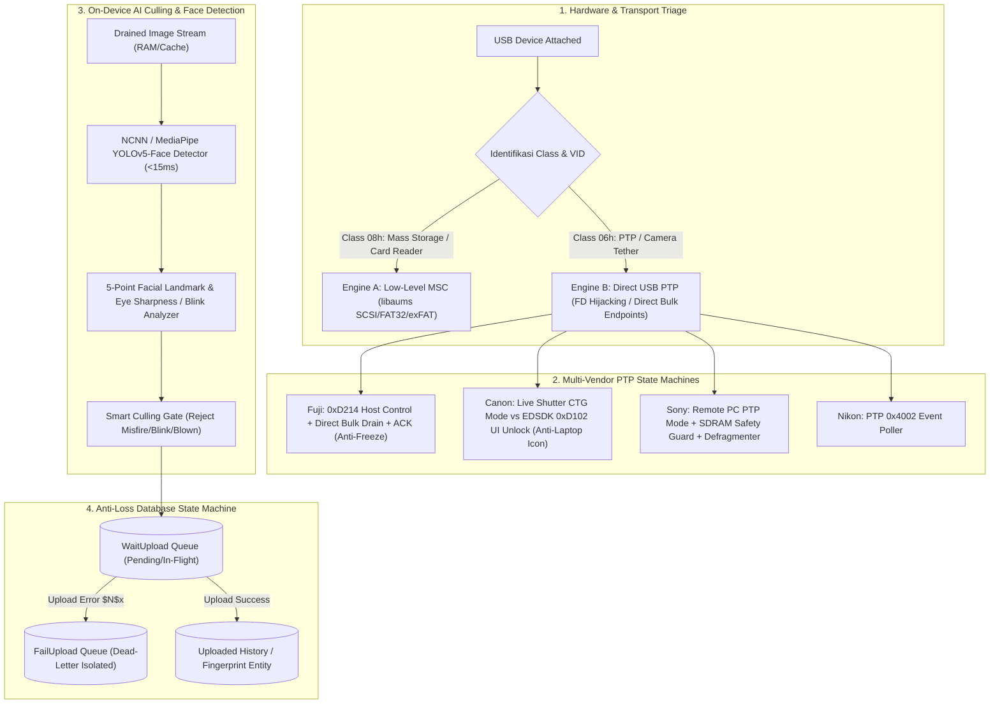

# Phase 14 Plan: Universal PTP Transport, Dual-Engine Storage, On-Device AI Culling & Resilient Pipeline

**Milestone:** v5.0 (Resilient Hardware Transport, Multi-Vendor PTP Orchestration & On-Device AI)  
**Phase:** 14  
**Title:** Universal PTP Transport, Dual-Engine Storage, On-Device AI Culling & Resilient Pipeline  
**Status:** Planned / Comprehensive Architecture Integration  
**Timestamp:** 2026-10-01T23:15:00+07:00  

---

## 1. Context & Architectural Insights (Forensic Lessons Learned)

Berdasarkan investigasi forensik terhadap kegagalan operasional di lapangan serta rekonstruksi komparatif terhadap binary Piufoto (`com.alltuu.android.godson`, `libportal0.1.so`, `libncnnyoloface.so`, `libeyeDetect.so`, `libusb-lib.so`, `alltuu_local_upload`):

---

## 2. Work Packages & Plan Waves

### Wave 1: Direct USB PTP Transport & Hardware Buffer Drain (Priority 1)
- [ ] **Task 14.1.1: Direct PTP Stream Drain di SessionViewModel (Anti-Freeze Fuji)**
  - Hapus pemanggilan `downloadMtpFile()` yang memicu tabrakan `MtpDevice` saat mode native PTP aktif.
  - Alirkan data byte langsung melalui `tetherAdapter.streamMedia(event.handle, tempFileStream)` dari USB Bulk IN endpoint.
  - Kirim ACK PTP vendor (`0x902B / 0xD215`) ke kamera Fujifilm segera setelah transfer tuntas agar firmware melepaskan buffer internal DRAM dan mematikan lampu indikator transfer.
  - *Files:* [`SessionViewModel.kt`](file:///Users/chiio/VSCode/TransferInFuji/app/src/main/java/com/rvmeur/transferin/feature/sessionactive/SessionViewModel.kt), [`FujiTetherAdapter.kt`](file:///Users/chiio/VSCode/TransferInFuji/app/src/main/java/com/rvmeur/transferin/data/usb/vendor/fuji/FujiTetherAdapter.kt).

- [ ] **Task 14.1.2: Canon Non-Locking Tether & UI Unlock Protocol**
  - Hapus pengiriman membabi buta `EOS_OC_SET_REMOTE_MODE (0x9114 = 1)` pada [`CannonCameraInitializer.kt`](file:///Users/chiio/VSCode/TransferInFuji/app/src/main/java/com/rvmeur/transferin/data/usb/vendor/CannonCameraInitializer.kt).
  - Implementasikan dual-mode:
    - *Mode Live Shutter (Default)*: Gunakan listener event MTP/CTG pasif tanpa mengklaim remote lock, menjaga shutter fisik kamera Canon tetap 100% responsif bagi fotografer.
    - *Mode EDSDK Remote Capture*: Jika remote capture diperlukan, sertakan urutan pelepasan UI lock `SetDevicePropValue` untuk `0xD102 (UI Lock = 0)` dan `0xD114 (Event Mode = 1)`.
  - *Files:* [`CannonCameraInitializer.kt`](file:///Users/chiio/VSCode/TransferInFuji/app/src/main/java/com/rvmeur/transferin/data/usb/vendor/CannonCameraInitializer.kt).

- [ ] **Task 14.1.3: Direct USB FD Hijacking Bridge (libusb Pattern)**
  - Bangun abstraction layer transport USB native yang membungkus `UsbDeviceConnection.getFileDescriptor()` menggunakan JNI/libusb (`libusb_wrap_sys_device`), memotong perantara `android.mtp.MtpDevice` yang lambat dan rawan deadlock.
  - *Files:* [`UsbHelper.kt`](file:///Users/chiio/VSCode/TransferInFuji/app/src/main/java/com/rvmeur/transferin/data/usb/UsbHelper.kt), [`SafeUsbTransportManager.kt`](file:///Users/chiio/VSCode/TransferInFuji/app/src/main/java/com/rvmeur/transferin/data/usb/core/SafeUsbTransportManager.kt).

---

### Wave 2: Dual-Engine Storage Architecture (PTP vs MSC Card Reader)
- [ ] **Task 14.2.1: Card Reader Mass Storage Engine (libaums Integration)**
  - Integrasikan library pembacaan block device USB Mass Storage (`libaums` / SCSI `READ_10`) untuk membaca memori kamera / OTG Card Reader berkecepatan tinggi tanpa protokol PTP.
  - Implementasikan traversal file FAT32/exFAT langsung di memori untuk mengurai folder `DCIM/` secara instan.
  - *Files:* [`ImportCameraEngine.kt`](file:///Users/chiio/VSCode/TransferInFuji/app/src/main/java/com/rvmeur/transferin/domain/session/ImportCameraEngine.kt), [`AutoStorageDetector.kt`](file:///Users/chiio/VSCode/TransferInFuji/app/src/main/java/com/rvmeur/transferin/data/storage/AutoStorageDetector.kt).

- [ ] **Task 14.2.2: PTP Recursive DCIM Object Enumeration (Existing Media Fix)**
  - Perbaiki *flat query* `parent = 0` di [`UsbHelper.kt`](file:///Users/chiio/VSCode/TransferInFuji/app/src/main/java/com/rvmeur/transferin/data/usb/UsbHelper.kt):
    - Implementasikan penelusuran rekursif `getObjectHandles(storageId, 0, folderHandle)` jika handle yang ditemukan adalah tipe direktori (format `0x3001` / association).
    - Tambahkan fallback enumerasi langsung via PTP Native Adapter saat `activeMtp` bernilai null.
  - *Files:* [`UsbHelper.kt`](file:///Users/chiio/VSCode/TransferInFuji/app/src/main/java/com/rvmeur/transferin/data/usb/UsbHelper.kt), [`CameraMediaRepositoryImpl.kt`](file:///Users/chiio/VSCode/TransferInFuji/app/src/main/java/com/rvmeur/transferin/data/repository/CameraMediaRepositoryImpl.kt).

---

### Wave 3: Lossless Filename & Deduplication State Machine
- [ ] **Task 14.3.1: Strict Case-Preserving Filename Engine**
  - Refaktor [`Fingerprint.kt`](file:///Users/chiio/VSCode/TransferInFuji/app/src/main/java/com/rvmeur/transferin/domain/shoot/Fingerprint.kt), [`NewShotDetector.kt`](file:///Users/chiio/VSCode/TransferInFuji/app/src/main/java/com/rvmeur/transferin/domain/shoot/NewShotDetector.kt), dan `MediaFingerprint`:
    - `toStorageKey()` hanya digunakan sebagai hash kunci identifikasi di database.
    - Properti `originalFileName` mempertahankan format penamaan asli kamera (`DSCF0001.JPG`, `IMG_1234.CR3`, `_DSF1002.RAF`) tanpa manipulasi `.lowercase()`.
  - *Files:* [`Fingerprint.kt`](file:///Users/chiio/VSCode/TransferInFuji/app/src/main/java/com/rvmeur/transferin/domain/shoot/Fingerprint.kt), [`CtgDatabaseParser.kt`](file:///Users/chiio/VSCode/TransferInFuji/app/src/main/java/com/rvmeur/transferin/domain/shoot/CtgDatabaseParser.kt), [`UploadQueueManager.kt`](file:///Users/chiio/VSCode/TransferInFuji/app/src/main/java/com/rvmeur/transferin/domain/session/UploadQueueManager.kt).

- [ ] **Task 14.3.2: Robust SQLite Queue State Machine (Alltuu-Inspired)**
  - Terapkan status transisi antrean atomik: `QUEUED` (0) $\rightarrow$ `IN_FLIGHT` (1) $\rightarrow$ `SUCCESS` (2) $\rightarrow$ `FAILED` (3).
  - Pindahkan file yang gagal upload secara persisten ke antrean *dead-letter* (`FailUpload`) agar tidak memblokir antrean foto baru yang masuk.
  - *Files:* [`UploadQueueManager.kt`](file:///Users/chiio/VSCode/TransferInFuji/app/src/main/java/com/rvmeur/transferin/domain/session/UploadQueueManager.kt), [`TransferQueueRepository.kt`](file:///Users/chiio/VSCode/TransferInFuji/app/src/main/java/com/rvmeur/transferin/domain/repository/TransferQueueRepository.kt).

---

### Wave 4: On-Device AI Face/Eye Detection & Smart Culling Engine
- [ ] **Task 14.4.1: Integrasi Open-Source On-Device Face & Eye Detector (NCNN / MediaPipe)**
  - Pasang engine inferensi lokal super-ringan berbasis **Tencent NCNN (YOLOv5-Face / SCRFD)** atau **Google MediaPipe Face Detection** (inferensi <15ms di CPU/NPU HP).
  - Ekstrak 5-point facial landmarks untuk analisis:
    - *Eye Open/Blink Ratio (EAR)*: Mendeteksi subjek yang berkedip/merem saat pemotretan.
    - *Face Sharpness / Blur Metric*: Mengukur Laplacian variance pada bounding box wajah.
  - *Files:* `app/src/main/java/com/rvmeur/transferin/domain/culling/AiFaceCullingEngine.kt`, `app/src/main/java/com/rvmeur/transferin/domain/culling/CullingDecisionGate.kt`.

- [ ] **Task 14.4.2: Automated Multi-Gate Culling Action**
  - Sambungkan output `ExposureAnalyzer` (Phase 10) dan `AiFaceCullingEngine` ke dalam `CullingDecisionGate`:
    - Underexposed critical / flash misfire $\rightarrow$ CULL (lewati upload RAW, upload preview saja atau tandai culling).
    - Subjek berkedip / blur parah $\rightarrow$ CULL / Low-Priority tag.
    - Foto optimal $\rightarrow$ Full Priority Direct Cloud/NAS Streaming.
  - *Files:* [`CullingDecisionGate.kt`](file:///Users/chiio/VSCode/TransferInFuji/app/src/main/java/com/rvmeur/transferin/domain/culling/CullingDecisionGate.kt), [`CullingPolicy.kt`](file:///Users/chiio/VSCode/TransferInFuji/app/src/main/java/com/rvmeur/transferin/domain/culling/CullingPolicy.kt).

---

### Wave 5: Android Background Keep-Alive & Doze Hardening
- [ ] **Task 14.5.1: MediaPlayback Foreground Service & WakeLock Guard**
  - Konfigurasikan foreground service type `mediaPlayback` dengan `PARTIAL_WAKE_LOCK` dan penanganan `REQUEST_IGNORE_BATTERY_OPTIMIZATIONS`.
  - Jamin transfer USB dan upload antrean tetap berjalan lancar saat layar HP mati atau aplikasi berada di latar belakang.
  - *Files:* `app/src/main/java/com/rvmeur/transferin/service/UsbTetherService.kt`, `app/src/main/AndroidManifest.xml`.

---

## 3. Verification & Acceptance Criteria

1. **Fuji Live Tethering Zero-Freeze**:
   - Memotret 10 foto berturut-turut pada kamera Fujifilm (X-T3/X-T4/X-T5) dalam mode `PC SHOOT AUTO`.
   - *Kriteria Lolos:* Seluruh foto tertransfer dalam $<1.5$ detik per foto, lampu indikator hijau/oranye kamera langsung padam setelah transfer, dan kamera dapat dimatikan seketika via tombol power.
2. **Canon Manual Shutter Freedom**:
   - Menghubungkan kamera Canon EOS $\rightarrow$ fotografer bebas membidik dan menekan shutter fisik secara manual tanpa muncul ikon laptop/PC.
3. **Lossless Casing Preservation**:
   - File tersimpan di NAS/Google Drive persis dengan nama `DSCF0001.JPG`, `IMG_9999.CR3`, `_DSF0012.RAF` tanpa mutasi lowercase.
4. **Instant DCIM Memory Discovery**:
   - Menancapkan kartu SD / kamera berisi 500+ foto lama $\rightarrow$ seluruh foto di dalam subfolder `DCIM/*` langsung terdaftar di UI dalam $<2$ detik.
5. **On-Device Face & Blink Culling Benchmark**:
   - Model AI mendeteksi wajah dan mata terbuka/tertutup dalam $<15\text{ms}$ per frame pada perangkat Android tanpa koneksi internet.
6. **Background Transfer Resilience**:
   - Mentransfer 50 foto saat layar HP dimatikan $\rightarrow$ transfer tetap berjalan 100% tuntas tanpa terputus oleh OS Doze mode.
