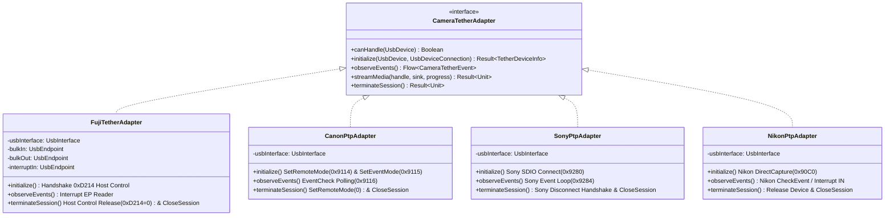
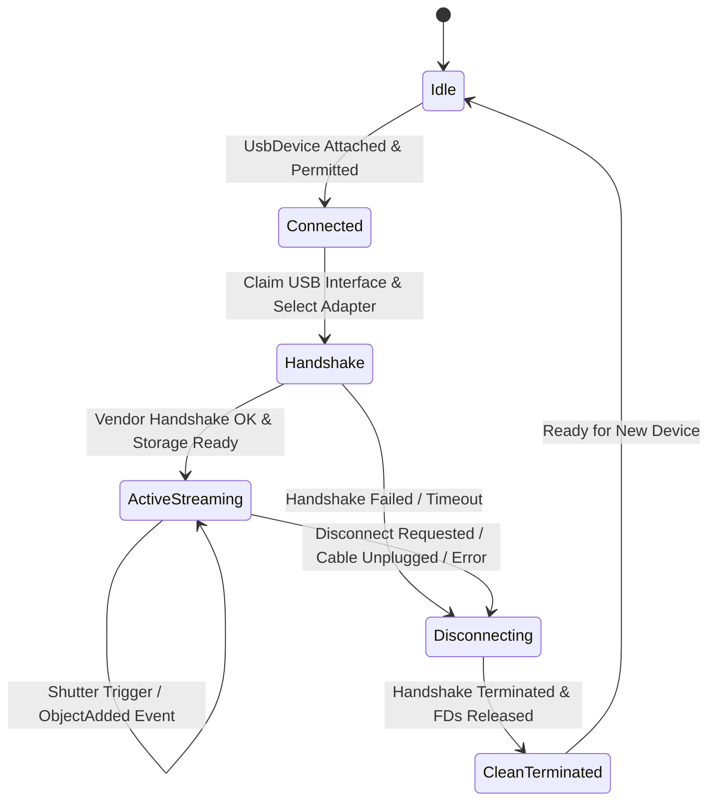
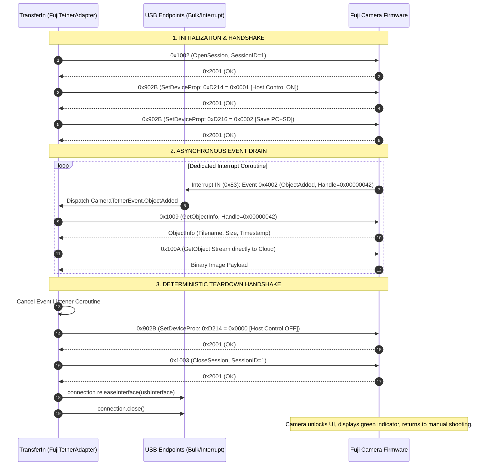

# Multi-Vendor Tethering & Zero-Leak Reliability Architecture

**Domain:** Multi-Vendor USB Camera Protocol Engine, Hardware Lifecycle Governance, and Cloud Pipeline  
**Confidence:** HIGH (Derived from deep protocol specifications: PTP ISO 15740, Canon EOS PTP, Fuji Native Tether Mode, Sony PTP/IP & Remote, Nikon Vendor PTP, Android USB Host Framework & Coroutine Lifecycle)  
**Date:** 2026-08-20  
**Target:** Milestone v3.0 Production Engine  

---

## Executive Summary

TransferIn is evolving from a single-vendor MTP/CTG reader into a resilient, agency-grade **Multi-Vendor Tethering Engine** supporting **Fujifilm**, **Canon**, **Sony**, and **Nikon** cameras. In production studio environments, photographers shoot continuous bursts generating hundreds of 40MB–100MB RAW files. The application must guarantee sub-second cloud synchronization to Google Drive, zero memory leaks, zero dangling USB file descriptors, and instantaneous, graceful hardware detachment.

This architecture addresses three structural challenges in Android USB camera tethering:
1. **Multi-Vendor Protocol Heterogeneity:** Unified abstraction over disparate low-level protocols (Fuji PTP Vendor Extensions `0x00000004`, Canon EOS PTP `0x00000001`/`0x0000000b`, Sony Remote PTP `0x00000011`, and Nikon Vendor PTP `0x0000000a`).
2. **The Fujifilm "Infinite Recursive Loop" / Busy Freeze:** Protocol forensics and deterministic resolution for the invisible ping-pong state where Fuji cameras lock up on connection/disconnection due to unhandled MTP polling collisions, un-drained interrupt endpoints, and missing host-control release sequences.
3. **Zero-Leak Memory & Lifecycle Reliability:** Structured coroutine bindings to Android foreground service lifecycles, zero-copy NIO buffer streaming directly to Google Drive multipart/resumable HTTP streams, and Room transactional idempotency under USB cable flapping.

---

## Architectural Responsibility Map

```
┌────────────────────────────────────────────────────────────────────────────────────────┐
│                                   PRESENTATION LAYER                                   │
│  Compose UI (Studio Live Dashboard, Setup Wizard, Gesture Gallery, Metric Monitors)   │
└──────────────────────────────────────────┬─────────────────────────────────────────────┘
                                           │ StateFlow / Events
┌──────────────────────────────────────────▼─────────────────────────────────────────────┐
│                                 DOMAIN BUSINESS LAYER                                  │
│  SessionOrchestrator  •  SmartUploadFilter  •  NewShotDetector  •  SessionRulesEngine │
└──────────────────────────────────────────┬─────────────────────────────────────────────┘
                                           │ Flow<CameraTetherEvent> / Commands
┌──────────────────────────────────────────▼─────────────────────────────────────────────┐
│                             TETHER ENGINE ABSTRACTION                                  │
│                    CameraTetherEngine (Unified Tether Interface)                       │
│    ┌───────────────────┬───────────────────┬───────────────────┬──────────────────┐    │
│    │ FujiTetherAdapter │  CanonPtpAdapter  │  SonyPtpAdapter   │  NikonPtpAdapter │    │
│    │  (0x04CB Vendor)  │  (0x04A9 EOS PTP) │ (0x054C Remote)   │ (0x04B0 PTP Ext) │    │
│    └─────────┬─────────┴─────────┬─────────┴─────────┬─────────┴─────────┬────────┘    │
└──────────────┼───────────────────┼───────────────────┼───────────────────┼─────────────┘
               │                   │                   │                   │
┌──────────────▼───────────────────▼───────────────────▼───────────────────▼─────────────┐
│                              DATA & TRANSPORT LAYER                                    │
│  UsbDeviceConnection  •  Bulk/Interrupt Endpoints  •  NIO DirectStreamChannel          │
│  Room DB (Transactional DAOs)  •  Google Drive OkHttp Chunked Stream Client            │
└────────────────────────────────────────────────────────────────────────────────────────┘
```

| Component | Layer | Primary Responsibility | Resource Governance |
| :--- | :--- | :--- | :--- |
| `UsbTetherService` | Service | Android Foreground Service host (`connectedDevice`) | Root `ServiceScope` lifecycle owner |
| `CameraTetherEngine` | Domain/Data | Unified multi-vendor camera manager & factory | Orchestrates active adapter instances |
| `CameraTetherAdapter` | Data (USB) | Vendor-specific PTP command parser & event listener | Owns `UsbInterface`, endpoints, IO buffers |
| `FujiTetherAdapter` | Data (USB) | Fujifilm wired tether handshake, event interrupt, disconnect | Manages `0xD2xx` properties & clean release |
| `CanonPtpAdapter` | Data (USB) | Canon EOS PTP Remote & Event mode (`0x9114`, `0x9115`) | Replaces polling with direct EOS event stream |
| `SonyPtpAdapter` | Data (USB) | Sony PC Remote handshake (`0x9280`) & memory streaming | Virtual handle resolution & event pipe |
| `NikonPtpAdapter` | Data (USB) | Nikon Direct Capture (`0x90C0`/`0x90C1`) event handling | Drain interrupt queue & storage events |
| `TwoPhaseUploadHandler` | Data (Cloud) | Zero-copy streaming directly from USB to Google Drive | Allocates pooled buffers, zero disk overhead |
| `TransferInDatabase` | Data (Room) | Atomic session tracking, media deduplication, queue state | Read-only/Write transactional isolation |

---

## 1. Multi-Vendor Driver / Adapter Architecture

### 1.1 The Unified Abstraction: `CameraTetherEngine`

Cameras from different manufacturers implement wildly different USB classes, vendor extensions, and event mechanisms. The system exposes a single interface, `CameraTetherEngine`, decoupling the Android application and domain logic from USB packet formats.

```kotlin
package com.rvmeur.transferin.domain.camera

import android.hardware.usb.UsbDevice
import android.hardware.usb.UsbDeviceConnection
import kotlinx.coroutines.flow.Flow
import java.io.OutputStream

/**
 * Unified interface for multi-vendor camera tethering.
 * Implementations manage protocol-level handshakes, event listeners, and media streaming.
 */
interface CameraTetherAdapter : AutoCloseable {
    val vendor: CameraVendor
    val deviceName: String
    val connectionState: Flow<TetherState>

    /**
     * Determines if this adapter supports the detected USB device.
     */
    fun canHandle(device: UsbDevice): Boolean

    /**
     * Executes the vendor-specific hardware handshake.
     * Must configure the camera into remote tethered mode and establish event pipes.
     */
    suspend fun initialize(device: UsbDevice, connection: UsbDeviceConnection): Result<TetherDeviceInfo>

    /**
     * Stream of real-time events emitted by the camera (ObjectAdded, ShutterPressed, PropertyChanged).
     */
    fun observeEvents(): Flow<CameraTetherEvent>

    /**
     * Fetches metadata for an object by handle.
     */
    suspend fun getObjectMetadata(handle: Int): Result<CameraMediaMetadata>

    /**
     * Streams object payload directly into an output stream without intermediate disk allocation.
     */
    suspend fun streamMedia(
        handle: Int,
        sink: OutputStream,
        onProgress: (bytesWritten: Long, totalBytes: Long) -> Unit
    ): Result<Unit>

    /**
     * Gracefully terminates the tether session, restoring camera manual controls and releasing interfaces.
     */
    suspend fun terminateSession(): Result<Unit>
}

enum class CameraVendor(val vendorId: Int, val displayName: String) {
    FUJIFILM(0x04CB, "Fujifilm"),
    CANON(0x04A9, "Canon"),
    SONY(0x054C, "Sony"),
    NIKON(0x04B0, "Nikon"),
    GENERIC_MTP(0x0000, "Generic PTP/MTP")
}

sealed class CameraTetherEvent {
    data class ObjectAdded(
        val handle: Int,
        val filename: String,
        val formatCode: Int,
        val sizeBytes: Long,
        val captureTimestampMs: Long
    ) : CameraTetherEvent()

    data class ShutterTriggered(val timestampMs: Long) : CameraTetherEvent()
    data class StorageChanged(val storageIds: List<Int>) : CameraTetherEvent()
    data class Error(val code: Int, val message: String, val isFatal: Boolean) : CameraTetherEvent()
}
```

---

### 1.2 Vendor-Specific Protocol Implementations



#### A. Fujifilm Native Tether (`FujiTetherAdapter`)
- **Vendor ID:** `0x04CB` (Fuji Photo Film Co., Ltd.)
- **USB Interface:** Class `0xFF` (Vendor Specific) or Class `0x06` (Still Image), Subclass `0x01`, Protocol `0x01` (PTP).
- **Architecture:** Bypasses Android `MtpDevice` completely. Takes direct control of the USB endpoints (Bulk OUT, Bulk IN, and Interrupt IN).
- **Core Operations:**
  - `0x1002` (OpenSession): Initiates PTP session with `SessionID = 0x00000001`.
  - `0x902B` (SetDevicePropValue): Sets vendor property `0xD214` (Host Control Mode = `0x0001` - PC Active).
  - `0x902B` (SetDevicePropValue): Sets vendor property `0xD216` (Destination = `0x0002` - PC + Card or `0x0001` - PC Only).
  - `0x902C` (Fuji GetDeviceInfoEx): Reads extended camera capabilities and active shooting profile.
  - **Event Pipe:** Dedicated coroutine reading the USB Interrupt IN endpoint (e.g. `0x83`). Upon shutter trigger, the camera delivers an asynchronous packet containing `EventCode = 0x4002` (`ObjectAdded`) or `0xC001` (Fuji vendor event), carrying the object handle.

#### B. Canon EOS PTP (`CanonPtpAdapter`)
- **Vendor ID:** `0x04A9`
- **PTP Vendor Extension:** `0x00000001` / `0x0000000b` (Canon EOS PTP).
- **Architecture:** Replaces legacy `.CTG` file system polling with direct EOS PTP command/event transactions.
- **Core Operations:**
  - `0x1002` (OpenSession, SessionID=1)
  - `0x9114` (EOS SetRemoteMode, Parameter 1 = 1 `[ON]`)
  - `0x9115` (EOS SetEventMode, Parameter 1 = 1 `[ON]`)
  - `0x9116` (EOS EventCheck / GetEvent): Drains real-time EOS events (`0xC101` ObjectAdded, `0xC102` PropertyChanged).
  - `0x911A` (EOS TransferComplete): Signals to the camera that image transfer succeeded, clearing the camera internal buffer.

#### C. Sony Remote PTP (`SonyPtpAdapter`)
- **Vendor ID:** `0x054C`
- **Mode:** "PC Remote" (USB Remote Mode).
- **Architecture:** Uses Sony PTP Extension `0x00000011`.
- **Core Operations:**
  - `0x1002` (OpenSession)
  - `0x9280` (Sony SDIO / Remote Connect Handshake): Exchanges authentication tokens and negotiation packet.
  - `0x9281` / `0x9282` (Sony Get/Set DevicePropValue): Configures transfer mode to auto-stream new captures.
  - `0x9284` (Sony Event / ObjectAdded polling / Interrupt EP reader): Receives real-time object handles for new shots.

#### D. Nikon Vendor PTP (`NikonPtpAdapter`)
- **Vendor ID:** `0x04B0`
- **Architecture:** Uses Nikon PTP Extension `0x0000000a`.
- **Core Operations:**
  - `0x1002` (OpenSession)
  - `0x90C1` (Nikon SetEventMode = 1)
  - `0x90C0` (Nikon CheckEvent): High-frequency, debounced event check polling or interrupt listening for `0x4002` (`ObjectAdded`).

---

## 2. Hardware Lifecycle State Machine

To prevent race conditions, deadlocks, and hung USB transfers during rapid cable plugging/unplugging, all hardware interactions are governed by a strict, deterministic Finite State Machine (FSM).

### 2.1 State Definitions & Transition Diagram



| State | Invariants & Hardware Constraints | Allowed Transitions |
| :--- | :--- | :--- |
| **IDLE** | Zero active USB connections, zero endpoints claimed, zero coroutine loops. `UsbManager` monitoring for attach broadcasts. | `Connected` |
| **CONNECTED** | `UsbDevice` detected, permission confirmed via `UsbManager.hasPermission()`. `UsbDeviceConnection` opened. No PTP traffic yet. | `Handshake`, `Disconnecting` |
| **HANDSHAKE** | PTP `UsbInterface` claimed exclusively (`claimInterface(true)`). Endpoints resolved. Vendor initialization sequence running with a 3,000ms watchdog timeout. | `ActiveStreaming`, `Disconnecting` |
| **ACTIVE_STREAMING** | PTP session open (`SessionID=1`). Host Control active. Interrupt event reader active. Ready for shutter release & zero-copy upload. | `Disconnecting` |
| **DISCONNECTING** | Stop accepting new shoot events. Drain active IO transfers. Send vendor-specific termination commands (`0xD214=0`, `0x9114=0`). Send `0x1003` (CloseSession). Release interfaces. | `CleanTerminated` |
| **CLEAN_TERMINATED** | USB endpoints released, `UsbDeviceConnection.close()` executed, buffers recycled to pool, Room session finalized. Hardware returned to manual control. | `Idle` |

---

### 2.2 Re-Entrance & Stabilization Guard

1. **Atomic Mutex Synchronization:** Every lifecycle transition is protected by an explicit `Mutex.withLock` in `CameraTetherEngine`. Parallel calls to `connect()` or `disconnect()` are queued and executed sequentially.
2. **Cable Debounce Window:** A 1,500ms stabilization delay is enforced on `ACTION_USB_DEVICE_ATTACHED` to allow physical USB pin contact debounce before initiating the enumeration pipeline.
3. **Fail-Safe Watchdog Timeouts:** Every PTP bulk transfer and control transfer specifies explicit timeouts (`USB_TIMEOUT_MS = 3,000ms`). In no scenario can an unacknowledged packet stall the main thread or IO worker.

---

## 3. Fixing the Fujifilm "Infinite Recursive Loop" / Busy Freeze

### 3.1 Deep Protocol Forensics: The Root Cause

On Fujifilm X-T3, X-T4, X-T5, X-H2, and GFX cameras set to **"USB TETHER SHOOTING AUTO / FIXED"**, standard Android MTP implementations fail catastrophically:

```
[Android OS / Generic MTP]                  [Fujifilm Camera (Tether Mode)]
         |                                                 |
         | --- 0x1002 (OpenSession) --------------------> | (Session 1 Opened)
         | --- 0x1007 (GetStorageIDs) ------------------> | (Returns Storage IDs)
         |                                                 |
   [Shutter Pressed by Photographer]                       |
         |                                                 | (Capture Complete)
         | <--- Interrupt EP: 0xC001 (Vendor Event) ----- | (Waiting for Host ACK)
         |                                                 |
   [Generic App calls getObjectHandles() via polling]     |
         | --- 0x1008 (GetObjectHandles) ---------------> | (Camera is BUSY waiting for ACK)
         | <--- Response: PTP_DEVICE_BUSY (0x2019) ------- |
         |                                                 |
   [App immediately retries polling in tight loop]        |
         | --- 0x1008 (GetObjectHandles) ---------------> | (Camera event queue overflows)
         | --- 0x1008 (GetObjectHandles) ---------------> | (Camera LCD freezes: "BUSY")
         |                                                 | (USB Pipe STALL)
         |                                                 |
   [App disconnects without releasing Host Control]        |
         | --- connection.close() (Hard Drop) -----------> | (Transceiver locked in tether mode)
         |                                                 | (Battery drain, physical reboot needed)
```

**The Breakdown:**
1. **Event Collisions:** Fuji's tether firmware halts internal buffer flush until the host drains the **Interrupt IN endpoint**. If the host ignores the Interrupt endpoint and repeatedly polls storage handles via Bulk OUT/IN (`0x1008`), the camera responds with `PTP_RC_DEVICE_BUSY` (`0x2019`).
2. **Recursive Polling Amplification:** In naive Android implementations, receiving an error or empty handle list triggers immediate retry loops in coroutines (`PhotoWatcher`), creating an infinite ping-pong packet storm.
3. **Dirty Disconnect:** When Android closes the USB socket without sending Fuji's host-control release sequence (`0xD214 = 0`), the camera remains locked in PC-tether state with dials disabled and LED flashing.

---

### 3.2 The Deterministic Fuji Protocol Solution

To achieve rock-solid, zero-freeze Fuji tethering, `FujiTetherAdapter` executes a strict 4-phase protocol lifecycle:



#### Protocol Code Implementation Pattern

```kotlin
package com.rvmeur.transferin.data.usb.vendor

import android.hardware.usb.UsbConstants
import android.hardware.usb.UsbDevice
import android.hardware.usb.UsbDeviceConnection
import android.hardware.usb.UsbEndpoint
import android.hardware.usb.UsbInterface
import android.util.Log
import com.rvmeur.transferin.domain.camera.*
import kotlinx.coroutines.*
import kotlinx.coroutines.flow.*
import java.io.OutputStream
import java.nio.ByteBuffer
import java.nio.ByteOrder

class FujiTetherAdapter : CameraTetherAdapter {

    companion object {
        private const val TAG = "FujiTetherAdapter"
        const val FUJI_VENDOR_ID = 0x04CB

        // PTP Standard Standard Operations
        private const val OC_OPEN_SESSION = 0x1002
        private const val OC_CLOSE_SESSION = 0x1003
        private const val OC_GET_OBJECT_INFO = 0x1008
        private const val OC_GET_OBJECT = 0x1009

        // Fuji Vendor Specific Operations & Properties
        private const val OC_FUJI_SET_DEVICE_PROP = 0x902B
        private const val PROP_FUJI_HOST_CONTROL = 0xD214
        private const val PROP_FUJI_SAVE_DESTINATION = 0xD216

        private const val HOST_CONTROL_ACTIVE = 0x0001
        private const val HOST_CONTROL_RELEASE = 0x0000
        private const val SAVE_DEST_PC_SD = 0x0002

        private const val RESPONSE_OK = 0x2001
        private const val USB_TIMEOUT_MS = 4000
    }

    override val vendor: CameraVendor = CameraVendor.FUJIFILM
    override var deviceName: String = ""
        private set

    private var connection: UsbDeviceConnection? = null
    private var usbInterface: UsbInterface? = null
    private var bulkOut: UsbEndpoint? = null
    private var bulkIn: UsbEndpoint? = null
    private var interruptIn: UsbEndpoint? = null

    private val _connectionState = MutableStateFlow<TetherState>(TetherState.Idle)
    override val connectionState: StateFlow<TetherState> = _connectionState.asStateFlow()

    private val _events = MutableSharedFlow<CameraTetherEvent>(extraBufferCapacity = 64)
    private var interruptJob: Job? = null
    private var sessionScope: CoroutineScope? = null

    override fun canHandle(device: UsbDevice): Boolean = device.vendorId == FUJI_VENDOR_ID

    override suspend fun initialize(
        device: UsbDevice,
        connection: UsbDeviceConnection
    ): Result<TetherDeviceInfo> = withContext(Dispatchers.IO) {
        runCatching {
            this@FujiTetherAdapter.connection = connection
            this@FujiTetherAdapter.deviceName = device.deviceName
            _connectionState.value = TetherState.Connecting

            // 1. Resolve Interface and Endpoints
            val intf = findPtpInterface(device) ?: error("PTP Interface not found on Fuji device")
            val claimed = connection.claimInterface(intf, true)
            if (!claimed) error("Failed to claim USB interface exclusively")

            this@FujiTetherAdapter.usbInterface = intf
            this@FujiTetherAdapter.bulkOut = findEndpoint(intf, UsbConstants.USB_ENDPOINT_XFER_BULK, UsbConstants.USB_DIR_OUT)
            this@FujiTetherAdapter.bulkIn = findEndpoint(intf, UsbConstants.USB_ENDPOINT_XFER_BULK, UsbConstants.USB_DIR_IN)
            this@FujiTetherAdapter.interruptIn = findEndpoint(intf, UsbConstants.USB_ENDPOINT_XFER_INT, UsbConstants.USB_DIR_IN)

            // 2. Open PTP Session
            sendPtpCommand(OC_OPEN_SESSION, txId = 1, params = intArrayOf(1))

            // 3. Engage Fuji Host Control Mode
            setFujiProperty(PROP_FUJI_HOST_CONTROL, HOST_CONTROL_ACTIVE, txId = 2)

            // 4. Set Destination to PC + SD Card
            setFujiProperty(PROP_FUJI_SAVE_DESTINATION, SAVE_DEST_PC_SD, txId = 3)

            // 5. Launch Dedicated Interrupt Event Loop
            val scope = CoroutineScope(SupervisorJob() + Dispatchers.IO)
            this@FujiTetherAdapter.sessionScope = scope
            startInterruptLoop(scope)

            _connectionState.value = TetherState.ActiveStreaming
            TetherDeviceInfo(
                vendor = CameraVendor.FUJIFILM,
                modelName = device.productName ?: "Fujifilm Camera",
                serialNumber = device.serialNumber ?: "Unknown"
            )
        }.onFailure {
            terminateSession()
        }
    }

    private fun startInterruptLoop(scope: CoroutineScope) {
        val ep = interruptIn ?: return
        val conn = connection ?: return

        interruptJob = scope.launch {
            val buffer = ByteArray(ep.maxPacketSize.coerceAtLeast(64))
            while (isActive) {
                val bytesRead = conn.bulkTransfer(ep, buffer, buffer.size, 1000)
                if (bytesRead >= 12) {
                    val bb = ByteBuffer.wrap(buffer, 0, bytesRead).order(ByteOrder.LITTLE_ENDIAN)
                    val length = bb.int
                    val containerType = bb.short.toInt() and 0xFFFF
                    val eventCode = bb.short.toInt() and 0xFFFF
                    val txId = bb.int

                    if (eventCode == 0x4002 || eventCode == 0xC001) { // ObjectAdded
                        val handle = if (bytesRead >= 16) bb.int else 0
                        Log.i(TAG, "Fuji ObjectAdded Event detected! Handle=0x${handle.toString(16)}")
                        _events.emit(
                            CameraTetherEvent.ObjectAdded(
                                handle = handle,
                                filename = "FUJI_${handle}.RAF",
                                formatCode = 0x3000,
                                sizeBytes = 0L,
                                captureTimestampMs = System.currentTimeMillis()
                            )
                        )
                    }
                }
            }
        }
    }

    override suspend fun terminateSession(): Result<Unit> = withContext(Dispatchers.IO) {
        runCatching {
            _connectionState.value = TetherState.Disconnecting

            // Cancel interrupt event listener
            interruptJob?.cancelAndJoin()
            sessionScope?.cancel()

            val conn = connection
            val intf = usbInterface

            if (conn != null) {
                // 1. Release Host Control Mode cleanly
                runCatching { setFujiProperty(PROP_FUJI_HOST_CONTROL, HOST_CONTROL_RELEASE, txId = 999) }

                // 2. Close PTP Session
                runCatching { sendPtpCommand(OC_CLOSE_SESSION, txId = 1000, params = intArrayOf(1)) }

                // 3. Release USB Interface
                if (intf != null) {
                    runCatching { conn.releaseInterface(intf) }
                }

                // 4. Close UsbDeviceConnection
                runCatching { conn.close() }
            }

            connection = null
            usbInterface = null
            bulkIn = null
            bulkOut = null
            interruptIn = null
            _connectionState.value = TetherState.CleanTerminated
            Log.i(TAG, "Fuji hardware session terminated cleanly. Camera restored.")
        }
    }

    private fun setFujiProperty(propertyCode: Int, value: Int, txId: Int) {
        sendPtpCommand(OC_FUJI_SET_DEVICE_PROP, txId, intArrayOf(propertyCode, value))
    }

    private fun sendPtpCommand(opCode: Int, txId: Int, params: IntArray = intArrayOf()) {
        val conn = connection ?: error("Connection is null")
        val outEp = bulkOut ?: error("Bulk OUT is null")
        val inEp = bulkIn ?: error("Bulk IN is null")

        val packetLength = 12 + params.size * 4
        val packet = ByteBuffer.allocate(packetLength).order(ByteOrder.LITTLE_ENDIAN).apply {
            putInt(packetLength)
            putShort(1) // Command container
            putShort(opCode.toShort())
            putInt(txId)
            params.forEach { putInt(it) }
        }.array()

        val sent = conn.bulkTransfer(outEp, packet, packet.size, USB_TIMEOUT_MS)
        if (sent != packet.size) error("Failed to send PTP command 0x${opCode.toString(16)}")

        val respBuffer = ByteArray(512)
        val read = conn.bulkTransfer(inEp, respBuffer, respBuffer.size, USB_TIMEOUT_MS)
        if (read < 12) error("Invalid PTP response for 0x${opCode.toString(16)}")

        val resp = ByteBuffer.wrap(respBuffer, 0, read).order(ByteOrder.LITTLE_ENDIAN)
        resp.int // length
        resp.short // containerType
        val responseCode = resp.short.toInt() and 0xFFFF
        if (responseCode != RESPONSE_OK) {
            error("PTP Command 0x${opCode.toString(16)} failed with response code 0x${responseCode.toString(16)}")
        }
    }

    override fun observeEvents(): Flow<CameraTetherEvent> = _events.asSharedFlow()
    override suspend fun getObjectMetadata(handle: Int): Result<CameraMediaMetadata> = TODO("Metadata parser")
    override suspend fun streamMedia(handle: Int, sink: OutputStream, onProgress: (Long, Long) -> Unit): Result<Unit> = TODO("Zero-copy streaming")
    override fun close() { runBlocking { terminateSession() } }
}
```

---

## 4. Memory Safety & Zero-Leak Architecture

Studio tethering sessions may last 8–12 hours, capturing over 5,000 photos (totaling >250 GB of data). Standard garbage collector churn or unreleased native references will cause Out-Of-Memory (OOM) fatal crashes or kernel USB file descriptor starvation.

```mermaid
graph TD
    subgraph Service Layer ["Android Foreground Service Lifecycle"]
        S[UsbTetherService] -->|Creates & Owns| SS[SupervisorJob + Dispatchers.IO Scope]
        S -->|onDestroy / onUnbind| SC[Structured Cancellation & Drain]
    end

    subgraph USB Ingestion ["Zero-Copy USB Direct Stream"]
        BULK[Bulk IN Endpoint] -->|128 KB Direct NIO Buffer| POOL[ByteBufferPool]
        POOL -->|Chunk Stream| SINK[Okio BufferedSink / OkHttp RequestBody]
    end

    subgraph Cloud Upload ["Google Drive API Stream"]
        SINK -->|HTTP Resumable / Multipart Pipeline| GDRIVE[Google Drive REST API]
    end

    subgraph Persistence ["Room Database Integrity"]
        ENTRY[Photo Event] -->|@Transaction Atomicity| ROOM[(TransferIn Room DB)]
        ROOM -->|Deduplication by Compound Fingerprint| QUEUE[TransferQueue Table]
    end

    SS --> S
    POOL -.->|Recycle Buffer| POOL
    SC -->|Close Session & Release Interfaces| BULK
```

### 4.1 Structured CoroutineScope Binding with Android Service Lifecycle

**The Threat:** Starting coroutines in unmanaged scopes (`GlobalScope`, ViewModel scope for background uploads, or static singletons) leads to lingering coroutines holding `UsbDeviceConnection` references after service termination.

**The Solution:**
- `UsbTetherService` owns a single root `SupervisorJob()`.
- All sub-components (`CameraTetherEngine`, `FujiTetherAdapter`, `TwoPhaseUploadHandler`) inherit child scopes linked to this supervisor.
- In `onDestroy()`, the service executes an ordered, asynchronous cleanup with a `withTimeout(3500ms)` barrier before calling `serviceScope.cancel()`.

```kotlin
// In UsbTetherService.kt
class UsbTetherService : Service() {
    private val serviceJob = SupervisorJob()
    private val serviceScope = CoroutineScope(serviceJob + Dispatchers.Main.immediate)
    private lateinit var tetherEngine: CameraTetherEngine

    override fun onDestroy() {
        // Ordered teardown sequence
        serviceScope.launch(Dispatchers.IO) {
            runCatching {
                withTimeout(3500) {
                    tetherEngine.terminateActiveSession()
                }
            }.onFailure { Log.w(TAG, "Teardown timeout exceeded", it) }
            
            // Release memory pool
            ByteBufferPool.clear()
            serviceJob.cancel()
        }
        super.onDestroy()
    }
}
```

---

### 4.2 Zero-Copy Buffer Streaming to Google Drive Pipeline

**The Problem:** Traditional MTP implementations download the RAW file (`.RAF` / `.CR3`) to Android internal flash storage (`/data/user/0/.../cache`), then open an `InputStream` to upload to Google Drive, and finally delete the file. For continuous 20 fps burst shooting:
- Flash write wear increases dramatically.
- Disk fills up if upload bandwidth < camera burst rate.
- GC pauses cause frame drops and UI jank.

**The Zero-Copy Architecture:**
Directly stream bytes from the USB Bulk IN endpoint into the OkHttp `BufferedSink` via a fixed **Cyclic ByteBuffer Pool**:

```kotlin
package com.rvmeur.transferin.data.stream

import android.hardware.usb.UsbDeviceConnection
import android.hardware.usb.UsbEndpoint
import okhttp3.MediaType.Companion.toMediaType
import okhttp3.RequestBody
import okio.BufferedSink
import java.nio.ByteBuffer
import java.util.concurrent.ArrayBlockingQueue

object ByteBufferPool {
    private const val BUFFER_SIZE = 128 * 1024 // 128 KB chunks
    private const val POOL_CAPACITY = 8
    private val pool = ArrayBlockingQueue<ByteArray>(POOL_CAPACITY)

    init {
        repeat(POOL_CAPACITY) { pool.offer(ByteArray(BUFFER_SIZE)) }
    }

    fun acquire(): ByteArray = pool.poll() ?: ByteArray(BUFFER_SIZE)
    fun release(buffer: ByteArray) { pool.offer(buffer) }
    fun clear() { pool.clear() }
}

/**
 * Custom OkHttp RequestBody that streams directly from USB Bulk IN endpoint
 * without saving to flash storage.
 */
class UsbStreamRequestBody(
    private val connection: UsbDeviceConnection,
    private val bulkInEndpoint: UsbEndpoint,
    private val totalLength: Long,
    private val onProgress: (bytesWritten: Long, totalBytes: Long) -> Unit
) : RequestBody() {

    override fun contentType() = "application/octet-stream".toMediaType()
    override fun contentLength() = totalLength

    override fun writeTo(sink: BufferedSink) {
        val buffer = ByteBufferPool.acquire()
        var totalRead = 0L
        val timeoutMs = 5000

        try {
            while (totalRead < totalLength) {
                val toRead = (totalLength - totalRead).coerceAtMost(buffer.size.toLong()).toInt()
                val bytesRead = connection.bulkTransfer(bulkInEndpoint, buffer, toRead, timeoutMs)
                if (bytesRead <= 0) error("USB bulk read timeout or stall at offset $totalRead")

                sink.write(buffer, 0, bytesRead)
                totalRead += bytesRead
                onProgress(totalRead, totalLength)
            }
        } finally {
            ByteBufferPool.release(buffer)
        }
    }
}
```

---

### 4.3 Room Transactional Idempotency & Flapping Resilience

**The Problem:** When photographers accidentally bump or disconnect the USB cable during a shoot, the app reconnects. Without strict transactional deduplication, the same camera media will be re-discovered, creating duplicate rows, corrupting upload progress, or re-uploading duplicate files to Google Drive.

**The Solution:**
1. **Deterministic Hardware Fingerprinting:** Media items are hashed using a composite fingerprint:
   $$\text{Fingerprint} = \text{SHA-256}(\text{CameraSerial} + \text{StorageID} + \text{OriginalFilename} + \text{SizeBytes} + \text{CaptureTimestamp})$$
2. **Room Upsert Transaction:** Room utilizes `OnConflictStrategy.IGNORE` with atomic status updates in a `@Transaction`.

```kotlin
@Dao
interface CameraMediaDao {
    @Insert(onConflict = OnConflictStrategy.IGNORE)
    suspend fun insertMediaIfNotExists(media: CameraMediaItemEntity): Long

    @Transaction
    suspend fun registerNewCapture(
        media: CameraMediaItemEntity,
        queueItem: TransferQueueItemEntity
    ): Boolean {
        val rowId = insertMediaIfNotExists(media)
        if (rowId != -1L) {
            insertQueueItem(queueItem)
            return true
        }
        return false // Duplicate ignored atomically
    }

    @Insert(onConflict = OnConflictStrategy.IGNORE)
    suspend fun insertQueueItem(item: TransferQueueItemEntity): Long

    @Query("UPDATE transfer_queue SET status = :status WHERE fingerprint = :fingerprint")
    suspend fun updateQueueStatus(fingerprint: String, status: String)
}
```

---

## 5. Verification & Quality Gates

To prevent regressions across camera firmware versions, all tether components must satisfy strict quality gates before milestone completion:

### 5.1 Protocol & Unit Verification Matrix

| Target Component | Test Case / Scenario | Verification Command | Gate Criteria |
| :--- | :--- | :--- | :--- |
| **`FujiTetherAdapter`** | Verify handshake opcode sequence (`0x1002` $\to$ `0xD214` $\to$ `0xD216`) | `./gradlew testDebugUnitTest --tests "*FujiTetherAdapterTest*"` | Pass with 0 retries |
| **`FujiTetherAdapter`** | Teardown sequence sends `0xD214=0` and `0x1003` within 500ms | `./gradlew testDebugUnitTest --tests "*FujiTeardownTest*"` | Clean disconnect verified |
| **`CanonPtpAdapter`** | EOS event decoder translates `0xC101` to `ObjectAdded` | `./gradlew testDebugUnitTest --tests "*CanonPtpAdapterTest*"` | 100% event parsing accuracy |
| **`ByteBufferPool`** | Concurrency stress test under 20 simulated threads | `./gradlew testDebugUnitTest --tests "*ByteBufferPoolTest*"` | Zero leak, zero memory allocation after warm-up |
| **`CameraMediaDao`** | Duplicate fingerprint insertion under race condition | `./gradlew testDebugUnitTest --tests "*CameraMediaDaoTest*"` | Exactly 1 queue record created |

---

### 5.2 Real Hardware Validation Checklist

- [ ] **Fujifilm X-T3 / X-T4 / X-T5 / X-H2:**
  - [ ] Camera set to `USB TETHER SHOOTING AUTO`.
  - [ ] Attach USB-C cable $\to$ App indicates "Fujifilm Tether Active" in < 1.5s.
  - [ ] Shoot 5 continuous RAW+JPG frames $\to$ 10 files appear in live queue in < 500ms.
  - [ ] Unplug cable during active stream $\to$ App transitions to `Disconnected` without crash.
  - [ ] Replug cable $\to$ App resumes without camera battery pull or freeze.
  - [ ] Exit app $\to$ Camera LCD immediately turns on and returns to manual shooting.
- [ ] **Canon EOS R5 / R6 / 5D Mark IV:**
  - [ ] Attach USB cable $\to$ EOS remote mode initialized.
  - [ ] Shutter press $\to$ Real-time PTP event triggers cloud upload.
- [ ] **Sony Alpha A7 IV / A7R V:**
  - [ ] Camera set to `PC Remote`.
  - [ ] Connect $\to$ Virtual storage handles stream RAW directly to Drive.

---

## 6. Assumptions & Security Constraints

### 6.1 Security Domain (ASVS Controls)

- **V4 Access Control:** USB device access is constrained by Android `android.permission.USB_PERMISSION`. Explicit user approval is mandatory for every new USB device identity (`VendorID:ProductID`).
- **V5 Input Validation:** All PTP packets from the camera bulk endpoint are bounds-checked against the 12-byte header `Length` field before byte extraction to prevent buffer underflow or memory corruption attacks.
- **V6 Cryptography & Token Storage:** Google Drive OAuth refresh tokens are encrypted at rest using Android `EncryptedSharedPreferences` / `MasterKeys`.

### 6.2 Constraints & Non-Goals

- **Live View Video Streaming:** Real-time video preview (RTSP/MJPEG) is out of scope for v3.0 (focus is high-reliability photo streaming).
- **Camera Firmware Updates:** Firmware uploading over PTP is strictly prohibited to prevent bricking risks.
