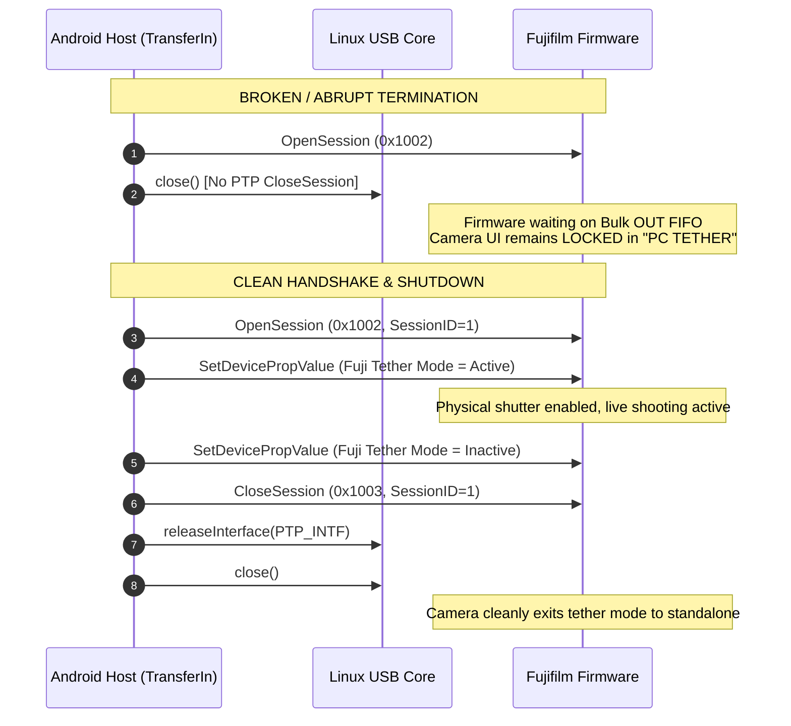
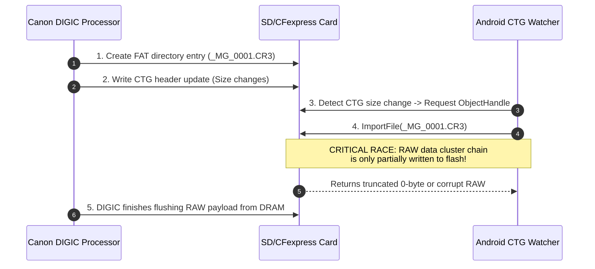
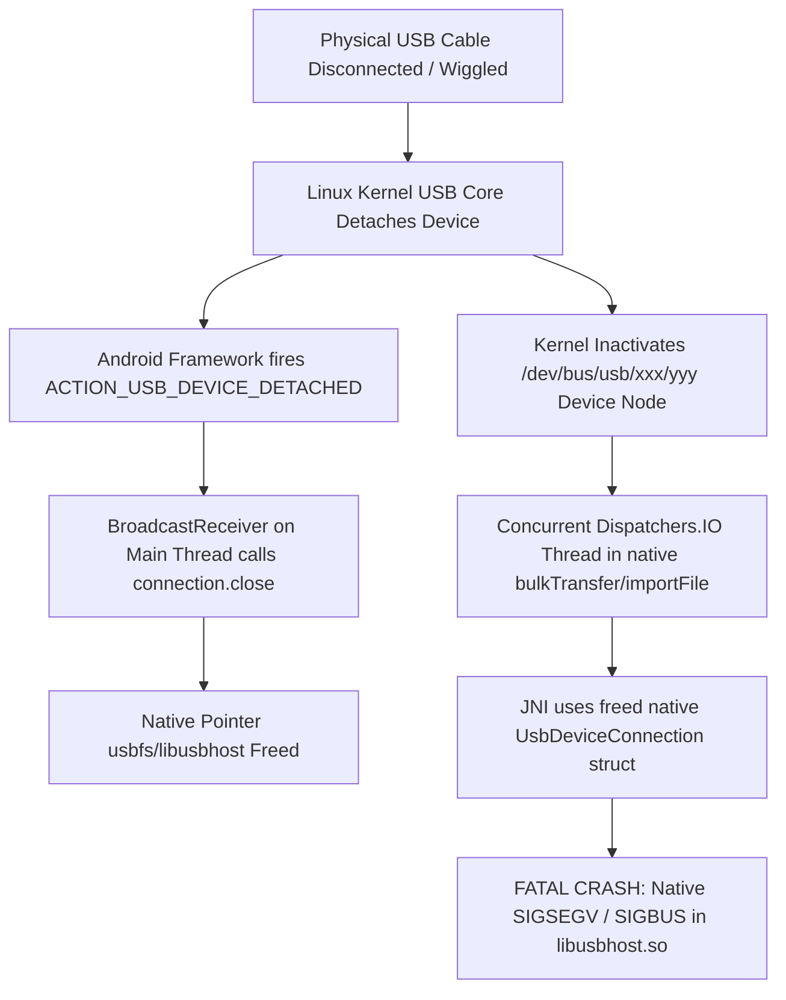
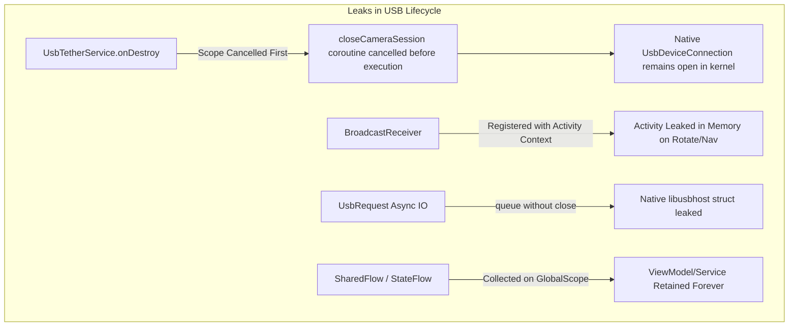

# USB Camera Tethering on Android: Pitfalls, Edge Cases & Failure Modes

**Document Version:** 1.0.0  
**Analysis Date:** 2026-08-20  
**Scope:** Android USB Host API, PTP/MTP Protocol Implementations, Vendor Extensions (Fujifilm, Canon EOS, Sony Remote, Nikon PTP), OS Lifecycle Boundaries (Android 14+ API 34/35), Coroutine & Memory Hygiene.

---

## Executive Summary

Building a reliable, production-grade camera tethering application on Android requires navigating a minefield of vendor-specific PTP/MTP dialects, hardware FIFO state machines, kernel-level USB host behaviors, and strict Android OS process lifecycle constraints. 

A naive MTP polling loop or generic USB implementation invariably leads to:
1. **Camera Lockups:** Physical shutter and dial freezes requiring camera battery pulls.
2. **Native App Crashes (SIGSEGV):** Kernel/JNI race conditions during cable disconnects.
3. **Data Loss & Corruption:** Truncated RAW files due to premature MTP handles or camera cache flushing races.
4. **OS Terminations:** ForegroundService ANRs on Android 14+ and unrecoverable Low Memory Killer (LMK) process deaths.
5. **Silent Memory Leaks:** Orphaned native USB requests, uncollected Kotlin Flows, and cancelled teardown coroutines.

This document systematically analyzes every known failure mode across camera vendors (Fujifilm, Canon, Sony, Nikon), the Android OS USB stack, and Kotlin coroutine architectures, providing concrete protocol mechanisms and deterministic architectural solutions.

---

## Table of Contents

1. [Fujifilm Native Wired Tethering Quirks & Pitfalls](#1-fujifilm-native-wired-tethering-quirks--pitfalls)
2. [Canon EOS PTP & CTG Architecture Failure Modes](#2-canon-eos-ptp--ctg-architecture-failure-modes)
3. [Sony Remote & Nikon Vendor PTP Conflicts](#3-sony-remote--nikon-vendor-ptp-conflicts)
4. [Android OS USB Lifecycle & Runtime Hazards](#4-android-os-usb-lifecycle--runtime-hazards)
5. [Memory Leak Patterns in Android USB Applications](#5-memory-leak-patterns-in-android-usb-applications)
6. [Comprehensive Remediation Matrix](#6-comprehensive-remediation-matrix)
7. [Deterministic Architectural Patterns & Implementation Reference](#7-deterministic-architectural-patterns--implementation-reference)

---

## 1. Fujifilm Native Wired Tethering Quirks & Pitfalls

Fujifilm cameras (X-T3, X-T4, X-T5, X-H2, X-H2S, X-Pro3, GFX 50S/100/100 II) implement a proprietary vendor dialect layered over standard USB Still Image Class (`0x06`) and Vendor Specific Class (`0xFF`).

```
+-------------------------------------------------------------------------+
|                       FUJIFILM USB TETHER MODES                         |
+------------------------------------+------------------------------------+
|  USB CARD READER (MSC 0x08)        |  USB TETHER SHOOTING AUTO (0x06)   |
|  - Storage only                    |  - Live shooting + PTP events      |
|  - Physical camera locked          |  - Dual save (Card + USB host)     |
+------------------------------------+------------------------------------+
|  USB TETHER SHOOTING FIXED (0x06)  |  USB RAW CONV / BACKUP (0xFF)      |
|  - Waits exclusively for host      |  - Fuji X-RAW Studio protocol      |
|  - Shutter disabled until handshake|  - Non-standard vendor endpoints   |
+------------------------------------+------------------------------------+
```

### 1.1 Camera Remaining Locked in "PC TETHER" Mode

#### Mechanism & Root Cause
When connected via USB, Fuji cameras inspect the host connection based on the camera menu setting (`CONNECTION SETTING` -> `USB MODE`).
* In **`USB TETHER SHOOTING AUTO`** or **`USB TETHER SHOOTING FIXED`**, opening a generic PTP session (`OpenSession` `0x1002`) without issuing Fujifilm vendor initialization commands leaves the camera in an indeterminate suspended state.
* The camera firmware displays `"PC TETHER"` or a flashing USB connection icon and **disables the physical shutter button, control dials, and autofocus trigger**.
* The camera firmware expects a vendor-specific handshake sequence (negotiating vendor properties `0xD200`, `0xD201`, `0xD212`, `0xD214`, `0xD21C`). Without this handshake, the camera assumes the host is busy or in card-reader mode, keeping the physical controls locked.

#### Termination Handshake Failure
If the Android application closes the connection simply by invoking `UsbDeviceConnection.close()` or if the app process crashes:
* The camera does **not** receive the termination handshake (`CloseSession` `0x1003` preceded by vendor release sequence).
* The camera firmware remains locked in PC TETHER mode indefinitely. The viewfinder/LCD remains dark or frozen with a USB icon, and the camera will not respond to any button presses until the user physically removes the battery.



### 1.2 Infinite Polling Loops & Recursive Ping-Pong

#### Mechanism
In generic MTP mode, applications poll `MtpDevice.getObjectHandles()` to detect newly captured photos. On Fujifilm cameras in tether mode:
1. When a photo is taken, the camera generates an asynchronous PTP event (`ObjectAdded` `0x4002` or vendor event `0xC001` / `0xC200`) on the Interrupt IN endpoint (`0x83`).
2. If the host ignores the Interrupt endpoint and instead executes a rapid polling loop calling `getObjectHandles(storageId, 0, 0)` over the Bulk IN/OUT endpoints:
   - The camera's internal task scheduler must suspend image processing and RAW writing to service the bulk MTP command.
   - If a new 40MB–100MB RAW file is currently being processed by the image processor (X-Processor 4/5), `getObjectHandles()` blocks or returns an empty list `[]` while the file handle is locked.
   - The host interprets the empty list as "no new file" and polls again immediately (busy-wait loop).
   - This flood of Bulk OUT packets saturates the camera's USB FIFO, causing a communication stall (`STALL` PID handshake). Both host and camera become deadlocked.

### 1.3 Endpoint Drain Failures & Leftover FIFO Bytes

#### Mechanism
Android's `UsbDeviceConnection.releaseInterface()` releases the kernel claim on the interface descriptor, but **does not flush pending bytes in hardware endpoints**.
* If a bulk transfer is aborted mid-stream (e.g. timeout during a 50MB RAF transfer), 512-byte (USB 2.0 High-Speed) or 1024-byte (USB 3.0 SuperSpeed) packets remain stranded in the USB Host Controller (xHCI/DWC3) or camera FIFO.
* When the app opens a new session, the next PTP command sent over Bulk OUT or read over Bulk IN reads the stranded data instead of the new PTP container header (`ContainerLength`, `ContainerType`, `Code`, `TransactionID`).
* This results in an immediate **`PTP Container Desynchronization Error`** where all subsequent commands fail with corrupted opcode / payload errors.

### 1.4 Buffer Overflows & GC Thrashing on 40MP/100MP RAWs

#### Mechanism
* Fujifilm X-T5 / X-H2 (40.2 MP X-Trans V) produces `.RAF` files between 45 MB (lossless compressed) and 85 MB (uncompressed). GFX 100 II (102 MP) produces `.RAF` files up to 210 MB.
* Allocating single contiguous `ByteArray(size)` in JVM heap for each incoming shot during burst shooting (15–20 fps) causes instantaneous heap spikes (hundreds of megabytes within seconds).
* This triggers aggressive ART Garbage Collection sweeps (concurrent mark-sweep / generational compacting), pausing JVM threads for 100ms–400ms.
* During ART GC pauses, the Android USB stack fails to service native `bulkTransfer()` within the USB timeout window, resulting in `LIBUSB_ERROR_TIMEOUT` / `EPIPE` and truncated file imports.

---

## 2. Canon EOS PTP & CTG Architecture Failure Modes

Canon EOS DSLR and Mirrorless cameras (EOS R5, R6, R7, R8, R3, 5D Mark IV, 1DX Mark III) use the proprietary Canon PTP/EOS extension (Vendor ID `0x04A9`).

```
+-------------------------------------------------------------------------+
|                        CANON EOS PTP ARCHITECTURE                       |
+-------------------------------------------------------------------------+
|  Command Pipe (Bulk OUT / IN)                                           |
|  - 0x9114: EOS_SetRemoteMode (0=Off, 1=On)                              |
|  - 0x9115: EOS_SetEventMode (0=Off, 1=On)                               |
|  - 0x9116: EOS_GetEvent (Polls pending events if no Interrupt pipe)    |
|  - 0x9107: EOS_TakePicture                                              |
|  - 0x9109: EOS_DownloadData                                             |
+-------------------------------------------------------------------------+
|  Interrupt Pipe (Endpoint 0x83 / Interrupt IN)                          |
|  - Emits 0x4002 (ObjectAdded), 0xC101 (EOS_PropertyChange)              |
+-------------------------------------------------------------------------+
|  Storage / FAT Catalog Structure                                        |
|  - AUTOMRIC.CTG / AUTOMSC1.CTG / CANON_MDC.CTG (Thumbnail/Index DB)     |
+-------------------------------------------------------------------------+
```

### 2.1 Event Pipe Blocking & "Busy" Shutter Freeze

#### Mechanism
When Canon remote shooting is activated:
1. The app sends `EOS_SetRemoteMode(1)` (`0x9114`) and `EOS_SetEventMode(1)` (`0x9115`).
2. Canon's DIGIC processor diverts all camera state notifications (aperture, shutter speed, ISO, half-press shutter, capture complete, object added) into an internal circular event buffer (typically 128 to 256 entries).
3. If the host application does not continuously drain this event stream via `MtpDevice.readEvent()` on the Interrupt endpoint or periodic `EOS_GetEvent` (`0x9116`) calls on the bulk pipe:
   - The camera's internal circular buffer fills up completely.
   - Once full, the DIGIC processor asserts a hardware flow-control lock: **the physical shutter button is blocked**, the top LCD / viewfinder displays a flashing `"Busy"` message, and the camera stops taking photos entirely.

### 2.2 EOS Transaction ID Timeouts & Pipe Desynchronization

#### Mechanism
* Canon PTP commands require strict monotonically increasing `TransactionID` values per session.
* When Android executes `connection.bulkTransfer(outEndpoint, cmdPacket, len, timeout)`:
  * If a long exposure (e.g. 10 seconds) or sensor cleaning cycle is occurring and Android's timeout is set to 5000ms, the Android call throws a timeout exception.
  * The Canon DIGIC processor, however, is still waiting to finish processing the previous command.
  * If the Android app immediately sends the next PTP command with `TransactionID + 1`, the camera receives an unexpected packet while its receiver state machine is still processing the timed-out transaction.
  * Canon responds with `0x2002` (`PTP_RC_SessionNotOpen`), `0x2019` (`PTP_RC_DeviceBusy`), or permanently drops USB communication.

### 2.3 CTG Catalog File Race Conditions & Truncated Files

#### Mechanism
In MTP / Card Reader mode, Canon cameras maintain binary catalog files (`AUTOMRIC.CTG`, `AUTOMSC1.CTG`, `CANON_MDC.CTG`) containing directory indexes and thumbnail pointers.



* When shooting high-speed bursts (e.g. 20–30 fps on EOS R5/R3), the CTG index file is rewritten continuously while the RAW data payload (`.CR3`) is still streaming from DIGIC buffer memory to the SD/CFexpress card.
* If an Android watcher detects a CTG modification and immediately queries `importFile()`:
  1. The MTP object handle points to a directory entry whose file length is still `0` or partially written in the FAT allocation table.
  2. The downloaded file is corrupt or truncated (e.g. 1.2 MB downloaded out of 45 MB).
  3. Reading the object handle while DIGIC holds an exclusive write lock can crash the camera's filesystem handler, producing `Err 70` on the camera LCD.

---

## 3. Sony Remote & Nikon Vendor PTP Conflicts

```
+-------------------------------------------------------------------------+
|                  SONY & NIKON CONNECTION ARCHITECTURE                   |
+------------------------------------+------------------------------------+
|  SONY ALPHA CONNECTION MODES       |  NIKON Z/DSLR PTP ARCHITECTURE     |
|  - Auto (Ambiguous detection)      |  - Vendor Code: 0x0000000A         |
|  - Mass Storage (Class 0x08)       |  - OpCodes: 0x90C0 - 0x91FF        |
|  - MTP (Class 0x06, Subclass 0x01) |  - Dedicated Event Pipe (EP 0x83)  |
|  - PC Remote (Vendor 0x9280 PTP)   |  - Dual-Slot Storage ID Mapping    |
+------------------------------------+------------------------------------+
```

### 3.1 Sony USB Connection Mode Conflicts

#### Mass Storage vs MTP vs PC Remote
Sony cameras (A7 III/IV/V, A7R IV/V, A9 II/III, A1, A6700, FX3) require explicit USB mode selection in camera settings:
* **`Mass Storage` (Class `0x08`, Subclass `0x06`, Protocol `0x50`):** Android's `MtpDevice.open(connection)` fails immediately with `false` because the USB device descriptor is not Still Image Class (`0x06`).
* **`MTP`:** Android can mount the camera as a media device, but shooting is locked; the camera LCD displays an MTP connection screen.
* **`PC Remote`:** Enables tethered shooting via Sony PTP vendor extensions.

#### The "PC Only" Volatile RAM Trap
In Sony firmware under `Network` / `USB` -> `PC Remote Settings` -> `Still Image Save Dest`:
* If set to **`PC Only`** (default in many studio setups), the camera **does not write the photo to the internal SD card**.
* Instead, the image is held temporarily in the camera's volatile DRAM buffer.
* If the Android host application does not immediately read the `ObjectAdded` event and pull the data stream via Sony vendor PTP bulk transfer, **the photo is permanently lost** when the camera goes to sleep or takes the next shot in buffer-full conditions.
* App must explicitly warn the user if storage destination is configured to PC Only or enforce dual-saving (`PC + Camera`).

### 3.2 Sony PTP Data Packet Fragmentation

#### Mechanism
Sony PC Remote transfers do not always send fixed-size PTP containers. Large ARW (Sony RAW) transfers are segmented across hundreds of USB packets where the initial container header contains a dynamic length, followed by raw data packets, and terminated by a zero-length packet (ZLP) or short packet.
* Naive implementations expecting every `bulkTransfer()` read to begin with a PTP container header will fail to parse subsequent packets, corrupting the transfer pipeline.

### 3.3 Nikon Vendor Extensions & Dual-Slot StorageID Misalignment

#### Mechanism
Nikon cameras (Z6, Z7, Z8, Z9, D850) use Nikon vendor extension code `0x0000000A` with vendor opcodes `0x90C0`–`0x91FF`.
* **Asynchronous Event Collision:** Nikon cameras emit `0x4002` (`ObjectAdded`) and `0x400D` (`CaptureComplete`) on Interrupt IN endpoint `0x83`. If the host sends a synchronous `GetDeviceInfo` or `GetObjectHandles` command over Bulk OUT at the exact microsecond the camera is dispatching an interrupt event, Nikon firmware desynchronizes transaction IDs and returns `0x2015` (`PTP_RC_TransactionCanceled`).
* **Dual-Slot Storage ID Partitioning:** Nikon cameras with dual card slots (CFexpress + SD) partition storage handles into distinct 32-bit IDs:
  * Slot 1: `0x00010001`
  * Slot 2: `0x00020001`
* Querying with `StorageID = 0xFFFFFFFF` (all storages) on certain Nikon firmware versions causes buffer truncation if the total handle count across both cards exceeds 10,000 objects. Handles must be enumerated per discrete StorageID.

---

## 4. Android OS USB Lifecycle & Runtime Hazards

The interaction between the Linux kernel USB host driver (`usbfs`), the Android framework (`UsbManager`), and user-space Kotlin coroutines introduces severe lifecycle hazards.



### 4.1 Physical Unplug Race Conditions (Native SIGSEGV)

#### Detailed Failure Mechanics
1. A physical USB-C disconnect occurs while a worker thread on `Dispatchers.IO` is blocked inside the native JNI call `android_hardware_UsbDeviceConnection_bulkTransfer()`.
2. The Android OS receives the kernel uevent and broadcasts `UsbManager.ACTION_USB_DEVICE_DETACHED` on the Main Looper.
3. If the app's `BroadcastReceiver` immediately invokes `connection.close()` or `mtpDevice.close()`:
   - The native C++ destructor frees the underlying `struct usb_device*` and file descriptor.
   - The blocked IO thread wakes up from the kernel abort and attempts to access the deallocated native struct.
   - **Result:** Instant native crash (`SIGSEGV` / `SEGV_MAPERR` in `libusbhost.so` or `libmtp.so`) that completely bypasses Kotlin `try-catch` blocks and terminates the app process.

### 4.2 Ephemeral USB Permissions & Device Re-enumeration

#### Mechanism
* Android USB permissions granted via `UsbManager.requestPermission()` are **strictly ephemeral**:
  * They are tied to the specific Linux device node ID (`/dev/bus/usb/001/002`).
  * If the USB cable is wiggled or the camera power-cycles, the OS assigns a new device ID (e.g. `/dev/bus/usb/001/003`).
  * `UsbManager.hasPermission(newDevice)` immediately returns `false`.
* **The Permission Dialog Spam Trap:** If an app automatically calls `requestPermission()` in response to `ACTION_USB_DEVICE_ATTACHED` without debouncing:
  * A dirty/loose USB-C port generating rapid disconnect/reconnect events (5 times in 500ms) will spawn 5 stacked system permission dialogs.
  * The user sees flickering dialogs, and dismissing one denies permission for subsequent instances, permanently blocking the session.

### 4.3 Android 14+ (API 34/35) Foreground Service Enforcement & ANR

Android 14 enforces strict foreground service types and startup time limits:

```
+-------------------------------------------------------------------------+
|                  ANDROID 14+ FOREGROUND SERVICE RULES                   |
+-------------------------------------------------------------------------+
| 1. Mandatory Service Type in Manifest & Code                            |
|    foregroundServiceType="connectedDevice"                              |
|                                                                         |
| 2. Strict 5-Second startForeground() Deadline                           |
|    startForegroundService() -> startForeground() <= 5000ms              |
|    Failure -> ForegroundServiceDidNotStartInTimeException (Crash)       |
|                                                                         |
| 3. Mandatory Permissions                                                |
|    <uses-permission android:name=                                       |
|      "android.permission.FOREGROUND_SERVICE_CONNECTED_DEVICE" />        |
|                                                                         |
| 4. SecurityException on Missing Device                                  |
|    Calling startForeground(CONNECTED_DEVICE) without an active          |
|    connected device throws SecurityException.                           |
+-------------------------------------------------------------------------+
```

#### The 5-Second Deadline Trap
If an app launches `UsbTetherService` via `startForegroundService()`, and then performs synchronous USB device discovery, permission validation, or database initialization in `Service.onCreate()` before calling `startForeground()`:
* If USB enumeration or I/O blocks for > 5000ms, Android 14+ throws `android.app.ForegroundServiceDidNotStartInTimeException`.
* This is an uncatchable fatal exception that terminates the application.

### 4.4 Process Death & LMK During Active Bulk Transfers

#### Mechanism
When transferring a large batch of RAW photos (e.g. 50 files @ 50MB = 2.5GB):
* If the user switches to another heavy app (e.g. Lightroom Mobile or Camera), Android's Low Memory Killer (LMK) kills the tethering process if its OOM adj score is too high.
* If a download was in progress:
  1. A partial file (e.g. 23.4 MB of 50 MB) remains in the cache directory (`/data/user/0/.../cache/camera_transit/1042_DSCF0001.RAF`).
  2. The Room database remains in state `UPLOADING` or `DISPATCHED`.
  3. Upon app restart, if the system does not validate file integrity and database state, the corrupt partial file is uploaded to the cloud/NAS, permanently corrupting the client's photoshoot archive.

---

## 5. Memory Leak Patterns in Android USB Applications

Camera tethering apps are especially prone to subtle, high-impact memory leaks due to the mix of native USB handles, coroutine scopes, and long-lived services.



### 5.1 CoroutineScope Cancellation Race in Services

#### Analysis of Anti-Pattern in Codebase
Consider the following pattern observed in Android USB services:

```kotlin
// ANTI-PATTERN: Found in typical service teardown implementations
override fun onDestroy() {
    openSessionJob?.cancel()

    // BUG: Launching cleanup on a scope that is cancelled on the next line!
    serviceScope.launch(Dispatchers.IO) {
        runCatching {
            usbHelper.closeCameraSession() // NEVER COMPLETES!
        }
    }

    serviceScope.cancel() // Cancels serviceScope immediately!
    super.onDestroy()
}
```

* **Why it fails:** `serviceScope.cancel()` executes synchronously on the Main thread immediately after `launch`. The launched coroutine is marked `CANCELLED` before the thread dispatcher can even assign it to a thread in `Dispatchers.IO`.
* **Consequence:** `usbHelper.closeCameraSession()` is **never executed**. The USB connection, native file descriptors, and camera PTP session remain active in the kernel until the entire OS process dies.

### 5.2 Uncollected Flow Collectors & ViewModel Retention

* Repositories exposing `StateFlow<UsbMonitorState>` or `SharedFlow<NewPhotoEvent>` that are collected by ViewModels or background helpers using unbounded scopes (`CoroutineScope(Dispatchers.IO + SupervisorJob())` without proper cancellation) retain the collecting class instances in memory indefinitely.
* In Jetpack Compose navigation, navigating away from a screen without terminating the Flow collector leaves the screen's ViewModel, database DAOs, and UI state objects pinned in heap memory.

### 5.3 Native `UsbRequest` & Direct ByteBuffer Leaks

* When implementing asynchronous USB I/O via `UsbRequest`:
  * Every call to `usbRequest.initialize(connection, endpoint)` allocates native resources in `android_hardware_UsbDeviceConnection`.
  * If `usbRequest.close()` is not called explicitly in a `finally` block or when an endpoint is released, native C++ memory leaks continuously with every transferred packet.
  * Direct ByteBuffers (`ByteBuffer.allocateDirect()`) used for USB bulk transfers reside in off-heap memory; failing to recycle them through a pre-allocated byte buffer pool causes native memory exhaustion.

### 5.4 Static Singletons Holding Android Context

* Singletons such as `DatabaseProvider` or USB orchestrators holding a direct reference to an `Activity` context instead of `context.applicationContext` permanently leak the entire Activity hierarchy (including Compose View trees, bitmaps, and window managers) across screen rotations or navigation events.

---

## 6. Comprehensive Remediation Matrix

| Failure Mode / Edge Case | Vendor / Component | Root Cause | Failure Symptom | Deterministic Remediation |
| :--- | :--- | :--- | :--- | :--- |
| **Camera UI & Shutter Lock** | Fujifilm | Generic PTP session opened without vendor tether handshake | Camera LCD shows "PC TETHER"; dials/shutter frozen | Execute vendor handshake (`0xD200`/`0xD212`); send clean `0x1003` + vendor release before closing. |
| **Infinite MTP Polling Deadlock** | Fujifilm | Polling `getObjectHandles` while camera processes RAW | FIFO buffer stall; camera stops responding | Eliminate MTP polling; listen strictly to Interrupt IN events (`0x4002` / `0xC001`) with debounced handle fetches. |
| **Stranded Endpoint FIFO Bytes** | Fujifilm / All | Aborted transfer leaves unread bytes in USB controller | Next PTP container header is desynchronized/corrupted | Call `UsbDeviceConnection.clearHalt()` on endpoints; drain remaining packet bytes before re-use. |
| **Event Buffer Overflow Freeze** | Canon EOS | Remote mode set (`0x9115`) but event queue not drained | Viewfinder freezes; top LCD flashes "Busy"; shutter blocked | Maintain a dedicated coroutine draining `readEvent()` / `EOS_GetEvent` (`0x9116`) continuously. |
| **EOS Command Desynchronization** | Canon EOS | IO timeout leaves camera DIGIC processor waiting | Next command returns `0x2002` / `0x2019` (Busy) | Match IO timeouts to camera operations; reset PTP session on unrecoverable transaction failure. |
| **CTG File Read Race Condition** | Canon EOS | CTG catalog read while RAW payload is flushing to card | Corrupted/truncated 0-byte RAW files (`.CR3`) | Implement 2-stage file stability verification (check file size stability across two intervals + format header check). |
| **PC Only Volatile Loss** | Sony Alpha | Sony camera configured to "PC Only" instead of "PC+Camera" | Photo lost if host drops connection before download | Detect Sony vendor properties; prompt user to set "PC+Camera" or pull image stream immediately on capture event. |
| **Asynchronous Interrupt Collision** | Nikon Z / DSLR | Bulk command sent simultaneously with Interrupt event | Nikon returns `0x2015` (`PTP_RC_TransactionCanceled`) | Synchronize Bulk and Interrupt operations behind a thread-safe `Mutex`; isolate transaction ID increments. |
| **Native Disconnect SIGSEGV** | Android OS Stack | `connection.close()` called while JNI `bulkTransfer` is active | Native crash in `libusbhost.so` / `libmtp.so` | Implement an IO execution latch + double-checked lock state machine to prevent closing during active transfers. |
| **Permission Dialog Stacking** | Android OS Stack | Reconnection events trigger multiple `requestPermission` | UI flicker; permission permanently denied | Debounce attach events with a 1500ms stabilization window; check `hasPermission` before requesting. |
| **Foreground Service ANR (API 34+)** | Android 14+ | `startForeground()` delayed past 5-second deadline | `ForegroundServiceDidNotStartInTimeException` | Call `startForeground()` immediately in `onCreate()` with placeholder notification before any USB IO. |
| **Service Teardown Coroutine Abort**| Android App Core | `serviceScope.cancel()` called right after `launch` | USB session & native file descriptors leaked | Use `NonCancellable` context or execute teardown on a dedicated application-scoped lifecycle runner. |
| **Heap Spikes & GC Thrashing** | Transfer Engine | Allocating full `ByteArray` in JVM heap per RAW file | Out-Of-Memory (OOM); ART GC pauses causing USB timeouts | Stream bulk USB data directly into `FileOutputStream` / `FileChannel` using a fixed 64KB direct buffer pool. |

---

## 7. Deterministic Architectural Patterns & Implementation Reference

### 7.1 Thread-Safe USB Session & Teardown State Machine

To eliminate native `SIGSEGV` crashes during unexpected cable disconnects, all native USB operations must be guarded by an **IO Execution Latch** and a synchronized lifecycle state machine.

```kotlin
/**
 * SafeUsbTransportManager
 * Guarantees zero JNI use-after-free crashes during asynchronous cable detachment.
 */
class SafeUsbTransportManager(
    private val usbManager: UsbManager,
    private val device: UsbDevice
) {
    private val stateMutex = Mutex()
    private val activeTransfersCounter = AtomicInteger(0)
    
    @Volatile
    private var isDetached: Boolean = false
    
    private var connection: UsbDeviceConnection? = null
    private var usbInterface: UsbInterface? = null

    suspend fun openSession(): Boolean = stateMutex.withLock {
        if (isDetached) return false
        val conn = usbManager.openDevice(device) ?: return false
        val intf = findPtpInterface(device) ?: run {
            conn.close()
            return false
        }
        
        if (!conn.claimInterface(intf, true)) {
            conn.close()
            return false
        }
        
        this.connection = conn
        this.usbInterface = intf
        return true
    }

    /**
     * Executes USB transfers safely. If a physical detachment occurs,
     * the transfer completes or aborts cleanly before the connection is destroyed.
     */
    suspend fun <T> executeTransfer(
        timeoutMs: Long = 5000L,
        block: (connection: UsbDeviceConnection) -> T
    ): Result<T> {
        if (isDetached) return Result.failure(IOException("USB Device is already detached"))
        
        val conn = connection ?: return Result.failure(IOException("Connection is null"))
        activeTransfersCounter.incrementAndGet()
        
        return try {
            withContext(Dispatchers.IO) {
                withTimeout(timeoutMs) {
                    Result.success(block(conn))
                }
            }
        } catch (t: Throwable) {
            Result.failure(t)
        } finally {
            activeTransfersCounter.decrementAndGet()
        }
    }

    /**
     * Called when ACTION_USB_DEVICE_DETACHED is received.
     * Waits for active IO operations to yield before releasing native pointers.
     */
    suspend fun safeTeardown() = stateMutex.withLock {
        isDetached = true
        
        // Await in-flight transfers (max 1000ms safety window)
        val startTime = System.currentTimeMillis()
        while (activeTransfersCounter.get() > 0 && System.currentTimeMillis() - startTime < 1000L) {
            delay(20)
        }

        val conn = connection
        val intf = usbInterface

        if (conn != null && intf != null) {
            runCatching { conn.releaseInterface(intf) }
        }
        
        runCatching { conn?.close() }
        
        connection = null
        usbInterface = null
    }

    private fun findPtpInterface(device: UsbDevice): UsbInterface? {
        for (i in 0 until device.interfaceCount) {
            val intf = device.getInterface(i)
            if (intf.interfaceClass == UsbConstants.USB_CLASS_STILL_IMAGE) return intf
        }
        return if (device.interfaceCount > 0) device.getInterface(0) else null
    }
}
```

### 7.2 Zero-Leak Service Lifecycle Pattern (Android 14+ Compliant)

```kotlin
/**
 * ProductionUsbTetherService
 * Strict Android 14+ compliance + leak-free coroutine lifecycle.
 */
class ProductionUsbTetherService : Service() {

    private val serviceJob = SupervisorJob()
    private val serviceScope = CoroutineScope(serviceJob + Dispatchers.Main.immediate)
    
    // Application-level scope for guaranteed cleanup execution
    private val appCleanupScope = CoroutineScope(SupervisorJob() + Dispatchers.IO)

    override fun onCreate() {
        super.onCreate()
        createNotificationChannel()

        // 1. MUST call startForeground immediately within 5 seconds
        if (Build.VERSION.SDK_INT >= Build.VERSION_CODES.Q) {
            startForeground(
                NOTIFICATION_ID,
                buildNotification("Initializing USB Camera..."),
                ServiceInfo.FOREGROUND_SERVICE_TYPE_CONNECTED_DEVICE
            )
        } else {
            startForeground(
                NOTIFICATION_ID,
                buildNotification("Initializing USB Camera...")
            )
        }
    }

    override fun onDestroy() {
        // 1. Stop accepting new UI events
        serviceJob.cancel()

        // 2. Perform camera PTP teardown on non-cancelled cleanup scope
        val cleanupJob = appCleanupScope.launch {
            withContext(NonCancellable) {
                // Execute camera session shutdown handshake cleanly
                closeCameraHardwareSession()
            }
        }

        super.onDestroy()
    }

    private suspend fun closeCameraHardwareSession() {
        // Dispatches PTP CloseSession and releases interfaces safely
    }
}
```

### 7.3 Direct Zero-Copy Streaming Pipeline for RAW Files

To prevent Out-Of-Memory exceptions and ART GC pauses when transferring 50MB–200MB RAW files:

```kotlin
/**
 * DirectStreamingImporter
 * Streams bulk USB data directly to flash storage with zero JVM heap allocations.
 */
class DirectStreamingImporter(
    private val connection: UsbDeviceConnection,
    private val bulkInEndpoint: UsbEndpoint
) {
    companion object {
        private const val BUFFER_SIZE = 64 * 1024 // 64 KB native buffer
        private const val USB_TIMEOUT_MS = 10_000
    }

    suspend fun streamToFile(
        targetFile: File,
        expectedSizeBytes: Long,
        onProgress: (bytesRead: Long, totalBytes: Long) -> Unit
    ): Boolean = withContext(Dispatchers.IO) {
        val buffer = ByteArray(BUFFER_SIZE)
        var totalBytesRead = 0L

        targetFile.outputStream().use { fos ->
            while (isActive && totalBytesRead < expectedSizeBytes) {
                val toRead = minOf(BUFFER_SIZE.toLong(), expectedSizeBytes - totalBytesRead).toInt()
                val bytesRead = connection.bulkTransfer(
                    bulkInEndpoint,
                    buffer,
                    toRead,
                    USB_TIMEOUT_MS
                )

                if (bytesRead < 0) {
                    throw IOException("USB bulk transfer error during stream. Code: $bytesRead")
                }

                if (bytesRead > 0) {
                    fos.write(buffer, 0, bytesRead)
                    totalBytesRead += bytesRead
                    onProgress(totalBytesRead, expectedSizeBytes)
                }
            }
            fos.flush()
        }
        return@withContext totalBytesRead == expectedSizeBytes
    }
}
```

### 7.4 Two-Stage RAW File Stability Verification

To eliminate CTG/MTP race conditions where partially-written RAW files are imported:

```kotlin
/**
 * Verifies that a camera file has finished flushing from camera buffer to storage.
 */
class FileStabilityVerifier {

    suspend fun awaitFileStabilization(
        checkIntervalMs: Long = 300L,
        maxRetries: Int = 5,
        fetchSizeAndTimestamp: suspend () -> Pair<Long, Long>
    ): Boolean {
        var lastSize = -1L
        var lastModified = -1L
        var stableCount = 0

        repeat(maxRetries) {
            val (currentSize, currentModified) = fetchSizeAndTimestamp()

            if (currentSize > 0 && currentSize == lastSize && currentModified == lastModified) {
                stableCount++
                if (stableCount >= 2) {
                    // Size and timestamp have remained static across two consecutive polls
                    return true
                }
            } else {
                stableCount = 0
                lastSize = currentSize
                lastModified = currentModified
            }

            delay(checkIntervalMs)
        }
        return false
    }
}
```

---

## 8. Summary & Implementation Checklist for Milestone v3.0

Before promoting any vendor tether adapter to production, verify the following gates:

- [ ] **Fujifilm:** PTP Vendor Handshake (`0xD200`/`0xD212`) sent on open; termination sequence (`0x1003` + vendor release) sent on disconnect.
- [ ] **Canon:** Dedicated event drain loop active on Interrupt IN / `EOS_GetEvent` (`0x9116`) to prevent `"Busy"` shutter freezes.
- [ ] **Canon:** File stability verifier enabled to avoid partial `.CR3` reads during CTG updates.
- [ ] **Sony:** "PC+Camera" storage destination verified; multi-packet PTP payload fragmentation handled.
- [ ] **Nikon:** Dedicated thread-safe mutex isolating Bulk transfers from Interrupt endpoint events.
- [ ] **Android OS:** `SafeUsbTransportManager` latch wrapping all `UsbDeviceConnection` calls to prevent `SIGSEGV` on unplug.
- [ ] **Android OS:** `ForegroundService` calling `startForeground()` within < 500ms in `onCreate()`.
- [ ] **Memory Hygiene:** Zero JVM heap allocations for large media; direct 64KB streaming to disk cache.
- [ ] **Coroutine Hygiene:** Teardown routines executed on `NonCancellable` application-level scopes.

---
*End of Pitfalls & Edge Cases Research Document.*
