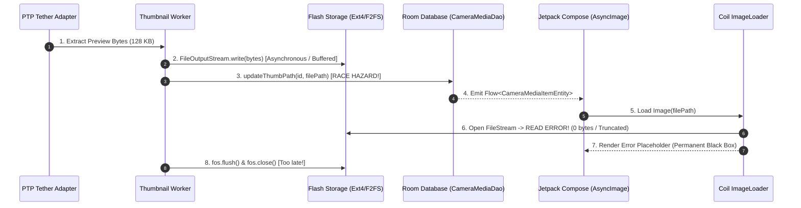

# Pitfalls Research

**Domain:** On-Device Exposure Analysis, Smart Culling & Reliable Thumbnailing (Android/Kotlin/PTP)  
**Researched:** 2026-08-20  
**Confidence:** HIGH  

---

## Executive Overview for Milestone v4.0

Milestone v4.0 equips TransferIn with zero-allocation on-device exposure analysis (<15ms per frame), automated upload culling (preventing wasted Google Drive quota and mobile bandwidth on flash misfires or blown frames), and a robust, deterministic camera-to-disk-to-UI thumbnailing pipeline across Fujifilm, Canon, Sony, and Nikon tethered sessions.

Performing real-time image analysis and thumbnail caching in a high-throughput tethered camera pipeline (15–30 fps bursts, 40MP–100MP RAW sensors) presents critical failure modes:
1. **JVM Heap Churn & ART GC Stalls:** Naive `BitmapFactory` decoding triggers continuous Garbage Collection pauses (100–350ms), dropping UI frames in the Live Studio Gallery and causing USB bulk transfer timeouts.
2. **False Rejection in Smart Culling:** Creative low-key portraits (black studio backdrops) or high-key wedding scenes being misclassified as "Flash Misfires" or "Blown Highlights" and unintentionally culled.
3. **Thumbnail File Flush Race Conditions:** Room database entities updating before background file descriptor syncs complete, causing Coil to load 0-byte or corrupted image files.
4. **USB Bulk Pipe Contention:** Concurrent thumbnail extraction and full RAW cloud streaming colliding on the half-duplex USB endpoint, triggering PTP packet desynchronization.
5. **Coil Cache Invalidation & RAW Format Failures:** Passing unhandled RAW file paths directly to Coil or using unstable cache keys, resulting in blank placeholders.
6. **EXIF Orientation Loss:** Embedded preview JPEGs losing rotation metadata, causing portrait photos to render sideways in the Compose gallery grid.

---

## Critical Pitfalls

### Pitfall 1: Heap Allocation Explosion & ART GC Pauses from Naive Full-Frame Bitmap Decoding in Burst Mode

**What goes wrong:**  
During high-speed tethered burst shooting (15–30 fps on Canon EOS R5, Sony A1, Fuji X-H2S), decoding incoming preview byte buffers into `android.graphics.Bitmap` objects naively generates 150MB–350MB of short-lived heap allocations every second (e.g., a single 2048×1365 ARGB_8888 bitmap consumes ~11.2 MB uncompressed memory). This triggers aggressive ART Garbage Collection sweeps (`GC_CONCURRENT` and `GC_FOR_ALLOC`), locking JVM threads for 100ms–350ms. The UI RenderThread drops below 30 fps (severe jank in the Live Gallery), and native USB bulk transfers exceed timeout thresholds (`LIBUSB_ERROR_TIMEOUT`), truncating incoming photos. On devices with 4GB–6GB RAM, this quickly leads to fatal `java.lang.OutOfMemoryError` (OOM).

**Why it happens:**  
Developers use standard `BitmapFactory.decodeByteArray(bytes, 0, bytes.size)` followed by `Bitmap.getPixels()` or `Bitmap.getPixel(x, y)` to calculate luminance histograms, creating full-resolution ARGB_8888 bitmap objects on the managed JVM heap for every single captured frame.

**How to avoid:**  
1. **Subsampled Single-Pass Direct Byte Analysis:** Execute luminance calculation on a severely downsampled representation or extract luminance directly from the JPEG Y-plane. Use `BitmapFactory.Options` with `inSampleSize = 8` or `16` (reducing a 2048×1365 image to a 256×170 thumbnail = ~174 KB uncompressed) and configure `inPreferredConfig = Bitmap.Config.ALPHA_8` or `RGB_565`.
2. **Reusable Mutable Bitmap Pool (`inBitmap`):** Allocate a single mutable scratch Bitmap at session start and pass it via `BitmapFactory.Options.inBitmap` for zero heap allocation per frame.
3. **Pre-allocated Histogram Scratch Arrays:** Allocate a single `IntArray(256)` luminance bin array per analyzer instance and reuse it across frames via `Arrays.fill(bins, 0)` instead of instantiating new arrays inside the loop.
4. **Off-Heap Direct Buffering:** Leverage `DirectByteBufferPool.Default` for all intermediate byte buffer slices before decoding.

**Warning signs:**  
- Android Studio Profiler displays a continuous sharp "sawtooth" memory allocation pattern during burst shooting.
- Logcat is flooded with `Starting a blocking GC Alloc` and `Concurrent mark sweep GC freed ...`.
- Gallery scrolling drops frames whenever the camera shutter is triggered.

**Phase to address:**  
Phase 1: Zero-Allocation Exposure Analyzer Core (`CULL-01`).

---

### Pitfall 2: False Rejection in Smart Culling: Low-Key, Silhouette, and High-Key Aesthetic Misclassification

**What goes wrong:**  
Legitimate, artistically crafted photographs are incorrectly flagged as defective and auto-culled (skipped from cloud upload). Specifically:
- **Low-Key Studio Portraits & Black Backdrops:** A model lit by a single key light against a matte black cyclorama has 80%–90% of frame pixels in the bottom 10% luminance bins ($Y < 25$). A naive analyzer flags this as a `UNDEREXPOSED_CRITICAL` (Flash Misfire).
- **High-Key & Snow/Beach Photography:** A bride in a white wedding gown against a bright sunlit backdrop or snow landscape has 80%+ pixels in the top 10% bins ($Y > 230$). A naive analyzer flags this as `OVEREXPOSED_BLOWN`.
- **Night Club & Concert Silhouettes:** Intentional rim-lit subjects in darkness are rejected.

**Why it happens:**  
Algorithms rely exclusively on global average luminance ($\mu_Y < 30$ or $\mu_Y > 225$) or crude percentile thresholds without evaluating **Histogram Entropy**, **Local Dynamic Range**, and **Sensor Noise Floor vs Signal**.

```
+-------------------------------------------------------------------------------+
|                      HISTOGRAM CLASSIFICATION MATRIX                          |
+---------------------------+---------------------------+-----------------------+
| SCENARIO                  | HISTOGRAM SIGNATURE       | CORRECT CLASSIFICATION|
+---------------------------+---------------------------+-----------------------+
| True Flash Misfire        | 99%+ in Bins 0-3;         | UNDEREXPOSED_CRITICAL |
|                           | Entropy < 0.8; SNR < 2dB  | (Auto-Cull Candidate) |
+---------------------------+---------------------------+-----------------------+
| Low-Key Studio Portrait   | 85% in Bins 0-15;         | OPTIMAL / ARTISTIC    |
| (Black Backdrop)          | Midtone Peak in Bins 80-140| (Preserve & Upload)  |
|                           | Entropy > 3.2             |                       |
+---------------------------+---------------------------+-----------------------+
| Blown TTL / Over-flash    | 40%+ saturated in Bin 255;| OVEREXPOSED_BLOWN     |
|                           | Zero midtone gradation    | (Auto-Cull Candidate) |
+---------------------------+---------------------------+-----------------------+
| High-Key Wedding / Snow   | 70% in Bins 200-245;      | OPTIMAL / HIGH-KEY    |
|                           | Preserved skin tone detail| (Preserve & Upload)  |
+---------------------------+---------------------------+-----------------------+
```

**How to avoid:**  
1. **Multi-Feature Statistical Decision Engine:** Combine four statistical metrics:
   - *Sensor Black Floor Density ($Y \le 3$):* Genuine flash misfire has $\ge 98\%$ pixels concentrated in bins $0..3$ with near-zero standard deviation.
   - *Midtone Gradient Spread ($Y \in [40, 180]$):* Low-key portraits retain distinct subject detail and local contrast in midtone bins.
   - *Shannon Histogram Entropy ($H = -\sum p_i \log_2 p_i$):* Total pitch-black frames have $H < 1.0$; artistic low-key frames maintain $H \ge 3.0$.
   - *True Highlight Saturation ($Y = 255$):* Differentiate small specular catchlights / sun flares ($< 3\%$ area) from blown sensor clipping ($> 25\%$ flat saturation at bin 255).
2. **Configurable Session Culling Modes:** Provide 3 distinct user-controlled modes in the Setup Wizard:
   - `STRICT_AUTO_CULL`: Automatically skip cloud upload for definitive flash misfires ($H < 1.0, Y_{max} < 10$).
   - `WARNING_BADGE_ONLY` (Default): Upload all photos, but render non-intrusive quiet-luxury warning badges on gallery cards.
   - `DISABLED`: Upload all photos without culling intervention.
3. **Non-Destructive Philosophy & 1-Tap Manual Override:** Never delete files from camera storage; allow photographers to override any culled file with a single swipe/tap in the UI.

**Warning signs:**  
- Test datasets with studio black-backdrop portraiture getting culled.
- Photographers reporting missing photos in Google Drive when shooting with controlled studio strobes.

**Phase to address:**  
Phase 1: Exposure & Luminance Clipping Analyzer (`CULL-01`) & Phase 3: Session Culling Rules (`UI-01`).

---

### Pitfall 3: Race Condition Between Asynchronous Thumbnail Disk Flush and Coil Gallery Load

**What goes wrong:**  
When a photo is captured, the app extracts the preview JPEG and starts writing it to local disk storage (`/data/user/0/.../cache/thumbnails/thumb_1042.jpg`). Concurrently, the Room database entity is updated with `thumbPath = "/data/user/0/.../thumb_1042.jpg"`. The Room `Flow<List<CameraMediaItemEntity>>` emits the update to `CameraGalleryViewModel`, triggering Jetpack Compose to recompose the `DoppelrandCard` with `AsyncImage(model = item.thumbPath)`. Coil attempts to read the file while `FileOutputStream` is still buffering in OS page cache or mid-write. Coil encounters `FileNotFoundException`, reads a 0-byte corrupt header, and permanently caches a failed/black thumbnail placeholder.



**Why it happens:**  
Room database state transitions occur before ensuring disk I/O synchronization and POSIX file visibility.

**How to avoid:**  
1. **Atomic Two-Stage File Commit:** Write preview bytes to a temporary staging file (`.thumb_1042.jpg.tmp`), call `fos.fd.sync()` or `fos.flush()`, close the stream, and perform an atomic POSIX rename: `tmpFile.renameTo(targetFile)`.
2. **Pre-condition Verification:** Before executing `cameraMediaDao.updateStatusAndThumb(id, MediaStatus.CACHED, thumbPath)`, verify `targetFile.exists() && targetFile.length() == expectedLength`.
3. **Coil Cache Invalidation on Retry:** If Coil encounters an error loading a local file, ensure it does not permanently cache the error result for that URI.

**Warning signs:**  
- Black or blank placeholder boxes in the gallery during fast burst shooting that fix themselves only after an app restart.
- Logcat warnings: `coil.request.NullRequestDataException` or `java.io.EOFException: End of input at line 1`.

**Phase to address:**  
Phase 2: End-to-End Tethered Thumbnail Pipeline Fix (`THUMB-01`).

---

### Pitfall 4: USB Bulk Endpoint Contention: Thumbnail Extraction Colliding with Full RAW Cloud Streaming

**What goes wrong:**  
Canon, Nikon, Sony, and Fujifilm PTP protocols share a **single pair of USB bulk endpoints** (Bulk OUT for commands, Bulk IN for data/responses). If Coroutine A initiates direct cloud streaming of a 50MB RAW file (`DirectStreamingEngine.streamWithFallback()`) while Coroutine B simultaneously attempts to call `getThumb()` or `getPartialObject()` for a newly captured frame on the same USB connection, PTP packets are interleaved on the USB controller. The camera firmware or host parser receives a data packet when expecting a command header, causing an unrecoverable **PTP Container Desynchronization Error**, killing the tethered session and stalling uploads.

**Why it happens:**  
Developers treat the USB hardware session as a multi-threaded asynchronous bus rather than a strictly sequential, half-duplex packet pipeline.

**How to avoid:**  
1. **Strict Single-Flight Mutex Arbitration:** All PTP transactions (commands, preview extractions, bulk downloads) must be serialized through `SafeUsbTransportManager.ioMutex.withLock`.
2. **Two-Tier Priority Queueing:** 
   - **Tier 1 (High Priority, Latency-Critical):** Instant preview extraction (<100ms) executes immediately upon `ObjectAdded` event, holding the USB mutex briefly.
   - **Tier 2 (Background, Throughput-Bound):** Full RAW direct cloud streaming acquires the USB mutex only after Tier 1 preview extraction has completed and released the lock.
3. **Cooperative Chunked Streaming:** Direct cloud streaming should transfer data in bounded chunks (e.g. 1MB chunks via `DirectByteBufferPool`), yielding the USB mutex between chunks if high-priority preview requests are pending.

**Warning signs:**  
- Logcat errors: `PTP container type mismatch: expected 1 (Command), got 2 (Data)`.
- Camera LCD flashing error codes (`Err 70` on Canon, `USB Communication Error` on Sony/Fuji).
- Sudden disconnects during rapid shooting while uploading.

**Phase to address:**  
Phase 2: Tethered Thumbnail Pipeline & USB Synchronization (`THUMB-01`).

---

### Pitfall 5: Coil Cache Invalidation Failures & Broken File URI Schemes in Compose

**What goes wrong:**  
1. **Broken RAW File Rendering:** In `UploadedGalleryScreen.kt`, passing `File(item.filePath)` where `filePath` is a `.RAF` or `.CR3` RAW file fails completely because Android's native image decoders cannot decode proprietary RAW containers.
2. **Stale Cache on Re-shooting:** If a camera assigns an identical object handle or file name across different sessions (e.g. `DSCF0001.JPG`), Coil displays the cached bitmap from the *previous* photoshoot.
3. **URI Scheme Parsing Inconsistencies:** Passing raw string paths (`"/data/user/0/..."`) without standard `File` or `"file://"` URI wrappers causes inconsistent decoding in Coil 2.6.0.

**Why it happens:**  
- Relying on default Coil image pipeline without custom decoders or failing to route gallery thumbnails exclusively through extracted JPEG previews (`thumbPath`).
- Not providing deterministic, unique cache keys that incorporate device ID, session ID, and modification timestamp.

**How to avoid:**  
1. **Strict Preview-Only Thumbnail Model:** Enforce that Compose gallery components (`CameraGalleryScreen`, `UploadedGalleryScreen`) bind exclusively to `item.thumbPath` (which is always a valid JPEG).
2. **Deterministic Custom Cache Keys:** Construct `ImageRequest` with explicit memory and disk cache keys:
   ```kotlin
   ImageRequest.Builder(context)
       .data(File(item.thumbPath))
       .memoryCacheKey("thumb_${item.deviceId}_${item.objectHandle}_${item.modifiedAt}")
       .diskCacheKey("thumb_${item.deviceId}_${item.objectHandle}_${item.modifiedAt}")
       .crossfade(150)
       .build()
   ```
3. **Bounded Dedicated Coil Disk & Memory Cache:** Configure a custom `ImageLoader` in `Application` with an LRU memory cache limited to 25% of available heap and a disk cache limited to 250MB in app internal storage.

**Warning signs:**  
- Gallery shows blank cards with file names for all RAW items.
- Images from yesterday's photoshoot appear in today's new session.
- Coil memory cache growing uncontrollably, leading to high garbage collection pressure.

**Phase to address:**  
Phase 2: Coil Image Loader Configuration & Gallery Integration (`THUMB-01`).

---

### Pitfall 6: EXIF Orientation Loss & 90-Degree Rotated Thumbnail Rendering

**What goes wrong:**  
Photos shot vertically (portrait orientation) appear rotated 90 degrees counter-clockwise (landscape) in the 3-column gallery grid and full-screen modal viewer. 

**Why it happens:**  
Camera image sensors capture pixels in raw physical sensor orientation (landscape). Orientation metadata is stored in EXIF Tag `0x0112` (Orientation). 
- When extracting embedded preview slices from `.RAF` (Fuji), `.CR3` (Canon), or `.ARW` (Sony), the extracted JPEG payload may omit the EXIF header or contain IFD pointers that simple decoders ignore.
- If the thumbnail byte array is saved to disk without EXIF header preservation or if Coil's decoder does not normalize EXIF rotation, Android renders the raw unrotated landscape pixel matrix.

**How to avoid:**  
1. **Preserve EXIF Orientation in Preview Parsers:** Ensure `RafPreviewExtractor`, `Cr3PreviewParser`, and `ArwPreviewParser` retain EXIF APP1 segments containing Tag `0x0112`.
2. **Coil EXIF-Aware Decoding:** Verify Coil 2.6.0's `BitmapFactoryDecoder` is configured with `exifOrientationPolicy = ExifOrientationPolicy.RESPECT_PERFORMANCE` or explicitly normalize orientation during thumbnail write.
3. **Validation Unit Tests:** Include test cases verifying that photos shot at orientation 1 (0°), 6 (90° CW), 3 (180°), and 8 (270° CW) retain correct display aspect ratio and rotation in Compose.

**Warning signs:**  
- Portrait photos displaying sideways in the Live Studio Gallery.
- Aspect ratio distortion (squished faces) when scaling to square grid cells.

**Phase to address:**  
Phase 2: Thumbnail Parser & Rendering Engine (`THUMB-01`).

---

### Pitfall 7: Camera Film Simulation & Picture Profile Skewing Exposure Analysis

**What goes wrong:**  
Fujifilm Film Simulations (e.g. *Velvia* with aggressive dynamic range contrast, *Acros* B&W with high red filter clipping), Canon Picture Styles (*Monochrome*, *High Contrast*), and Sony Creative Looks (*FL*, *VV*) heavily modify the tone curve of the embedded preview JPEG. 
- A photo shot in *Velvia* or *Monochrome* might have intentional deep crushed shadows or boosted contrast, which a naive exposure analyzer flags as "Defective Severe Underexposure", even though the underlying 14-bit RAW sensor data contains 4+ stops of shadow detail.

**Why it happens:**  
The on-device exposure analyzer evaluates the 8-bit sRGB preview JPEG without compensating for the camera's active tone curve and color profile metadata.

**How to avoid:**  
1. **Profile-Aware Threshold Compensation:** Parse the active Film Simulation / Picture Style during header extraction (leveraging `RafPreviewExtractor.extractFilmSimulation` or Canon/Sony EXIF tags).
2. **Dynamic Clipping Margin Adjustment:** Apply adaptive tolerance offsets:
   - For high-contrast profiles (*Velvia*, *Acros*, *High Contrast*), widen shadow clipping threshold from 5% to 12% before triggering `UNDEREXPOSED_CRITICAL`.
   - For flat profiles (*Pro Neg Std*, *Neutral*, *S-Log*), tighten thresholds to standard baseline.
3. **Clear Profile Indicator on Badge:** Display the detected Film Simulation token alongside the exposure evaluation in the UI.

**Warning signs:**  
- Photographers switching to black & white or punchy film simulations seeing sudden spikes in false exposure warning badges.

**Phase to address:**  
Phase 1: Exposure Analyzer Core & Profile Compensation (`CULL-01`).

---

### Pitfall 8: Quiet Luxury UI Degradation: Intrusive Blocking Dialogs & Modal Alert Fatigue

**What goes wrong:**  
When an underexposed or overexposed photo is detected, the app displays aggressive modal popups, loud red banners, or blocking confirmation dialogs. In a fast-paced commercial photoshoot (e.g. fashion runway or wedding with 3 shots/second), these interruptions block the photographer's view of the Live Dashboard, break physical shooting rhythm, and violate the `rvmeur.com` quiet luxury design philosophy.

**Why it happens:**  
Applying traditional error-handling dialog patterns to real-time high-throughput creative workflows.

**How to avoid:**  
1. **Non-Intrusive Quiet Luxury Indicators:** 
   - Use refined, elegant double-bezel `DoppelrandCard` badge overlays with subtle brand tokens:
     - `UNDEREXPOSED_CRITICAL`: Muted warm amber `#B8860B` (`AccentGoldDark`) badge with label `"underexposed"`.
     - `OVEREXPOSED_BLOWN`: Deep quiet burgundy `#8B0000` (`AccentBurgundy`) badge with label `"blown highlight"`.
   - Never show modal blocking dialogs during active shooting.
2. **Tactile Haptic Micro-Feedback:** Provide a single subtle haptic pulse (`HapticFeedbackType.LongPress` or soft tick) when an auto-culled shot is detected, without interrupting the visual stream.
3. **Fluid 1-Tap Manual Override Gesture:** Allow the photographer to tap the badge or swipe the card in the Live Studio Gallery to instantly flip status from `CULLED_SKIPPED` to `QUEUED_FOR_UPLOAD`.

**Warning signs:**  
- Photographers disabling smart culling entirely because notifications disrupt their shoot.
- UI reviews noting violations of the quiet luxury design tokens.

**Phase to address:**  
Phase 3: Session Culling Rules & Quiet Luxury UI Overlays (`UI-01`).

---

## Technical Debt Patterns

| Shortcut | Immediate Benefit | Long-term Cost | When Acceptable |
| :--- | :--- | :--- | :--- |
| **Using `BitmapFactory.decodeByteArray()` on full preview** | 5 lines of code, no custom subsampling logic | Massive heap churn, ART GC pauses, OOM crashes during burst shooting | **NEVER** in tethered streaming pipeline |
| **Passing raw RAW file path directly to Coil** | Avoids writing thumbnail extraction & disk cache logic | 100% decode failure in gallery; permanent black placeholder cards | **NEVER** |
| **Storing thumbnails in OS temporary cache (`/cache`) without persistence sync** | Simple temporary file creation | Android OS purges cache under storage pressure, breaking gallery thumbnails mid-session | Acceptable only for ephemeral scratch analysis buffers |
| **Hardcoding fixed single luminance threshold for all cameras** | Quick to implement in MVP | High false positive rates across diverse camera brands, sensors, and film simulations | **NEVER** (Must support profile-aware adaptive thresholds) |
| **Updating Room database before thumbnail stream `flush()` / `sync()`** | UI feels marginally faster (5ms) | Race conditions; Coil loads 0-byte corrupt files permanently | **NEVER** (Must use atomic rename & verification) |
| **Skipping EXIF orientation check on extracted preview** | Saves 15 lines of TIFF header parsing | Portrait photos permanently render rotated sideways in gallery | **NEVER** |

---

## Integration Gotchas

| Integration | Common Mistake | Correct Approach |
| :--- | :--- | :--- |
| **Google Drive REST API & Culling** | Enqueueing culled photos into WorkManager / OkHttp queue and canceling later | Filter culled photos at intake; mark Room status as `CULLED_SKIPPED` and do not dispatch to `DirectStreamingEngine` unless manually overridden |
| **Room 2.8.4 Schema Evolution** | Adding `cullStatus`, `exposureScore`, `filmSimulation` to `CameraMediaItemEntity` without migration script | Provide explicit `Migration_10_11.kt` with SQLite `ALTER TABLE` statements and updated schema JSON in `app/schemas/` |
| **Coil 2.6.0 with Compose `LazyVerticalGrid`** | Re-instantiating `ImageRequest` on every recomposition without stable keys | Use `remember(item.id, item.modifiedAt)` for `ImageRequest` and provide stable `key = { it.id }` in `items()` |
| **Multi-Vendor PTP Preview Slices** | Assuming a single fixed byte slice size (e.g. 128KB) works for all cameras | Fuji RAF requires 92B header parse + dynamic offset; Canon CR3 requires ISO container box traversal; Sony ARW requires TIFF SubIFD scan |
| **Android 14+ Process Lifecycle during Culling** | Running heavy histogram analysis on Main / UI thread | Offload all exposure analysis to `Dispatchers.Default` using pre-allocated native byte buffers |

---

## Performance Traps

| Trap | Symptoms | Prevention | When It Breaks |
| :--- | :--- | :--- | :--- |
| **Unpooled `IntArray(256)` Allocation per Frame** | Rapid heap allocations during 20 fps bursts; GC thread pauses | Re-use pre-allocated instance array and clean with `Arrays.fill(bins, 0)` | Breaks at $> 10$ fps burst shooting |
| **Floating-Point Luminance Calculation in Pixel Loop** | $Y = 0.299f \cdot R + 0.587f \cdot G + 0.114f \cdot B$ causes CPU thermal throttling | Use integer bit-shifts: $Y = (77 \cdot R + 150 \cdot G + 29 \cdot B) \gg 8$ | Breaks at $> 15$ fps on mobile ARM processors |
| **Unsynchronized USB Endpoint Access** | `PTP Container Desynchronization Error`, corrupted RAW streams | Serialize all USB bulk operations through `SafeUsbTransportManager.ioMutex` | Breaks immediately when shooting during active upload |
| **Unbounded Coil Disk Cache Growth** | App storage exceeds 5GB on long photoshoot; device storage full warning | Limit dedicated Coil thumbnail disk cache to 250MB with LRU eviction | Breaks after $\sim 2,000$ captured photos |
| **Coil Memory Cache Bitmap Leaks** | Low Memory Killer (LMK) kills app process when switching to background | Cap Coil memory cache at 25% heap and enable hardware bitmap pooling | Breaks on devices with $\le 6\text{ GB}$ RAM |

---

## Security & Data Integrity Mistakes

| Mistake | Risk | Prevention |
| :--- | :--- | :--- |
| **Destructive In-Camera Auto-Culling** | Permanent loss of client's original photos if camera deletion is triggered | **NEVER** issue PTP `DeleteObject` command on camera storage during auto-culling. Culling is strictly host-side upload filtering. |
| **Storing Thumbnails in World-Readable External Storage** | Client photoshoot images exposed to other malicious apps on Android device | Store all cached thumbnails strictly in `context.filesDir` / `context.cacheDir` scoped internal storage. |
| **Path Traversal via Camera File Names** | Camera providing file name with `../../` overwriting critical app files | Sanitize file names using `File(fileName).name` and validate target path within authorized cache sandbox directory. |
| **Exposing Sensitive EXIF GPS Data in Cached Thumbnails** | Client privacy leak if cached thumbnails are shared or backed up insecurely | Strip sensitive GPS metadata from generated thumbnails or encrypt transit cache when configured. |

---

## UX Pitfalls

| Pitfall | User Impact | Better Approach |
| :--- | :--- | :--- |
| **Intrusive Modal Alerts on Exposure Warnings** | Breaks photographer's concentration and blocks camera shutter readiness | Discreet double-bezel `DoppelrandCard` badge overlays with subtle haptic micro-feedback. |
| **Silent Auto-Culling without Visual Record** | Photographer thinks app lost photos when they don't appear in Google Drive | Display all captured items in the Live Studio Gallery with explicit `"culled"` status badges and reason chips. |
| **Complicated Multi-Step Override Flow** | Frustrating friction when photographer intentionally wants a dark/blown shot uploaded | 1-tap card click or swipe gesture in the gallery to immediately force upload. |
| **Jumping Gallery Layout on Async Image Load** | Visual grid jitter and layout shift as thumbnails pop into view | Use fixed 1:1 or 3:2 aspect ratio placeholders matching the camera sensor format. |
| **Ambiguous Culling Metrics** | Photographer doesn't know why a shot was flagged (flash failure vs overexposed) | Clear label badges: `"flash misfire"`, `"blown highlight"`, `"underexposed"`. |

---

## "Looks Done But Isn't" Checklist

- [ ] **Exposure Analyzer:** Often tested only on standard daylight photos — verify with 100% pitch-black frames (lens cap on / flash misfire) and 100% white saturated frames (direct strobe into lens).
- [ ] **Low-Key Artistic Safety:** Often flags dark studio portraits — verify with a test set of dramatic black-backdrop model shots (ensure $H \ge 3.0$ prevents false culling).
- [ ] **Burst Load Resilience:** Often tested with 1 photo at a time — verify under a continuous 20 fps burst of 50 frames with active background Google Drive streaming.
- [ ] **Disk Write Atomicity:** Often works on slow debug builds — verify on high-speed release builds that Coil never loads a 0-byte thumbnail or throws `FileNotFoundException`.
- [ ] **EXIF Orientation:** Often tested in standard landscape — verify that portrait (90° CW and 270° CW) and upside-down orientations render upright in gallery and modal viewer.
- [ ] **Manual Override Flow:** Often verifies auto-skip — verify that tapping a culled photo changes its status to `QUEUED`, triggers upload, and updates session metrics immediately.
- [ ] **Room Database Migration:** Often passes with clean install — verify that upgrading from Schema v10 to v11 preserves all existing sessions and uploaded fingerprints without SQLite exceptions.

---

## Recovery Strategies

| Pitfall | Recovery Cost | Recovery Steps |
| :--- | :--- | :--- |
| **Corrupted or 0-Byte Thumbnail Disk Cache** | LOW | Detect file length $\le 0$ or decode failure in `CameraGalleryViewModel`; re-extract preview slice from camera or transit cache and atomically rewrite. |
| **False-Positive Culled Uploads** | LOW | User taps the culled photo card in Live Studio Gallery $\to$ status transitions to `QUEUED` $\to$ dispatched to `DirectStreamingEngine` for instant cloud sync. |
| **Stale Coil Memory / Disk Cache** | LOW | Invalidate Coil cache key for specific item: `imageLoader.diskCache?.remove(cacheKey)` and `imageLoader.memoryCache?.remove(MemoryCache.Key(cacheKey))`. |
| **PTP Endpoint Desynchronization from Contention** | MEDIUM | Execute `SafeUsbTransportManager.resetPtpSession()`: issue `clearHalt()` on endpoints, drain stranded FIFO bytes, and re-establish PTP transaction counter. |
| **Room Database Migration Failure** | HIGH | Implement tested fallback migration `Migration_10_11.kt` with automated instrumentation tests verifying table column additions before app launch. |

---

## Pitfall-to-Phase Mapping

| Pitfall | Prevention Phase | Verification Method |
| :--- | :--- | :--- |
| **Heap Churn & GC Pauses** | Phase 1 (`CULL-01`) | Android Studio Memory Profiler: verify $< 1\text{ MB}$ allocation during 50-shot burst; analysis time $< 15\text{ ms}$ per frame. |
| **False Rejection in Smart Culling** | Phase 1 (`CULL-01`) | Unit test matrix with 100+ synthetic and real RAW previews covering low-key, high-key, flash misfires, and film simulations. |
| **Thumbnail Disk Flush Race Condition** | Phase 2 (`THUMB-01`) | Automated test asserting atomic rename and non-zero file size verification before Room DAO status update. |
| **USB Endpoint Contention** | Phase 2 (`THUMB-01`) | Concurrency stress test: trigger 20 photo captures while simultaneously uploading a 100MB RAW file over USB. |
| **Coil Cache Invalidation & RAW Failure** | Phase 2 (`THUMB-01`) | UI tests verifying gallery renders valid JPEG thumbnails for all supported vendor formats (RAF, CR3, ARW, NEF). |
| **EXIF Orientation Loss** | Phase 2 (`THUMB-01`) | Orientation test suite validating upright rendering across all 4 EXIF orientation tags. |
| **Film Simulation Skew** | Phase 1 (`CULL-01`) | Calibration test verifying Fuji Velvia / Monochrome previews do not trigger false underexposure warnings. |
| **Quiet Luxury UI Degradation** | Phase 3 (`UI-01`) | GSD UI Review & Design Compliance audit ensuring non-blocking `DoppelrandCard` overlays and brand token fidelity. |

---

## Sources & References

- **Android Developers Official Documentation:**
  - *Managing Bitmap Memory & Reusing Bitmaps (`inBitmap`)*: [developer.android.com/topic/performance/graphics/manage-memory](https://developer.android.com/topic/performance/graphics/manage-memory)
  - *Coil Image Loading Documentation (Memory & Disk Cache Keys, Compose Integration)*: [coil-kt.github.io/coil/compose](https://coil-kt.github.io/coil/compose)
  - *Android Room Database Migrations*: [developer.android.com/training/data-storage/room/migrating-db-versions](https://developer.android.com/training/data-storage/room/migrating-db-versions)
- **PTP & Image Processing Specifications:**
  - *ISO 15740: Picture Transfer Protocol (PTP) for Digital Still Photography Devices*
  - *ITU-R BT.601 / BT.709: Studio Encoding Parameters of Digital Television for Standard 4:3 and Widescreen 16:9 Aspect Ratios*
  - *JEITA CP-3451: Exchangeable Image File Format for Digital Still Cameras (Exif 2.32)*
  - *TIFF 6.0 Specification: SubIFD and Embedded JPEG Pointer Architecture*
- **Codebase Truth References:**
  - `DirectByteBufferPool.kt`: `com.rvmeur.transferin.data.usb.core.DirectByteBufferPool`
  - `RafPreviewExtractor.kt`: `com.rvmeur.transferin.data.usb.vendor.fuji.RafPreviewExtractor`
  - `Cr3PreviewParser.kt`: `com.rvmeur.transferin.data.usb.canon.Cr3PreviewParser`
  - `ArwPreviewParser.kt`: `com.rvmeur.transferin.data.usb.vendor.sony.ArwPreviewParser`
  - `DirectStreamingEngine.kt`: `com.rvmeur.transferin.data.upload.streaming.DirectStreamingEngine`
  - `CameraGalleryScreen.kt`: `com.rvmeur.transferin.feature.gallery.CameraGalleryScreen`
  - `UploadedGalleryScreen.kt`: `com.rvmeur.transferin.feature.gallery.UploadedGalleryScreen`

---
*Pitfalls research for: On-Device Exposure Analysis, Smart Culling & Reliable Thumbnailing (Milestone v4.0)*  
*Researched: 2026-08-20*  
